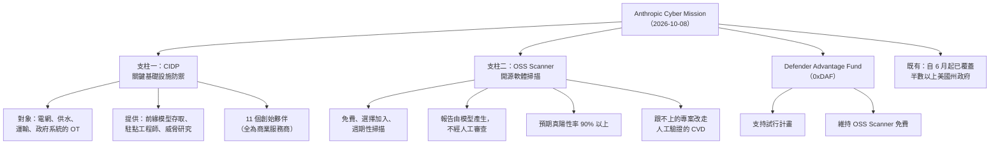
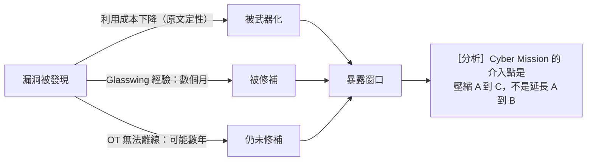
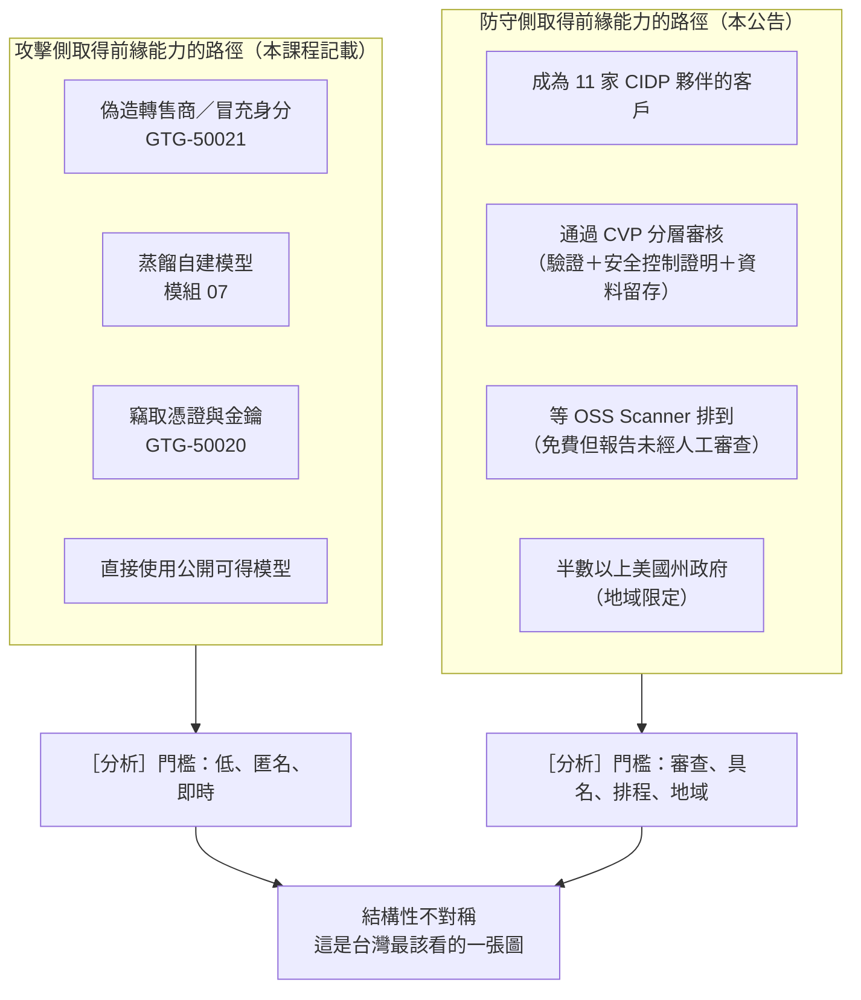

# Anthropic《Introducing the Anthropic Cyber Mission》（2026 年 10 月）

> 課程模組：09 延伸研究 ｜ 來源類型：產業研究（模型供應商的防禦側計畫揭露） ｜ 原文：https://www.anthropic.com/news/anthropic-cyber-mission ｜ 整理日期：2026-10-12

> **本教材的資料層次標示規則**（沿用本模組慣例）：
> - **［原文］**＝Anthropic 2026-10-08 這篇公告本身可直接追溯的內容，逐字句另標「逐字」。
> - **［Anthropic 2026-09］**＝課程主體《Detecting and countering misuse of AI: September 2026》PDF，附頁碼。
> - **［外部］**＝第三方來源，附 URL 與日期，並註明「獨立查證」還是「僅引述原報告」。
> - **［分析］**＝本教材作者的推論或教學詮釋，原文沒有明說，學員應視為可被挑戰的假設。

---

## 0. 這份教材在課程裡的位置：防守方的鏡像

本課程模組 01 到 08 全部在講**攻擊側**：誰拿 AI 做了什麼。模組 09 已有一份防守側教材（[Mandiant 的 agentic 原始碼審查](mandiant-2026-08-agentic-vulnerability-discovery.html)）。這一份是第二份，而且是**規模最大、承諾最明確、也最容易被當成公關稿讀過去的一份**。

它值得認真讀的理由有三個：

1. 它把防守側的資源**具名、具數字地攤開**：11 個創始夥伴、一項免費的開源掃描服務、數筆對開源基金會的資助、以及一個明確的兩年預測。
2. 它處理的目標**正是本課程點名台灣的那幾案的目標類別**：電網、供水、運輸、政府系統（對照模組 04 的[GTG-17002](../04-weapons/GTG-17002-ew-sead-taiwan.html)與模組 03 的[伊朗關聯 OSINT 與工控偵察](../03-surveillance/GTG-30004-30005-30006-osint-recon.html)）。
3. 它內含一個**設計上的張力**，而原文自己把它寫出來了：開源掃描的報告「model-generated and sent without human review」，預期真陽性率「above 90%」。［原文，逐字片段］［分析］也就是說，有約一成的報告可能是錯的，而它們會直接寄給志工維護者。這一條在第 3.3 節與第 8.3 節處理。

---

## 1. 一頁速覽

1. **這是什麼**：Anthropic 的計畫公告，**2026-10-08 發布**，宣布 Anthropic Cyber Mission：一項**長期協助防守方保護其軟體與系統**的工作，起步聚焦**關鍵基礎設施**與**開源軟體**兩個領域，之後再擴及其他領域。［原文］

2. **核心前提，逐字**：「Frontier models can be misused to exploit vulnerabilities and conduct cyber operations.」以及「Highly cyber-capable AI models are widely available to attackers now.」［原文，逐字］［分析］**供應商自己把這件事寫成計畫的出發點**，這與 2026-09 威脅報告的案例證據互相支撐，是本課程少見的「廠商定性主張」與「廠商案例證據」對齊的例子。

3. **支柱一：Critical Infrastructure Defense Program（CIDP）**。對象是電網、供水系統、運輸網路與政府系統背後的 **OT（operational technology）**。提供給受信任的安全服務商：前緣 Claude 模型的存取權、駐點工程師、威脅研究。**11 個創始夥伴**：Accenture、Booz Allen、CrowdStrike、Deloitte、Dragos、Hitachi、Insane Cyber、Nozomi Networks、Palo Alto Networks、PwC、Rockwell Automation。Anthropic 說從小規模開始，先學什麼有效。［原文］

4. **支柱二：OSS Scanner**。選擇加入（opt-in）、**免費**，用 Anthropic 最強的模型對開源專案做**週期性掃描**。每份報告可含概念驗證、說明與建議修法。逐字「The reports are model-generated and sent without human review.」預期真陽性率在 **90% 以上**。跟不上模型產出的專案，仍可依其協同漏洞揭露（CVD）政策收到**經人工驗證**的揭露。［原文］

5. **為什麼 OT 特別難**：逐字「they often cannot be taken offline to patch, so known vulnerabilities can stay unresolved for years.」另外原文引用 Project Glasswing 的經驗：「months pass between a vulnerability being found and being fixed.」［原文，逐字］

6. **資助與生態**：Anthropic 表示資助了 Python Software Foundation、Alpha-Omega 與 OpenSSF（透過 Linux Foundation）、Apache Software Foundation，並支持協調漏洞回報的 Akrites 與 Gold Eagle。**Defender Advantage Fund（0xDAF）**支持試行計畫並維持 OSS Scanner 免費。［原文］

7. **政府側的既有進度**：自 6 月針對美國州、地方、部落與領地政府的計畫起，已向**半數以上的美國州**與部分大型公營關鍵基礎設施營運者提供 Claude 模型與技術支援。［原文］

8. **一個可被驗證的預測，逐字**：「Our forecast is that in two years, AI will favor defense」，並說近期的情況可能更糟。［原文，逐字］［分析］這是整份公告唯一**可被事後否證**的主張，教學上應該當成一個要追蹤的標的，而不是一句願景（見第 10.2 節第 1 題）。

9. **這份研究在課程裡要教什麼**：教**「防守方取得同級能力的路徑，和攻擊方取得的路徑完全不對稱」**。攻擊側取得能力的方式在本課程記載得很清楚：偽造轉售（[GTG-50021](../01-cyber/GTG-50021-fake-reseller.html)）、蒸餾（[模組 07](../07-distillation/00-distillation-intro-and-mitigations.html)）、憑證竊取、或直接用公開可得的模型。防守側取得的方式則是：被 11 家廠商之一納入、申請分層審核（見[CVP 教材](anthropic-2026-10-cyber-verification-program.html)）、或等免費掃描服務排到你。**這個不對稱是本課程最該讓決策者看見的一張圖**（見第 4.3 節）。

---

## 2. 報告基本資料

| 項目 | 內容 | 出處 |
|---|---|---|
| 完整標題 | Introducing the Anthropic Cyber Mission | ［原文］ |
| 機構 | Anthropic | ［原文］ |
| 署名 | 頁面未署名個別作者 | ［原文］ |
| 發布日期 | **2026-10-08** | ［原文］ |
| 形式 | 網頁公告，含夥伴引述 | ［原文］ |
| 資料來源類型 | 第一方計畫說明；夥伴引述為第三方意見（非獨立量測） | ［原文］［分析］ |
| 量化內容 | **極少**。無事件數、無威脅統計；數字集中在夥伴數（11）、OSS Scanner 預期真陽性率（90% 以上）、美國州別涵蓋（半數以上） | ［原文］ |
| 涉及模型 | 原文以「frontier Claude models」「our strongest models」概稱，**未逐一列名** | ［原文］ |
| IOC | **無** | ［原文］ |
| 系列位置 | 2026-10-06 [CVP 擴大](anthropic-2026-10-cyber-verification-program.html)、2026-10-08 使用政策更新、2026-10-09 [未預期模型動作報告](anthropic-2026-10-unintended-model-actions.html) 的同週發布 | ［原文］［分析］ |

### 2.1 兩個支柱與一個基金

［原文］圖中各節點內容來自原文；圖的組織方式為本教材整理。

---

## 3. 主要發現與案例逐一摘要

本文是計畫公告，不是案例集。以下依原文結構整理，並明確區分**已做之事**、**承諾之事**與**預測**。

### 3.1 CIDP：11 家夥伴與它們代表的結構

［原文］創始夥伴（依原文列序）：Accenture、Booz Allen、CrowdStrike、Deloitte、Dragos、Hitachi、Insane Cyber、Nozomi Networks、Palo Alto Networks、PwC、Rockwell Automation。原文說**部分夥伴已在用 Claude 修補漏洞**，且 Anthropic 刻意從小規模世代（cohort）開始，先學什麼有效。

夥伴引述（原文收錄，屬**第三方意見**，非獨立量測）：

- Palo Alto Networks：逐字「Threat actors are using AI to find and exploit exposures at machine speed.」
- Booz Allen：逐字「Operational technology is the next frontier for autonomous AI-enabled attacks.」

> ［分析］**這份名單的組成本身是情報**。11 家裡有四家大型顧問或整合商（Accenture、Booz Allen、Deloitte、PwC）、三家資安平台（CrowdStrike、Palo Alto Networks、Insane Cyber）、兩家 OT 專門（Dragos、Nozomi Networks）、兩家工控製造（Hitachi、Rockwell Automation）。**沒有任何一家台灣或日韓以外的亞洲業者**（Hitachi 為日本）。對台灣的意涵見第 10.4 節。另外：把前緣能力透過 11 家商業服務商下放，意味著**關鍵基礎設施取得這個能力的實際門檻，是能不能成為這 11 家的客戶**。

### 3.2 OT 的結構性困境（原文的論證鏈）

［原文］

1. 國家級對手「have spent years gaining footholds in these systems」（已在這些系統裡經營多年據點）。
2. OT「often cannot be taken offline to patch」，因此已知漏洞可能**數年未解**。
3. 漏洞利用的成本下降了，而驗證與修補仍然很慢。
4. Project Glasswing 的經驗是「months pass between a vulnerability being found and being fixed」。

> ［分析］上圖與[微軟數位防禦報告 2026](microsoft-2026-10-digital-defense-report.html) 第 3.4 節的同構圖、以及 [GTIG 2026-09-30](gtig-2026-09-vulnerability-trends-ai-era.html) 的案例時間軸，是**三家機構對同一個結構性落差的三種表達**。微軟給的是生態中位數（武器化中位數遠低於 24 小時、企業修補 30 到 60 天），Anthropic 這裡給的是 OT 的極端值（可能數年）。**三者的量測對象不同，不可互相代入**，但方向一致，這是本模組目前較穩固的跨機構一致主張之一。

### 3.3 OSS Scanner：本文最該被追問的設計

［原文］設計要點：免費、選擇加入、用最強模型週期性掃描、報告可含概念驗證與建議修法、**報告由模型產生且不經人工審查即寄出**、預期真陽性率 **90% 以上**、跟不上的專案改走**人工驗證的 CVD** 流程。

> ［分析］**三個必須在課堂上提出的問題**：
> 1. **「90% 以上」的分母是什麼**。是每份報告、每個發現、每個專案，原文未說明。在 90% 真陽性的假設下，工業規模的掃描會產生工業規模的偽陽性，而收件者是志工維護者。
> 2. **「不經人工審查」是功能還是風險**。它是讓服務能免費且規模化的必要條件（人工審查無法擴張），同時也是把成本外部化到維護者身上的機制。原文設了一個減壓閥（跟不上的專案改走人工驗證的 CVD），但**誰判定「跟不上」、如何判定，原文未說明**。
> 3. **這條線與 CVP 的 129,000 要併讀**。[CVP 教材](anthropic-2026-10-cyber-verification-program.html)第 3.2 節記載 Project Glasswing 夥伴在四個月內找出至少 129,000 個已驗證漏洞，而回報修補數字的夥伴不到 50%。**瓶頸在承載量，不在發現量**。Cyber Mission 的計畫承諾（自動化 triage 與修補）正是衝著這個瓶頸去的，但那是承諾，不是已完成的事。

### 3.4 已做、承諾與預測：三類主張必須分開登錄

| 類別 | 內容 | 主張狀態 |
|---|---|---|
| **已做** | 11 家創始夥伴成立 CIDP；部分夥伴已用 Claude 修補漏洞；資助 PSF、Alpha-Omega／OpenSSF、ASF；支持 Akrites 與 Gold Eagle；自 6 月起向半數以上美國州與部分公營關鍵基礎設施營運者提供模型與技術支援 | **來源陳述**（第一方自述，無外部佐證） |
| **承諾** | 擴大 CIDP 到更多夥伴與產業；分享經驗含失敗；延伸到開源與供應鏈安全；自動化 triage 與修補；研究安全架構與撰碼實務；與其他 AI 開發者、資安公司與政府合作 | **承諾**，尚未發生 |
| **預測** | 逐字「Our forecast is that in two years, AI will favor defense」，近期可能更糟 | **分析推論（供應商的）**，可被事後否證 |
| **第三方意見** | Palo Alto Networks 與 Booz Allen 的引述 | **意見**，非量測，且來自利害相關方 |

［分析］上表是本教材提出的分類，原文沒有這樣分。**本課程[證據與方法](../shared/04-evidence-and-methods.html)要求逐項標註主張狀態，這張表就是對這份公告執行該要求的結果**，可以直接作為課堂示範。

---

## 4. 與 Anthropic 2026-09 報告的對照

### 4.1 同一家機構的攻防兩面

| 面向 | 2026-09 威脅報告 | 本公告 |
|---|---|---|
| 主體 | 外部行為者 | Anthropic 與 11 家服務商 |
| AI 的角色 | 攻擊側的人力替代與加速 | 防守側的漏洞探勘與修補加速 |
| 目標系統 | 報告逐案列出受害者 | 電網、供水、運輸、政府系統的 OT；開源專案 |
| 量化程度 | 逐案數字與 51 張圖表 | **極少量化** |
| 可驗證性 | 單一來源，部分有外部佐證 | 單一來源，夥伴具名（可間接查證夥伴關係存在） |

［分析］值得注意的是**量化程度的反差**：同一家機構對「別人的濫用」提供了大量數字與圖表，對「自己的防禦計畫」幾乎只給定性敘述與一個預測。這不必然是刻意的（計畫剛啟動確實沒有成效數字），但在引用時必須標明：**本公告不提供任何可用於效益評估的數據**。

### 4.2 逐點對照

1. **與[模組 04 常規武器導論](../04-weapons/00-weapons-intro-and-safeguards.html)與[GTG-17002 電子戰／防空壓制](../04-weapons/GTG-17002-ew-sead-taiwan.html)**：GTG-17002 的模擬情境改為台灣的 12 個目標，屬於國防與關鍵系統類別。CIDP 的對象（電網、供水、運輸、政府系統）**與之高度重疊**。［分析］攻擊側已有實際案例，防守側剛啟動試行世代，兩者的時間差是本課程最該強調的事實。

2. **與[模組 03 的伊朗關聯 OSINT 與工控偵察](../03-surveillance/GTG-30004-30005-30006-osint-recon.html)**：該案含工控與網通設備的 CVE 清單。本公告的 OT 論證（無法離線、已知漏洞數年未解）**正好解釋了那份 CVE 清單為什麼有價值**：它們不是零日，是長期未修補的已知漏洞。［分析］這組對照是「IOC 壽命」教學的最佳材料：在 OT 環境裡，已知 CVE 的情報壽命以年計。

3. **與[GTG-10007 自主零日鑄造廠](../01-cyber/GTG-10007-exploit-foundry.html)**：攻擊側的自主漏洞探勘。OSS Scanner 是**同一技術路線的防守側實作**，而且公開、免費、具名。［分析］把兩者並列可以問：同一個能力在攻擊側被記為威脅案例，在防守側被記為公益服務，差別只在授權與揭露。這是本課程雙重用途主線的核心教案。

4. **與[模組 01 章節導論](../01-cyber/00-cyber-trends-and-skills.html)的「攻擊複雜度與攻擊者能力脫鉤」**：本公告的對應命題是**防禦複雜度與防禦者能力也脫鉤**：一個三人維護的開源專案可以得到前緣模型的掃描。［分析］但脫鉤的方向不對稱：掃描是免費的，**修補不是**，而修補需要的是人力與停機窗口，AI 目前補不上這兩項。

5. **與[Mandiant 2026-08 agentic 原始碼審查](mandiant-2026-08-agentic-vulnerability-discovery.html)**：**本模組內最直接的同類對照**。兩者都是防守側 agentic 漏洞探勘，Mandiant 側重方法與驗證，Anthropic 側重規模與免費提供。［分析］兩份併讀可以比較「誰負責驗證發現」這個關鍵差異。

6. **與[模組 02 影響力行動](../02-influence/00-influence-intro-and-breakout-scale.html)、[模組 05 生物](../05-bio/00-bio-intro-and-safeguards.html)、[模組 06 詐騙](../06-scams/GTG-15001-dating-app-network.html)、[模組 07 蒸餾](../07-distillation/00-distillation-intro-and-mitigations.html)**：**沒有對應**。本公告只處理網路安全與軟體漏洞。

### 4.3 能力取得路徑的不對稱（本節的核心圖）

［分析］本圖為本教材整理，兩份原始文件都沒有這張圖。它刻意不評價任何一方的制度設計是否正確，只呈現門檻形態的差異。

---

## 5. TTP 與 MITRE ATT&CK 對應

> ［分析］本公告沒有攻擊者 TTP。本節改為處理一個對 SOC 與 OT 團隊更實用的問題：**這份公告描述的威脅落在哪個框架裡，以及框架在哪裡接不上**。

| 本公告描述的威脅面 | 適用框架 | 技術 ID 或對應 | 偵測構想（未實測，屬假說） |
|---|---|---|---|
| 國家級對手在 OT 系統內長期據點 | **ATT&CK for ICS** | T0859 Valid Accounts（ICS）、T0886 Remote Services | OT 網段的長期低頻連線基線；工程師工作站的異常時段活動 |
| 已知漏洞因無法離線而數年未修 | ATT&CK for ICS | T0819 Exploit Public-Facing Application（ICS） | 資產盤點與 CVE 比對的定期落差報告（補償控制，非偵測） |
| 攻擊方以 AI 加速漏洞探勘 | **無適切技術** | 缺口 | 無法從受害端偵測對手是否用了 AI，見下方第 2 點 |
| 模型產生的漏洞報告大量湧入維護者 | **非 ATT&CK 範疇** | 缺口 | 專案側的揭露流程負載監測（這是流程問題，不是偵測問題） |

### 5.1 框架缺口

1. **企業版 ATT&CK 不涵蓋 OT**。CIDP 的對象是 OT，討論時必須切換到 ATT&CK for ICS，兩套的技術編號不可混用。本課程既有教材多使用企業版，講到關鍵基礎設施時要明確切換。
2. **「對手是否使用 AI」在受害端幾乎不可偵測**。這一點本課程[章節導論](../01-cyber/00-cyber-trends-and-skills.html)已經建立：AI 的 uplift 體現在速度、規模與深度，而非留下新的技術痕跡。本公告的夥伴引述（「at machine speed」）是**對手側的速度主張**，受害端只能觀察到速度，無法歸因到 AI。引用這類引述時必須標明這一層。
3. **ATT&CK 沒有防守側能力的欄位**。本公告的主要內容是防守側能力的分配，而威脅框架在設計上不描述這件事。［分析］教學含意：評估「AI 是否有利於防守」不能用 ATT&CK 覆蓋率衡量，必須另建指標（第 10.2 節第 1 題）。

---

## 6. 圖表判讀

［原文］本教材取得的文字版**未見資料圖表**。頁面以敘述、夥伴清單與夥伴引述組成，沒有統計圖、架構圖或時間軸。本教材第 2.1、3.2、4.3 節的三張 Mermaid 圖**全部是本教材繪製的教學整理，不是原文圖表**。

［分析］「公告沒有圖」與本模組其他教材的對照值得一提：[微軟數位防禦報告 2026](microsoft-2026-10-digital-defense-report.html) 有數字牆，[GTIG 的 AI 威脅追蹤](gtig-2026-09-ai-threat-tracker.html) 有案例表，本公告兩者皆無。**這與它的主張類型一致**：它主要陳述承諾與計畫，而承諾沒有可畫的分布。判讀訓練上，這本身是一個訊號：**當一份文件沒有任何可視化的數據時，先問它在主張什麼類型的事**。

本教材無法排除原文含有本次未取回的圖片元素，見第 12 節。

---

## 7. IOC 與技術指標

［原文］**本公告沒有 IOC**，沒有網域、IP、雜湊或帳號。它不是事件報告。

可作為**追蹤用名詞**（非 IOC）記錄：

| 名詞 | 性質 | 課程用途 |
|---|---|---|
| Critical Infrastructure Defense Program（CIDP） | 計畫名 | 追蹤夥伴名單與產業擴張 |
| OSS Scanner | 服務名 | 追蹤是否公布真陽性率的實測結果與維護者回饋 |
| Defender Advantage Fund（0xDAF） | 基金名 | 追蹤資助對象與金額是否公開 |
| Project Glasswing | 已併入 CVP 的前身程式 | 名稱對應（見[CVP 教材](anthropic-2026-10-cyber-verification-program.html)） |
| Akrites、Gold Eagle | 原文所述協調漏洞回報的受支持組織 | **本教材未查證這兩個組織的性質與規模**，見第 12 節 |

> **安全提醒**：本教材依本模組紅線，未對上述任何名稱做連線或查詢。

---

## 8. 該機構的偵測、處置與防線缺口

### 8.1 做了什麼（已發生的部分）

［原文］見第 3.4 節「已做」列。重點：CIDP 成立並有 11 家夥伴、OSS Scanner 推出、對四個開源組織的資助、對兩個漏洞協調組織的支持、0xDAF 基金、以及自 6 月起對半數以上美國州政府的提供。

### 8.2 怎麼偵測

［原文］本公告的「偵測」指的是**漏洞探勘**（在程式碼中找弱點），不是威脅偵測。方法上，原文只說用最強的模型做週期性掃描、報告可含概念驗證與建議修法，**未揭露**掃描的技術方法、覆蓋語言與生態、單次掃描的規模、或真陽性率 90% 這個數字是怎麼量出來的。

### 8.3 防線缺口（本教材的判斷）

［分析］

1. **偽陽性的成本被外部化**。報告不經人工審查即寄出，約一成可能為偽，收件者是志工維護者。減壓閥（跟不上者改走人工驗證 CVD）的啟動條件未定義。
2. **修補端沒有被解決**。掃描免費、修補不免費。OT 不能離線、開源維護者是志工，這兩個瓶頸都不是模型能補的。原文的「自動化 triage 與修補」是承諾，不是現況。
3. **能力分配集中於 11 家商業服務商**。這既是實務上的必要（Anthropic 無法直接服務所有營運者），也造成**取得前緣防禦能力的實際門檻是商業關係**。
4. **地域集中**。已覆蓋的政府客戶是美國州、地方、部落與領地政府。原文未提及任何非美國政府的對應計畫。
5. **沒有成效指標**。整份公告沒有一個可用於事後評估的成效數字（例如：夥伴環境中因此關閉的漏洞數、OT 修補週期的縮短幅度）。這使得兩年預測在目前無法用該計畫自身的資料檢驗。
6. **夥伴引述的證據地位**。兩段引述來自參與計畫的商業夥伴，屬利害相關方意見，**不可作為威脅趨勢的證據引用**。

---

## 9. 第三方驗證與外部來源

| 來源 | URL | 日期 | 性質 | 本教材取得程度 |
|---|---|---|---|---|
| Anthropic 原文 | anthropic.com/news/anthropic-cyber-mission | 2026-10-08 | **一手來源** | 已取得，含短逐字片段 |
| Anthropic CVP 擴大公告 | anthropic.com/news/cyber-verification-program | 2026-10-06 | 一手，相關（本模組另有教材） | 已取得 |
| Anthropic 2026 使用政策更新 | anthropic.com/news/2026-usage-policy-update | 2026-10-08 | 一手，相關 | 摘要層級 |
| 11 家夥伴各自的公告或新聞稿 | 未取得 | 未知 | **潛在的半獨立佐證**（可證實夥伴關係存在） | **未取得**。本研究環境網路政策拒絕多數相關網域 |
| 開源基金會（PSF、OpenSSF、ASF）對資助的確認 | 未取得 | 未知 | **潛在的獨立佐證** | **未取得** |
| 第三方對 OSS Scanner 的獨立評估 | 無 | 無 | 無 | **不存在**（本教材查詢範圍內；服務剛推出） |
| Akrites、Gold Eagle 的性質 | 未取得 | 未知 | 無 | **未查證** |

### 9.1 單一來源判定

［分析］**本公告是單一來源，且其主要內容在性質上多屬承諾與計畫，不是可被查證的事件**：

- 11 家夥伴具名，因此「夥伴關係存在」這一項**原則上可由各家自己的公告半獨立佐證**，但本教材未能取得任何一家的對應發布。
- 對開源基金會的資助**原則上可由受助方確認**，本教材未能取得。
- 真陽性率 90% 以上、兩年預測、以及全部承諾項目，**沒有任何外部可查證的對應物**。
- 夥伴引述來自利害相關方，不增加證據量。
- ［分析］**人工審核建議**：補查 11 家夥伴中任兩家的官方公告、以及 OpenSSF 或 PSF 對資助的確認。這是本教材最容易取得增量驗證的方向，但需要可連外的環境。

---

## 10. 課程教學設計

### 10.1 核心教學要點

1. **攻防兩側的能力取得門檻形態不同**（第 4.3 節的圖）。攻擊側低門檻、匿名、即時；防守側審查、具名、排程、地域限定。
2. **瓶頸已從發現移到修補**。免費掃描解決的是發現，OT 不能離線與志工維護者的工時解決不了。
3. **偽陽性的成本會落在最沒有資源的一方**。OSS Scanner 的設計把這一點寫在明面上。
4. **主張必須分成已做、承諾、預測、意見四類**（第 3.4 節的表可直接當示範）。
5. **講到關鍵基礎設施時要切換到 ATT&CK for ICS**，不可混用企業版編號。
6. **「對手用了 AI」在受害端不可偵測**，夥伴引述的「machine speed」是對手側主張。
7. **兩年預測是可否證的**，課程應建立追蹤方式。

### 10.2 課堂討論題（具爭議性）

1. 「兩年後 AI 將有利於防守」。要用什麼指標檢驗這個預測，而這些指標現在有人在量嗎。如果沒有，這個預測在兩年後能被判定對或錯嗎。
2. OSS Scanner 的報告不經人工審查即寄出，預期真陽性率九成以上。對一個三人維護的開源專案，這是幫助還是負擔。如果你是維護者，你會選擇加入嗎。
3. 把前緣防禦能力透過 11 家商業服務商下放，是最有效率的做法，還是把關鍵基礎設施的安全綁進了商業採購關係。有沒有第三條路。
4. 這份公告沒有任何成效指標。一份沒有成效指標的防禦計畫公告，對 CISO 的決策有什麼用。它應該被當成情報，還是被當成市場訊號。
5. 同一家公司在同一週發布：未預期模型動作的自我揭露（10-09）、網路能力的分層放寬（10-06）、以及這份防禦計畫（10-08）。這三件事放在一起，是連貫的策略還是互相矛盾的訊號。
6. 台灣沒有任何業者在 11 家名單中。這重要嗎。如果重要，應該爭取進入名單，還是建立不依賴這類名單的路徑。

### 10.3 桌面演練建議（教室內安全執行，不教攻擊操作）

**演練一：主張分類實作（40 分鐘，紙上作業）**
發給學員本公告的十到十五條敘述（去掉本教材的標示），要求逐條歸入「已做／承諾／預測／第三方意見」四類，並標出每一條若要查證需要什麼外部證據。收束比對第 3.4 節。這是本課程[證據與方法](../shared/04-evidence-and-methods.html)最直接的應用練習。

**演練二：維護者視角的揭露負載推演（60 分鐘）**
各組扮演一個開源專案維護團隊（人力設定為二到三人、每週可投入四小時）。給定假設條件：每月收到 20 份模型產生的漏洞報告、真陽性率 90%。要求產出：分流流程、拒收或降級的判準、以及在什麼情況下會選擇退出掃描服務。**不連線、不實際申請任何服務。**

**演練三：OT 修補窗口的對照表（45 分鐘）**
以第 3.2 節的三條時間線（武器化、一般修補、OT 修補）為基礎，各組為本機構或一個假想的台灣關鍵基礎設施營運者，填出實際的三個數字與其資料來源。若取不到數字，寫明「未知」與取得方式。收束強調：填不出來本身就是風險評估的結論。

**演練四：能力取得路徑的不對稱分析（45 分鐘，討論）**
以第 4.3 節的圖為題，要求各組為台灣的一個關鍵基礎設施營運者列出**實際可走的防守側路徑**，並評估每條路徑的時間、成本與依賴對象。對照模組 07 的蒸餾案例，討論攻擊側的時間與成本。

### 10.4 對台灣的意涵

［分析］

1. **11 家名單裡沒有台灣業者，但有兩家 OT 專門廠商與兩家工控製造商**。對台灣的實際路徑是**成為這些廠商的客戶**，或透過其在台的服務體系取得。這是採購層級的決定，建議納入關鍵基礎設施營運者的年度資安規劃討論。
2. **OT 不能離線這個困境在台灣更嚴重**。台灣的電網、供水與軌道系統同樣面對「已知漏洞長期未修」的結構，而且本課程模組 04 的[GTG-17002](../04-weapons/GTG-17002-ew-sead-taiwan.html)顯示已有行為者以台灣目標做電子戰與防空壓制的模擬。**攻擊側的準備已有實證，防守側的對應計畫目前地域上不含台灣。**
3. **開源掃描是台灣可以立刻用上的一項**。OSS Scanner 是免費且選擇加入的，台灣的開源專案維護者與使用開源元件的企業都在適用範圍內。**可操作的第一步**：盤點自家產品依賴的開源元件，確認其上游是否已加入，並預先建立「收到模型產生的漏洞報告時怎麼分流」的內部流程（見第 10.3 節演練二）。
4. **政府側的對應需要自己建**。原文的政府計畫覆蓋美國州、地方、部落與領地政府。台灣若要類似安排，[公部門人工智慧應用參考手冊](moda-2026-01-public-sector-ai-playbook.html) 的框架可以延伸，但必須加上本教材[CVP 教材](anthropic-2026-10-cyber-verification-program.html)第 10.4 節指出的兩個硬條件：資料留存要求與雲端通路綁定。
5. **不要只讀防禦承諾**。本公告與同週的[CVP 擴大](anthropic-2026-10-cyber-verification-program.html)、[未預期模型動作報告](anthropic-2026-10-unintended-model-actions.html)併讀，才看得到完整圖像：**能力在放寬、防禦在建設、而模型自己也會越界**。三份文件同一週發布，課程應當作一組教材處理。

---

## 11. 關鍵原文引文

> 受取回工具的引文長度限制，以下多為句中片段，均為逐字。繁中翻譯為本教材所譯。

1. 「Frontier models can be misused to exploit vulnerabilities and conduct cyber operations.」
   前緣模型可能被濫用於利用漏洞與執行網路行動。

2. 「Highly cyber-capable AI models are widely available to attackers now.」
   高網路能力的 AI 模型現在已普遍可為攻擊者所得。

3. 「State-sponsored adversaries have spent years gaining footholds in these systems」（指關鍵基礎設施）
   國家支持的對手已花費多年在這些系統中建立據點。

4. 「they often cannot be taken offline to patch, so known vulnerabilities can stay unresolved for years.」
   它們往往無法為了修補而離線，因此已知漏洞可能數年未解。

5. 「months pass between a vulnerability being found and being fixed.」（引述 Project Glasswing 的經驗）
   從漏洞被發現到被修補，會經過數個月。

6. 「The reports are model-generated and sent without human review.」（指 OSS Scanner）
   這些報告由模型產生，且未經人工審查即送出。

7. 「Our forecast is that in two years, AI will favor defense」
   我們的預測是，兩年後 AI 將有利於防守。

8. 「Threat actors are using AI to find and exploit exposures at machine speed.」（Palo Alto Networks 的引述，屬第三方意見）
   威脅行為者正在以機器速度使用 AI 尋找並利用暴露面。

---

## 12. 未能驗證之處與研究限制

### 12.1 取得範圍

| 項目 | 狀態 |
|---|---|
| Anthropic 2026-10-08 原文 | **已取得** |
| 原文的完整逐字段落 | **未完整取得**。取回工具限制單條引文長度，第 11 節多為句中片段 |
| 原文是否含圖表 | **未能確認**（見第 6 節） |
| OSS Scanner 真陽性率 90% 的量測方法與分母 | **原文未揭露** |
| 「跟不上模型產出」的判定方式 | **原文未揭露** |
| 資助金額、0xDAF 規模 | **原文未揭露** |
| Akrites、Gold Eagle 的性質與規模 | **未查證** |
| CIDP 夥伴的各自公告 | **未取得**（網路政策限制） |
| 開源基金會對資助的確認 | **未取得** |
| 政府計畫覆蓋的具體州別與內容 | **原文未揭露**（僅稱半數以上） |

核對範圍的時間分層：**來源發布日** 2026-10-08；**本教材取得與撰寫日** 2026-10-12；**觀察期間**：原文未界定（僅提及 6 月起的政府計畫）；**指定主張複核日**：尚未進行，本教材為首版。

### 12.2 本教材明確不知道的事

1. **CIDP 提供的「前緣 Claude 模型存取權」與 [CVP](anthropic-2026-10-cyber-verification-program.html) 三層制的關係**。原文未說明 CIDP 夥伴是否自動歸入 CVP 的哪一層。這是兩份同週文件之間最明顯的未解接點。
2. **OSS Scanner 覆蓋哪些語言與生態、單次掃描規模**。未揭露。
3. **「部分夥伴已在用 Claude 修補漏洞」的部分是幾家、成果如何**。未揭露。
4. **兩年預測的依據**。原文未提供模型或推估方法。
5. **是否有非美國的對應計畫**。未提及。

### 12.3 本教材自身的推論標示

第 0 節的定位、第 2.1／3.2／4.3 節的三張 Mermaid 圖、第 3.1 節對夥伴名單組成的分析、第 3.3 節的三個追問、第 3.4 節的主張分類表、第 4 節全部的對照判斷、第 5 節的框架對應與缺口、第 8.3 節的六項缺口、第 10.4 節的五點台灣意涵，**全部為本教材的分析推論，原文沒有明說**。第 5 節的偵測構想**未經實測，屬假說**，不宣稱低誤報或可直接部署。

特別提醒：本教材對「約一成報告可能為偽」的推論，是從「預期真陽性率 90% 以上」這句話直接反推。原文沒有說偽陽性率是 10%，而且「90% 以上」是下限表述，實際偽陽率可能更低。引用時**必須保留這個不確定性**。

### 12.4 建議的後續工作（供人工審核）

1. 補查 CIDP 夥伴中任兩家的官方公告，以及 PSF 或 OpenSSF 對資助的確認，寫入第 9 節。
2. 追蹤 OSS Scanner 推出後維護者社群的公開回饋（例如開源基金會的部落格、郵件論壇摘要），這是檢驗第 8.3 節第 1 點最直接的證據來源。
3. 追蹤 CIDP 與 CVP 層級的對應關係是否被釐清（第 12.2 節第 1 點）。
4. 兩年預測的追蹤：建議在課程的[查核狀態與公開勘誤](../shared/05-editorial-review-and-changelog.html)建立一條追蹤項，記錄 2028 年回看時的檢驗結果與所用指標。
