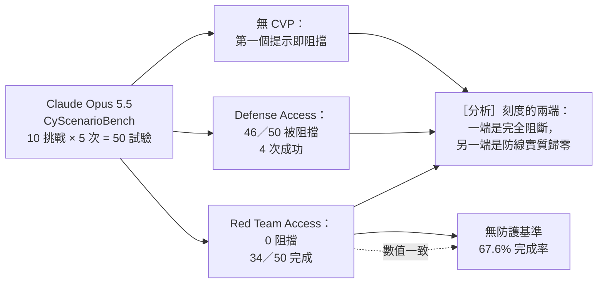

# Anthropic《Expanding the Cyber Verification Program》（2026 年 10 月）

> 課程模組：09 延伸研究 ｜ 來源類型：產業研究（模型供應商的防線設計與量測揭露） ｜ 原文：https://www.anthropic.com/news/cyber-verification-program ｜ 整理日期：2026-10-12

> **本教材的資料層次標示規則**（沿用本模組慣例）：
> - **［原文］**＝Anthropic 2026-10-06 這篇公告本身可直接追溯的內容。本教材以兩次獨立取回交叉比對，逐字句另標「逐字」。
> - **［Anthropic 2026-09］**＝課程主體《Detecting and countering misuse of AI: September 2026》PDF，附頁碼。
> - **［外部］**＝第三方來源，附 URL 與日期，並註明「獨立查證」還是「僅引述原報告」。
> - **［分析］**＝本教材作者的推論或教學詮釋，原文沒有明說，學員應視為可被挑戰的假設。

---

## 0. 為什麼這份公告對本課程特別重要

本課程[安全防護專題](../shared/02-claude-safeguards-and-bypass-paths.html)與模組 05 的[分類器四種狀態](../05-bio/00-bio-intro-and-safeguards.html)反覆問同一個問題：**防線到底擋掉了多少，又誤殺了多少**。這個問題在本課程的全部教材裡都只能定性回答，因為 2026-09 威脅報告從來沒有公布過任何阻擋率。

這份公告公布了。它為了說明「分層放寬」的效果，提供了一組 **CyScenarioBench** 的實測數字：同一個模型（Claude Opus 5.5）在無存取權、Defense Access 與 Red Team Access 三種狀態下，執行十個多階段網路行動挑戰的被阻擋與完成情況。［原文］

［分析］這是本模組目前唯一一份**由模型供應商公布的、可對照的防線阻擋率**。教學價值不在那三個數字好不好看，而在於它讓「雙重用途困境」第一次有了可以放在投影片上的刻度。

---

## 1. 一頁速覽

1. **這是什麼**：Anthropic 的產品與政策公告，**2026-10-06 發布**，宣布擴大 Cyber Verification Program（CVP）。頁面自述 CVP 的作用是「making advanced cyber capabilities and reduced blocking classifiers available to qualifying security professionals」。［原文，逐字片段］

2. **結構變動**：原本的 **Project Glasswing** 與原本的 CVP **合併成單一的三層制**：Defense Access、Red Team Access、Specialized Access。每一層都包含最強的模型，含 **Claude Opus 5.5、Claude Sonnet 5.5、Claude Mythos 5.1**。［原文］

3. **這個程式存在的前提**：資安工作「inherently dual use」（本質上雙重用途），所以一般可用的模型採用保守的網路安全防護，會**阻擋大部分的網路安全工作**；Anthropic 說這同時也限制了惡意行為者能做的事。［原文，逐字片段］

4. **最值得上課講的數字（CyScenarioBench，Claude Opus 5.5，每層 10 個挑戰 × 5 次嘗試 = 50 次試驗）**：
   - **無 CVP 存取權**：每一個任務在**第一個提示就被阻擋**。
   - **Defense Access**：50 次試驗中 **46 次在某個環節被阻擋**，**4 次成功**。
   - **Red Team Access**：**沒有任何阻擋**，50 個任務完成 **34 個**，與**無防護狀態的 67.6% 完成率一致**。
   ［原文］

5. **第 4 點的含意要說清楚**［分析］：Red Team 層的完成率與「完全沒有防護」的完成率相同，表示在這個基準上，**該層的阻擋實質為零**；剩下沒完成的 16 個任務是模型能力的上限，不是防線的作用。所以「reduced blocking」在最高兩層不是「放寬一點」，而是「在該基準範圍內移除」。這不是批評，是讀數字時必須做的區分。

6. **防線沒有全放**：即使在 Red Team 層，對**可能造成物理傷害或大規模中斷**的行為仍保留即時阻擋，例如部署勒索軟體、破壞物理系統、對高風險安全系統做滲透測試。［原文］

7. **代價是什麼：資料留存**。加入的組織**必須保留資料**，讓 Anthropic 能夠「monitor for cyber misuse」。在 Enterprise Frontier Safeguards（EFS，原文稱預計今年秋季稍後推出）之前，對 Claude Fable 5.1 或 Claude Mythos 5.1 具零資料留存權限的組織可以在零留存下使用 CVP。［原文，逐字片段］

8. **防守方的產出數字**：Project Glasswing 的夥伴在 **2026-04 到 2026-07** 間找出**至少 129,000 個已驗證的軟體漏洞**；Anthropic 自己的掃描在 **2026-04 到 2026-10** 間另外找出 **5,500 個**；其中**超過 33,000 個**被評為 critical 或 high。Anthropic 明說這是低估，因為只有部分夥伴回報（**回報修補數字的夥伴不到 50%**），並預期真實影響**至少高出五倍**。［原文］

9. **這份研究在課程裡要教什麼**：教**「可信任使用者審核制」從生物領域擴散到網路領域之後長什麼樣**。模組 05 的[生物導論](../05-bio/00-bio-intro-and-safeguards.html)介紹了 Anthropic 對生物領域採用的受信任使用者審核；CVP 是**同一個治理模式在網路領域的完整實作**，而且這一次附帶了量化的阻擋數據、分層標準、以及一個本課程必須正面處理的新風險：**一個「被核可就能解除防護」的名單，本身就是高價值攻擊目標**（見第 8.3 節）。

---

## 2. 報告基本資料

| 項目 | 內容 | 出處 |
|---|---|---|
| 完整標題 | Expanding the Cyber Verification Program | ［原文］ |
| 機構 | Anthropic | ［原文］ |
| 署名 | 頁面未署名個別作者 | ［原文］ |
| 發布日期 | **2026-10-06** | ［原文］ |
| 形式 | 網頁公告，非研究論文、非威脅情報報告 | ［原文］ |
| 資料來源類型 | 第一方：自有基準測試（CyScenarioBench）、夥伴調查回報 | ［原文］ |
| 涵蓋期間 | 漏洞統計涵蓋 2026-04 到 2026-07（夥伴）與 2026-04 到 2026-10（自有掃描） | ［原文］ |
| 涉及模型 | Claude Opus 5.5、Claude Sonnet 5.5、Claude Mythos 5.1；另提及 Claude Fable 5.1（零留存情境） | ［原文］ |
| 供應管道 | Claude Platform、Google Cloud Vertex AI、Microsoft Foundry；Amazon Bedrock **僅限符合 EFS 資格的客戶** | ［原文］ |
| IOC | **無** | ［原文］ |
| 系列位置 | 同期相關發布：2026-10-08 [Anthropic Cyber Mission](anthropic-2026-10-cyber-mission.html)、2026-10-08 使用政策更新、2026-10-09 [未預期模型動作報告](anthropic-2026-10-unintended-model-actions.html) | ［原文］［分析］ |

### 2.1 三層制逐層對照

| | **Defense Access** | **Red Team Access** | **Specialized Access** |
|---|---|---|---|
| 允許的工作 | 防禦性工作：SOC 與事件回應、惡意程式逆向工程、漏洞分析 | 加上**經授權的**滲透測試與紅隊演練 | 阻擋最少，對關乎生命或市場的系統做測試 |
| 申請資格 | 公司、非營利、大學、政府機關、關鍵基礎設施營運者、較小型資安公司、開源維護者、**有漏洞回報紀錄的個人研究者** | **僅限組織**，個人研究者不符資格 | **極少數**經驗證的組織，例如飛航系統、電網、電信網路的授權測試方 |
| 授權範圍限制 | 以防禦自有系統為主 | 逐字「Organizations in this tier can only perform adversarial testing against systems they are authorized to test」 | 需逐一深度審查，**與美國政府共同進行** |
| 審查時間 | 數日內回覆 | 數週；審查期間先納入 Defense Access | 未揭露 |
| 保留的即時阻擋 | （未逐項揭露） | 可能造成物理傷害或大規模中斷者：部署勒索軟體、破壞物理系統、對高風險安全系統滲透測試 | 同上類別，程度未揭露 |
| 與舊制的關係 | 原 CVP 成員自動評估納入新模型 | 新增層 | **原 Project Glasswing 成員移入此層** |

［原文］上表全部欄位來自原文，括號標示處為原文未揭露。

### 2.2 共同的驗證與控制要求

［原文］

- 所有申請者**都要經過身分驗證**，並**提供其層級所要求的安全控制的證明**。
- **強制資料留存**，目的是讓 Anthropic 能監測網路濫用。
- 管理員必須把存取權**指派到特定 workspace**。
- 提供**申訴表單**：使用者若認為自己的層級本應允許某項被阻擋的工作，可以申訴。
- **EFS（Enterprise Frontier Safeguards）**：原文描述為結合零資料留存隱私與穩健防護的新方案，預計秋季稍後推出，屆時符合資格的組織可把資料存放在**自己控制的雲端基礎設施**。

---

## 3. 主要發現與案例逐一摘要

本文不是案例集，核心內容是制度設計與兩組數字。

### 3.1 CyScenarioBench：防線阻擋率的第一次公開刻度

［原文］該基準測量的是模型「能否在現實約束下規劃並執行多階段網路行動」。測試設定：Claude Opus 5.5，每一層 10 個挑戰、每個挑戰 5 次嘗試。

| 狀態 | 阻擋情況 | 完成情況 | 與無防護基準的關係 |
|---|---|---|---|
| 無 CVP 存取權 | **每個任務在第一個提示即被阻擋** | 0 | 完全阻斷 |
| Defense Access | **50 次試驗中 46 次在某環節被阻擋** | **4 次成功** | 多階段行動基本上走不完 |
| Red Team Access | **無阻擋** | **50 個任務完成 34 個** | **與無防護的 67.6% 完成率一致** |

［分析］上圖為本教材整理，原文未提供流程圖。

> ［分析］**三個必須向學員點明的讀法**：
> 1. **「阻擋」與「失敗」不是同一件事**。Red Team 層沒完成的 16 個任務是能力限制。把兩者混為一談，就會高估防線的作用。
> 2. **Defense Access 的 4 次成功是個關鍵數字**。它說明防禦層的放寬**不足以完成多階段攻擊鏈**，這正是設計意圖；但它同時說明放寬不是零，仍有 8% 的試驗走通。防線的設計目標顯然不是零通過率，而是「不足以構成一條完整行動」。
> 3. **樣本規模小**。10 個挑戰、每層 50 次試驗，信賴區間不會窄。原文沒有給信賴區間或變異數，因此**不應把 46／50、34／50 當成穩定的比率引用**，只能當成量級指示。

### 3.2 防守方的產出：129,000 這個數字怎麼讀

［原文］

| 數字 | 內容 | 期間 | 來源性質 |
|---|---|---|---|
| **至少 129,000** | Project Glasswing 夥伴找出的**已驗證**軟體漏洞 | 2026-04 到 2026-07（4 個月） | **夥伴調查回報**，非 Anthropic 直接量測 |
| **5,500** | Anthropic 自有開源掃描另外找出的漏洞 | 2026-04 到 2026-10（7 個月） | Anthropic 自有量測 |
| **超過 33,000** | 上述中評為 critical 或 high 的數量 | 同上 | 同上 |
| **不到 50%** | 有回報修補數字的夥伴比例 | 同上 | 原文自述的資料缺口 |
| **至少 5 倍** | Anthropic 對真實影響的預估倍數 | 同上 | **原文自述為預估，非量測** |

> ［分析］**口徑警告**：129,000 這個數字的分子是「夥伴自行回報的已驗證漏洞數」，分母（夥伴數、掃描的程式碼量、專案數）**完全未揭露**。「至少高出五倍」是機構預估，不是外推計算，原文沒有給方法。因此這組數字**不適合用在任何正式的量化風險評估**，它的用途是支持一個定性主張：**AI 輔助的漏洞探勘在防守方這一側已經是工業規模**。這與 [GTIG 2026-09-30 的漏洞趨勢統計](gtig-2026-09-vulnerability-trends-ai-era.html)與[微軟數位防禦報告 2026](microsoft-2026-10-digital-defense-report.html) 的「2026 上半年將近 40,000 件 CVE」是同一個現象的三家觀察，但**三者的口徑互不相同，不可相加**。

> ［分析］**另一個被數字蓋住的問題**：如果四個月產出十二萬九千個已驗證漏洞，而不到一半的夥伴能回報修補狀況，那麼瓶頸已經不在發現，而在**驗證、通報與修補的承載量**。這條線在[Anthropic Cyber Mission](anthropic-2026-10-cyber-mission.html) 的 OSS Scanner 設計上會再出現一次（模型產生的報告不經人工審查即寄出），兩份文件併讀才看得到完整的張力。

### 3.3 制度上的三個實質變化

［原文］

1. **合併**：Project Glasswing 併入 CVP，成為 Specialized Access 層。
2. **全層升級到最強模型**：每一層都含 Opus 5.5、Sonnet 5.5、Mythos 5.1；既有成員自動評估納入新模型。
3. **通路分化**：Bedrock 上只給符合 EFS 資格的客戶，其他三個通路一般提供。［分析］這意味著**防護等級與雲端通路綁在一起**，企業選雲就等於選了能不能用這個程式，這是採購時容易漏掉的一條。

---

## 4. 與 Anthropic 2026-09 報告的對照

### 4.1 這份公告是威脅報告的「另一半」

［分析］2026-09 威脅報告記錄的是**防線擋下了什麼、漏了什麼**，但從來沒有說明那些防線在正常情況下對合法使用者造成多少阻擋。這份公告補上的正是這一面：**原來一般可用的模型「會阻擋大部分的網路安全工作」**。把兩份文件並讀，本課程對「防線」的描述才完整：

| 面向 | 2026-09 威脅報告 | 本公告 |
|---|---|---|
| 防線擋下惡意使用 | 逐案記錄（例如模組 05 的分類器攔下案） | 以 CyScenarioBench 量化：無存取權時第一個提示即擋 |
| 防線誤殺合法使用 | **幾乎未處理** | 明確承認會阻擋大部分網路安全工作，並以分層與申訴處理 |
| 防線被繞過 | 四種失效模式（重新提示、跨階段拆分、工具中性、部署後不可收回） | 未處理繞過，只處理「核可後解除」 |

### 4.2 逐點對照

1. **與[模組 05 生物導論](../05-bio/00-bio-intro-and-safeguards.html)的可信任使用者審核制**：**最直接的對應**。生物領域先採用受信任使用者審核，CVP 是同一治理模式在網路領域的完整版，並且多了分層與量化。［分析］兩者併讀可以問一個好問題：生物領域的審核制沒有公布阻擋率，網路領域公布了；差別是因為網路領域的雙重用途邊界比較可談，還是因為生物領域的誤殺成本比較難承認。

2. **與[模組 01 章節導論](../01-cyber/00-cyber-trends-and-skills.html)的 uplift 三軸（speed／scale／depth）**：CyScenarioBench 測的正是 depth（多階段行動的完成度）。［分析］這給了課程一個對照組：威脅報告記載攻擊者在 depth 上取得的 uplift 是實際發生的，而這份公告量到的是**同一個 depth 在防線下的衰減幅度**。

3. **與[GTG-10007 自主零日鑄造廠](../01-cyber/GTG-10007-exploit-foundry.html)**：該案是攻擊方用 agent swarm 做自主漏洞探勘；本公告的 129,000 是防守方用同一類能力做漏洞探勘。**同一能力的兩側，而且都在 2026 年同一季**。［分析］這是本課程「AI 作為勞動力」主線最清楚的雙面標本。

4. **與[GTG-50021 假 Claude 轉售商](../01-cyber/GTG-50021-fake-reseller.html)與[GTG-50020 AI 供應鏈](../01-cyber/GTG-50020-ai-supply-chain.html)**：兩案證明**取得模型能力本身就是攻擊目標**（假轉售、憑證收割、評測沙箱注入竊金鑰）。CVP 創造了一個新的高價值目標：**一份「核可後防護降低」的組織名單與其憑證**。見第 8.3 節。

5. **與[模組 04 常規武器導論](../04-weapons/00-weapons-intro-and-safeguards.html)的 ASL-3 防線錯位**：該節論點是防線等級對準 CBRN、常規武器落在縫隙。CVP 呈現相反的設計：**在網路領域，防線不是對不準，而是太寬，寬到要靠分層才能把合法使用者放進來**。［分析］兩種錯位（太窄與太寬）併讀，是講「防線校準」最好的教材組合。

6. **與[模組 02 影響力行動](../02-influence/00-influence-intro-and-breakout-scale.html)、[模組 06 詐騙](../06-scams/GTG-15001-dating-app-network.html)、[模組 07 蒸餾](../07-distillation/00-distillation-intro-and-mitigations.html)**：**沒有對應**。本公告只處理網路安全領域的雙重用途，不涉及影響力、詐騙或蒸餾。

### 4.3 一個時間序上的觀察

［分析］2026-09-10 威脅報告、2026-09-17 生命科學驗證程式（本教材僅由 anthropic.com/news 列表取得標題）、2026-10-06 本公告、2026-10-08 使用政策更新與 Cyber Mission、2026-10-09 未預期模型動作報告。**四週內六份文件**，方向一致：把「高能力模型的受控釋出」制度化。對課程的意義是，模組 09 從此要處理的不只是「誰濫用了模型」，還有「供應商如何決定誰可以不被擋」。

---

## 5. TTP 與 MITRE ATT&CK 對應

> ［分析］本公告不是威脅情報，沒有攻擊者 TTP。本節改為對照**兩種與本公告直接相關的濫用路徑**，並明確標示 ATT&CK 的適用邊界。

| 情境 | 戰術 | 技術 ID | 具體作法（假想路徑） | 偵測構想（未實測，屬假說） |
|---|---|---|---|---|
| 冒充合格資安組織申請 CVP | Resource Development | T1585 Establish Accounts | 以偽造的公司身分與安全控制證明申請 Defense Access | 申請階段的組織實體驗證；交叉比對漏洞回報紀錄的公開可查性 |
| 竊取已核可組織的憑證 | Credential Access／Initial Access | T1078 Valid Accounts | 取得已在 CVP 中的組織帳號，繼承其降低的阻擋 | 已核可 workspace 的異常地理與時段使用；與該組織授權測試範圍不符的目標 |
| 內部人超出授權範圍測試 | （無適切戰術） | 無適切技術 | 在 Red Team 層對未經授權的第三方系統進行測試 | 將授權範圍清單作為結構化資料，比對實際目標網域 |
| 繞過層級限制 | Defense Evasion | T1562 Impair Defenses（弱對應） | 把被擋的工作拆給未受管的通路或較弱模型 | 同一組織在不同通路與模型間的工作切換樣態 |

### 5.1 框架缺口

1. **「合法取得能力後的越權使用」沒有對應技術**。ATT&CK 假設攻擊者在防守方環境內活動；這裡的濫用發生在**供應商與客戶之間的授權關係**裡。
2. **「授權範圍」不是 ATT&CK 的欄位**。Red Team 層的唯一實質限制是「只能測你被授權測的系統」，而這個限制的驗證完全落在組織自述上。［分析］這是整個制度設計中最軟的一環，而原文沒有說明如何驗證授權。
3. **資料留存是補償控制，不是預防控制**。它讓事後偵測可能，不阻止事前濫用。教學上要把這兩類控制分開登錄。

---

## 6. 圖表判讀

［原文］本教材取得的文字版包含一組 CyScenarioBench 的數字與三層制的說明。**本教材無法確認原文是以表格、圖表或純文字呈現這些數字**，取回結果中沒有圖片元素。

［分析］若原文確實有一張「三層阻擋率」的圖，它會是本模組最值得放進講義的單張圖，因為它把雙重用途困境畫成一條刻度。**人工審核時建議開啟原文確認並補上第 6 節的逐張描述**。依本課程慣例，本教材不下載、不嵌圖。

---

## 7. IOC 與技術指標

［原文］**本公告沒有 IOC**，也沒有任何網域、雜湊或帳號指標。它不是事件報告。

可作為**治理指標**（非 IOC）記錄的名詞：

| 名詞 | 性質 | 課程用途 |
|---|---|---|
| CyScenarioBench | Anthropic 的內部基準 | 追蹤後續是否公開方法與題庫；目前外部無法重現 |
| Project Glasswing | 已併入 CVP 的前身程式 | 查核歷史引用時的名稱對應 |
| Enterprise Frontier Safeguards（EFS） | 預計秋季推出的零留存＋防護方案 | 採購條件與資料留存談判的關鍵字 |

---

## 8. 該機構的偵測、處置與防線缺口

### 8.1 做了什麼

［原文］（1）三層分級並與工作範圍綁定；（2）全申請者身分驗證與安全控制證明；（3）強制資料留存以監測濫用；（4）即使最高層仍保留對物理傷害與大規模中斷的即時阻擋；（5）最高層與美國政府共同深度審查；（6）申訴機制；（7）管理員需把存取權指派到特定 workspace。

### 8.2 怎麼偵測

［原文］唯一明說的偵測基礎是**資料留存**，用於監測網路濫用。原文**未揭露**：監測的方法、頻率、由誰執行、濫用判定後的處置流程、以及被判定濫用的組織數量。

### 8.3 防線缺口（本教材的判斷）

［分析］

1. **授權範圍無法驗證**。Red Team 層的核心限制是「只測你被授權測的系統」，而原文沒有說明 Anthropic 如何驗證這份授權。對照模組 01 的[GTG-50021](../01-cyber/GTG-50021-fake-reseller.html)：偽造身分進入 AI 供應鏈已有實例。
2. **名單本身是攻擊面**。一份「核可後防護降低」的組織清單，其成員帳號的價值高於一般帳號。本課程[安全防護專題](../shared/02-claude-safeguards-and-bypass-paths.html)的第五個控制檢查點應增補這一類：**被核可的身分，就是防線**。
3. **零留存與監測的張力**。強制留存是監測的前提，而 EFS 允許資料留在客戶自控的雲端。［分析］原文沒有說明在客戶自控儲存的情況下，Anthropic 的濫用監測如何執行。這是一個設計上的實質問題，不是文字疏漏，值得在課堂上討論（第 10.2 節第 4 題）。
4. **外溢效應**。模組 05 的案例 2 記載過「分類器降載到最弱模型」導致需求被推向防護較弱模型的外溢效應。CVP 的鏡像風險是：**被 Defense Access 擋住 46／50 的使用者，會不會把工作搬到其他供應商或開源模型上**。原文未處理，本課程[章節導論](../01-cyber/00-cyber-trends-and-skills.html)對開源治理的討論可以接上。
5. **樣本與可重現性**。CyScenarioBench 未公開題庫與方法，外部無法重現或挑戰（第 9 節）。

---

## 9. 第三方驗證與外部來源

| 來源 | URL | 日期 | 性質 | 本教材取得程度 |
|---|---|---|---|---|
| Anthropic 原文 | anthropic.com/news/cyber-verification-program | 2026-10-06 | **一手來源** | 兩次取回，含短逐字片段 |
| Anthropic Cyber Mission | anthropic.com/news/anthropic-cyber-mission | 2026-10-08 | 一手，相關（本模組另有教材） | 已取得 |
| Anthropic 2026 使用政策更新 | anthropic.com/news/2026-usage-policy-update | 2026-10-08 | 一手，相關 | 摘要層級 |
| Life Sciences Verification Program | anthropic.com/news/life-sciences-verification-program | 2026-09-17 | 一手，**生物領域的對應程式** | **僅由 anthropic.com/news 列表取得標題與日期，未開啟** |
| 獨立評測或第三方重現 CyScenarioBench | 無 | 無 | 無 | **不存在**（本教材查詢範圍內） |

### 9.1 單一來源判定

［分析］**本公告是單一來源，且其核心數字在可見範圍內無任何外部佐證**：

- CyScenarioBench 是 Anthropic 自有基準，題庫與方法未公開，**外部無法重現**。
- 129,000 這個數字來自**夥伴自行回報**，Anthropic 自己標示為低估且不完整（回報修補數字的夥伴不到 50%）。這是**第二手回報經第一方彙總**，不是獨立量測。
- 「至少高出五倍」是機構預估，**無方法揭露**，在本課程的主張狀態分類中屬於**未知**，不是來源陳述的事實。
- 本教材**未取得任何第三方對這份公告的獨立分析**。本研究環境的網路政策也限制了部分媒體網域的取得（見第 12 節）。

---

## 10. 課程教學設計

### 10.1 核心教學要點

1. **雙重用途困境第一次有了刻度**。無存取權時第一個提示即擋，Red Team 層阻擋實質為零，Defense Access 在中間（46／50 被擋、4 次成功）。
2. **「阻擋為零」與「任務失敗」要分開**。Red Team 層的 34／50 對應無防護基準的 67.6%，剩下的是能力上限。
3. **防線的誤殺成本是真實的**。一般模型會阻擋大部分網路安全工作，這是供應商自己說的。本課程過去只談漏接，現在必須同時談誤殺。
4. **可信任使用者審核制會擴散**。生物領域先有，網路領域跟上，而兩者的揭露透明度不同。
5. **被核可的身分就是新的防線**，因此也是新的攻擊面。
6. **發現漏洞的能力已超過修補的承載量**（129,000 對比不到 50% 的夥伴回報修補）。

### 10.2 課堂討論題（具爭議性）

1. Red Team 層的阻擋實質為零。那麼這一層的安全保證完全來自「申請審查」與「資料留存」這兩個制度控制，而不是技術控制。這個取捨對嗎。如果一個經核可的組織內部出現惡意人員，技術上還剩什麼。
2. Defense Access 擋掉 46／50。一個真正的 SOC 分析師會不會因此覺得這個層級不堪用，轉而使用防護較弱的其他模型。如果會，這個分層設計是提升了整體安全，還是把風險外推給別人。
3. Anthropic 公布了阻擋率，但沒有公布題庫與方法。公布一個無法重現的數字，比不公布好還是壞。
4. EFS 允許客戶把資料留在自己控制的雲端，而資料留存是濫用監測的前提。這兩件事如何同時成立。如果不能，哪一邊應該讓步。
5. 最高層需要「與美國政府共同深度審查」。對台灣的組織而言，這代表什麼。一個由單一國家政府參與審查的能力釋出機制，對非美國盟邦的資安產業是機會還是結構性劣勢。
6. 129,000 個已驗證漏洞在四個月內被找出，而不到一半的夥伴能回報修補。在這個比例下，「用 AI 大規模找漏洞」對整體生態是淨正面還是淨負面。

### 10.3 桌面演練建議（教室內安全執行，不教攻擊操作）

**演練一：寫一份分層申請審查標準（60 分鐘，紙上作業）**
各組扮演模型供應商，為「紅隊層」設計申請審查的驗證項目，要求每一項都寫出**可驗證的證據形式**（例如：授權測試範圍如何證明、由誰簽署、如何抽查）。交換後由另一組扮演偽造申請方，指出哪些項目可以用公開資訊或偽造文件通過。收束：對照原文只說明「需提供安全控制證明」與「只能測被授權的系統」，討論真實制度的驗證密度。

**演練二：阻擋率數字的判讀練習（45 分鐘）**
給學員第 3.1 節的三行數字，不給本教材的解讀。要求各組回答：（a）哪一個數字是防線的效果、哪一個是模型能力的上限；（b）樣本規模允許什麼程度的結論；（c）要再追問供應商哪三個問題才能用於風險評估。收束比對第 3.1 節的三點讀法。

**演練三：被核可身分的威脅建模（60 分鐘）**
以第 8.3 節第 2 點為題，為「本機構取得 Defense Access 之後」畫一張威脅模型圖，列出至少五條新增攻擊路徑與對應的本地控制（例如 workspace 指派的最小化、服務帳號與人員帳號分離、授權測試範圍的內部登錄）。**不連線、不申請、不測試任何真實系統。**

**演練四：外溢效應的政策推演（45 分鐘，討論）**
假設貴機構的滲透測試工作被 Defense Access 擋掉八成。列出三種實際可能的因應（申請升級、改用其他供應商、改用自架開源模型），並為每一種評估資安與合規後果。對照模組 05 案例 2 的外溢效應討論。

### 10.4 對台灣的意涵

［分析］

1. **這是台灣資安業者可以實際申請的東西**。Defense Access 明列「較小型資安公司」與「有漏洞回報紀錄的個人研究者」為合格申請者。台灣的資安服務商、CERT 團隊與獨立研究者在資格上並未被排除，**可操作的第一步是盤點自身是否具備該層要求的安全控制證明**。
2. **資料留存是本地合規的硬問題**。強制留存與台灣公部門及金融業對資料落地、個資與營業秘密的要求直接相撞。[公部門人工智慧應用參考手冊](moda-2026-01-public-sector-ai-playbook.html) 的風險登錄表應增列「供應商為監測濫用而強制留存」這一項，並在採購時確認 EFS 類方案的時程與可用區域。
3. **通路綁定會影響採購**。Bedrock 僅限 EFS 資格客戶、其他三通路一般提供，意味著雲端選擇會決定能否取得這個程式。這是跨部門（資安與 IT 採購）必須一起看的條件。
4. **最高層的政府參與審查是地緣政治變數**。Specialized Access 需與美國政府共同審查，而台灣的電網、電信與飛航系統正是該層設計的對象類別。這件事該由誰在什麼層級談，是政策題不是技術題。
5. **與點名台灣的案例併讀**：模組 04 的[GTG-17002 電子戰／防空壓制](../04-weapons/GTG-17002-ew-sead-taiwan.html)顯示有行為者以台灣目標做模擬。防守側取得同級能力的門檻（分層審查、資料留存、政府參與）與攻擊側取得能力的門檻（偽造身分、轉售、蒸餾，見模組 07）**完全不對稱**，這個不對稱本身就是台灣的結構性風險，值得單獨一堂課。

---

## 11. 關鍵原文引文

> 受取回工具的引文長度限制，以下多為句中片段，均為逐字。繁中翻譯為本教材所譯。

1. 「making advanced cyber capabilities and reduced blocking classifiers available to qualifying security professionals」
   讓合格的資安專業人員能取得進階網路安全能力與降低阻擋的分類器。

2. 「inherently dual use」（描述資安工作的性質）
   本質上雙重用途。

3. 「conservative cyber safeguards that block most cyber work」（描述一般可用模型的防護）
   保守的網路安全防護，會阻擋大部分的網路安全工作。

4. 「Organizations in this tier can only perform adversarial testing against systems they are authorized to test」
   此層級的組織只能對其被授權測試的系統進行對抗性測試。

5. 「whether models can plan and execute multi-stage cyber operations」（描述 CyScenarioBench 測什麼）
   模型能否規劃並執行多階段網路行動。

6. 「monitor for cyber misuse」（描述強制資料留存的目的）
   監測網路濫用。

7. 「at least 129,000 verified software vulnerabilities」
   至少 129,000 個已驗證的軟體漏洞。

---

## 12. 未能驗證之處與研究限制

### 12.1 取得範圍

| 項目 | 狀態 |
|---|---|
| Anthropic 2026-10-06 原文 | **已取得**，兩次獨立取回交叉比對 |
| 原文的完整逐字段落 | **未完整取得**。取回工具限制單條引文長度，第 11 節多為句中片段 |
| 原文是否含圖表 | **未能確認**（見第 6 節） |
| CyScenarioBench 的題庫、方法、信賴區間 | **原文未揭露**，外部無法重現 |
| 129,000 的分母（夥伴數、掃描範圍） | **原文未揭露** |
| 「至少高出五倍」的推估方法 | **原文未揭露** |
| 第三方獨立分析 | **未取得**。本研究環境網路政策拒絕多數媒體與研究機構網域 |
| Life Sciences Verification Program 原文 | **未開啟**，僅取得標題與日期 |

核對範圍的時間分層：**來源發布日** 2026-10-06；**本教材取得與撰寫日** 2026-10-12；**資料涵蓋期間** 2026-04 到 2026-10（漏洞統計）；**指定主張複核日**：尚未進行，本教材為首版。

### 12.2 本教材明確不知道的事

1. **Defense Access 層保留哪些即時阻擋**。原文只對 Red Team 層列舉了保留項目。
2. **已核可的組織數量、申請通過率、申訴成功率**。全部未揭露。
3. **濫用監測的方法與已處置案例**。未揭露。
4. **EFS 下的監測如何執行**（第 8.3 節第 3 點）。未說明。
5. **CyScenarioBench 與 2026-09 威脅報告所述真實案例的關係**。無法判斷該基準是否以真實案例為題。
6. **這三層與 Anthropic ASL 等級體系的關係**。原文未連結到 Responsible Scaling Policy 的等級定義。

### 12.3 數字使用的硬限制

［分析］本教材重申三條，供引用時遵守：

1. **46／50、4／50、34／50、67.6%** 只能作為量級指示，**不可當成穩定比率**（樣本 50 次試驗，無信賴區間）。
2. **129,000、5,500、33,000** 的分母未揭露，**不可用於任何佔比計算**。
3. **「至少高出五倍」在本課程的主張狀態分類中屬「未知」**，不得作為來源陳述引用。

### 12.4 本教材自身的推論標示

第 0 節的定位、第 3.1 節的 Mermaid 圖與三點讀法、第 3.2 節的口徑警告與承載量推論、第 4 節全部的對照判斷、第 5 節全部的 ATT&CK 對照與偵測構想、第 8.3 節的五項缺口、第 10.4 節的五點台灣意涵，**全部為本教材的分析推論，原文沒有明說**。第 5 節的偵測構想**未經實測，屬假說**，不宣稱低誤報或可直接部署。

### 12.5 建議的後續工作（供人工審核）

1. 開啟原文確認是否有圖表，若有則補寫第 6 節。
2. 補讀 Life Sciences Verification Program（2026-09-17），與本教材第 4.2 節第 1 點併讀後，考慮在模組 05 增補交叉連結。
3. 追蹤 EFS 實際推出後的條款，特別是零留存與濫用監測如何共存。
4. 若日後出現第三方對 CyScenarioBench 的獨立評論，補入第 9 節並重估第 3.1 節的可信度。
