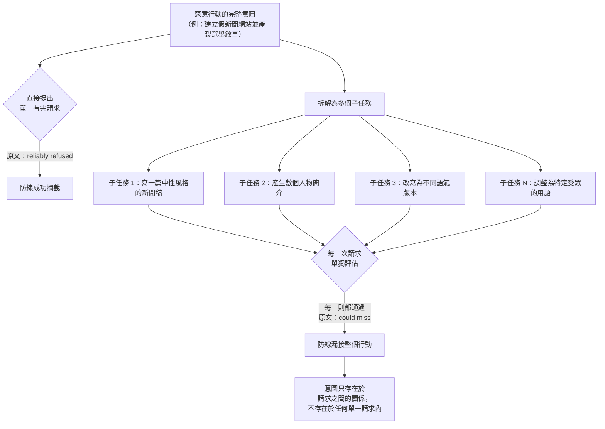

# Anthropic《Preparing for the 2026 US midterms》（2026-10）

> 課程模組：09 延伸研究 ｜ 來源類型：官方政策與防線自述（含少量威脅情報揭露） ｜ 原文：[Preparing for the 2026 US midterms](https://www.anthropic.com/news/2026-us-midterms) ｜ 整理日期：2026-10-19
>
> 證據邊界：本篇只核對 Anthropic 官方該篇原文，以及可取得的第三方報導。本教材**未取得**原文所引的政治公正性評測完整方法、ISD 與 McCain Institute 紅隊測試的原始報告、Clio 分析的查詢定義與分類器規則，也未取得被停權帳號的任何鑑識資料。第 4 節的對照、第 5 節的框架缺口、第 10 節的教學設計，以及所有標示「本教材分析」的段落是教學分析，不是原文陳述。本篇不含任何可操作的攻擊或規避內容。

## 1. 一頁速覽

- **學習目標：**用 Anthropic 自己在選舉場景的防線自述，驗證本課程最核心的一條主線（**單次請求的拒絕率，不等於整個行動的阻擋率**），並學會分辨「廠商自述」、「獨立紅隊測試」與「平台遙測」這三種證據的強度差異。
- 2026-10-14 發布，屬**政策與防線自述**體裁，不是威脅情報報告。它沒有 GTG 代號、沒有 IOC、沒有時間軸、沒有具名行為者，但夾帶了兩則處置揭露與一項紅隊測試結論。
- **全篇對本課程價值最高的一句**，來自與 Institute for Strategic Dialogue（ISD）及 McCain Institute 合作的紅隊測試：「Claude reliably refused a single harmful request, but could miss a malicious campaign when it was spread across many individual requests that looked harmless on their own.」（Claude 能可靠拒絕單一有害請求，但當一個惡意行動被拆散成許多個別看來無害的請求時，它可能漏接。）
- 這句話是**由 Anthropic 自己承認、且由第三方測試者取得**的防線失效證據，證據等級高於本課程主體報告中多數由平台遙測推斷的防線缺口。它直接對應本課程[Claude 防線與繞過路徑](../shared/02-claude-safeguards-and-bypass-paths.html)所整理的**分解式繞過**（decomposition），也是模組 02 多起案例共同的結構性成因。
- **使用量數據（Clio 類方法）：**2026-09-21 至 09-27 一週、約 **250,000** 則美國 Claude.ai 對話樣本中，政治或政策或社會議題約 **5.75%**，明確涉及選舉或投票約 **0.51%**，詢問「該投給誰」約 **0.01%**，違反選舉誠信政策者約 **0.002%**。
- **兩則處置揭露（皆未具名、未計數、未標日期）：**其一為外國操作者經營**假新聞網站**，用 Claude 生產偏向俄羅斯、伊朗與北韓敘事的期中選舉報導；其二為以**廣告營收**為目的的捏造新聞。兩者帳號均已停權。
- **防線工程揭露：**新增針對**新型與多步驟濫用**的分類器（含假社群帳號、假新聞網站、財務動機的選舉圖利），強化外國國家行為者偵測，並對美國、以色列、巴西的在地化風險加設防護。
- **這份研究在課程裡要教什麼：**它是**廠商自述**體裁的典型樣本。課堂用法不是接受它的結論，而是拿它來練習三件事：（一）把 0.002% 這個數字還原成分子與分母再問它證明了什麼；（二）辨認哪一句是自述、哪一句是第三方測試結果；（三）把「分解式繞過」從本課程的推論升級為有外部佐證的命題。
- 限制：單一廠商自述，處置案例無日期、無數量、無行為者歸因、無 IOC；紅隊測試只有結論一句，沒有方法、樣本數與失敗率；政治公正性 99% 的評測定義未公開於本篇。

## 2. 報告基本資料

| 欄位 | 核對結果 |
|---|---|
| 機構 | Anthropic（原文置於 Policy 分類） |
| 具名作者 | **無**。原文未署個別作者或團隊名 |
| 發布日期 | **2026-10-14** |
| 文件形式 | 官方網站政策長文，含附註（Footnotes）與相關內容連結 |
| 資料型態 | **廠商自述**為主體，夾帶（一）平台遙測的彙總統計、（二）第三方紅隊測試的結論、（三）第三方評測機構的質性評語 |
| 涵蓋期間 | 使用量分析為 **2026-09-21 至 2026-09-27**（一週）。兩則處置揭露**未標日期**。防線工程無明確起訖 |
| 涉及模型 | Claude Opus 5.5、Sonnet 5.5、Haiku 5.5（政治公正性評測）；另提及 Claude Sonnet 4.5（FAI 的評語對象） |
| 地理範圍 | 主體為美國；紅隊測試涵蓋**美國、以色列、巴西**；CIP 問卷涵蓋**美國、英國、印度** |
| 行為者代號 | **無**。原文只用「foreign state actors」、「Political, state-aligned, and commercial actors」等類別語 |
| 章節結構 | 未標題導言、How people use Claude for elections and politics、Connecting people to trusted sources、Measuring and preventing political bias、How we define misuse（含 Testing and strengthening our defenses）、What we've found、Looking ahead、Footnotes |
| 與其他發布的關係 | 引用「Our recent threat intelligence report」並連至**本課程主體的 2026-09 報告**；另連至先前的選舉防線更新與[模型未預期動作研究](anthropic-2026-10-unintended-model-actions.html) |

**體裁判讀（本教材分析）：**這篇的證據地位必須講清楚，否則容易被當成威脅情報報告引用。它是**防線自述**，與本模組的 [Anthropic Cyber Mission](anthropic-2026-10-cyber-mission.html)、[網路能力分層審核](anthropic-2026-10-cyber-verification-program.html) 同屬一類，而與本課程主體報告（案例型遙測）不同類。

但它內部的證據強度**並不均勻**，這是本篇最值得教的結構特徵：

| 原文段落 | 證據類型 | 強度判讀（本教材分析） |
|---|---|---|
| 紅隊測試結論（分解式請求漏接） | **第三方測試者在 Anthropic 系統上的實測** | **最高**。測試方是外部機構，結論對 Anthropic 不利，符合「不利自述」的證據法則 |
| Clio 類使用量統計 | 平台遙測彙總 | 中。方法與分類定義未揭露於本篇，分母清楚（約 250,000 則、一週、美國消費者） |
| 兩則處置揭露 | 廠商自述 | **低**。無日期、無數量、無歸因、無 IOC、無外部佐證 |
| 政治公正性 99% | 廠商自評 | 低。評測定義與題庫未揭露於本篇 |
| 第三方評測機構評語 | 第三方質性評估 | 中。但本篇只摘錄，未附完整報告 |
| 分類器與產品防線 | 廠商自述 | 低。無誤報率、無攔截率、無覆蓋範圍 |

課堂上請學員先做這張表，再談內容。**同一篇文件裡混了六種證據強度，這本身就是閱讀廠商發布的第一課。**

## 3. 主要發現逐段摘要

### 3.1 使用量：四個層層收窄的比率

原文給出的一週快照（2026-09-21 至 09-27，約 250,000 則美國 Claude.ai 對話）：

| 類別 | 占比 | 換算為約略則數（本教材計算） |
|---|---|---|
| 政治、政策或社會議題 | 約 **5.75%** | 約 14,400 則 |
| 明確涉及選舉或投票 | 約 **0.51%** | 約 1,280 則 |
| 詢問「該投給誰」 | 約 **0.01%** | 約 25 則 |
| 違反選舉誠信政策 | 約 **0.002%** | 約 5 則 |

**本教材分析，且這是本節最重要的一段：**換算成則數之後，問題立刻浮現。約 **5 則**違規，是一個小到無法支撐任何趨勢結論的分子。原文沒有宣稱它支撐趨勢結論，但讀者很容易自行補上「可見選舉濫用極其罕見」這個推論。

這個推論**不成立**，理由有三，全部是本教材分析：

1. **分母錯置。**樣本是**美國消費者 Claude.ai 對話**。本課程模組 02 的九起影響力行動案例，絕大多數是**透過 API 與商業方案**運作的**非美國**操作者。影響力行動的工業化流量，結構上不會出現在這個分母裡。用消費者對話的違規率去推論影響力行動的盛行率，是**換了母體**。
2. **偵測上限即測量上限。**這個比率是「被分類器判定為違規」的比率，不是「實際違規」的比率。而原文在同一篇裡承認分類器會漏接拆散的行動（見 3.3）。**被自己承認會漏接的尺規，量不出自己漏接了多少。**
3. **一週快照不含選舉週期的尖峰。**2026-09-21 當週距投票日尚有一段時間，原文也未宣稱該週具代表性。

**課堂上的正確說法：**這四個比率有效證明的是「**在美國消費者介面上，選舉相關使用是小眾，且其中被判定違規者極少**」。它不能證明選舉濫用罕見，也不能證明防線有效。這正是本課程[證據與方法](../shared/04-evidence-and-methods.html)所要求的「占比要附單位、分子與分母」的紀律，在一份新文件上的實際操作。

### 3.2 連結可信來源與政治公正性

原文揭露的產品措施：

- 介面橫幅連至 **TurboVote**（Democracy Works 的無黨派資源），涵蓋登記、投票地點與選舉日期。
- 原文稱自該月稍後起，Claude 將為美國使用者**引用 Democracy Works 的官方投票資訊**：「Someone asking where to vote or what ID to bring to their polling place will now get an answer specific to their state.」（詢問在哪投票、要帶什麼身分證件的人，現在會得到該州專屬的答案。）
- 選舉夜及其後數日顯示**官方開票結果**。

政治公正性：

- Claude Opus 5.5、Sonnet 5.5、Haiku 5.5 被描述為「most evenhanded to date」，在 Anthropic 的政治公正性評測得 **99%**。
- 第三方評語並非一致好評。The Future of Free Speech 與 Foundation for American Innovation（FAI）給多數回應高評價；The Future of Free Speech 與 Collective Intelligence Project（CIP）則發現 Claude「rarely refused requests, but sometimes added unsolicited caveats and counterarguments」（很少拒絕請求，但有時加上未經要求的保留與反論）。FAI 發現 Claude Sonnet 4.5「didn't always hedge evenly」（並非總是均勻地保留），且較傾向軟化右傾立場的論點。
- CIP 在美國、英國、印度調查**2,000 人以上**以協助發展其評測。

**本教材分析：**這一段與本課程的濫用主題只有間接關係，但有一個方法論價值值得保留。**99% 這個數字與第三方的質性批評並不矛盾，因為兩者量的不是同一件事。**評測量的是「立場是否對稱」，第三方批評的是「保留語與反論的分布是否對稱」。一個系統可以在前者接近滿分，同時在後者有系統性偏斜。這是**單一分數掩蓋多維行為**的教科書案例，與本課程[能力評測研究](../08-capability-research/01-targeting-evals.html)章節所教的「不要用一個分數概括一個能力」同構。

### 3.3 防線測試：本篇對本課程最關鍵的揭露

原文陳述，Anthropic 與 **Institute for Strategic Dialogue（ISD）** 及 **McCain Institute** 合作，在**美國、以色列、巴西**壓力測試其防護。

測試方法（原文所述）：測試者先從直接請求開始，然後「broke full campaigns into smaller tasks that could look harmless on their own」（把完整的行動拆成個別看來無害的較小任務）。

測試結論（原文逐字）：

> 「Claude reliably refused a single harmful request, but could miss a malicious campaign when it was spread across many individual requests that looked harmless on their own.」

**本教材分析，這是全篇最重要的教學切口：**

這個失效模式的結構是**意圖的位置**。有害性不在任何一則請求裡，而在請求的**集合與序列**裡。一個逐則評估的分類器，無論單則準確率多高，在定義上就看不到這個層次。這不是模型能力不足，是**評估單位錯置**。

為什麼這一句的證據價值特別高（三個理由，本教材分析）：

1. **不利自述。**這是 Anthropic 公開承認自家防線的結構性缺口，而非宣稱成功。不利於發布者的陳述，可信度高於有利陳述。
2. **第三方測試者。**執行測試的是 ISD 與 McCain Institute，不是 Anthropic 內部紅隊。這使它成為本模組少見的**準獨立**證據。
3. **它把本課程的推論升級為命題。**本課程模組 02 與 03 的多起案例（最清楚的是 [GTG-14021 維穩與跨境鎮壓](../03-surveillance/GTG-14021-weiwen-transnational-repression.html)的重新提示突破、[GTG-54002 影響力即服務](../02-influence/GTG-54002-influence-as-a-service.html)的工序切分）都讓本教材**推論**存在分解式繞過。現在發布者自己確認了這個機制。

**但必須同時標示本句的限制（本教材分析）：**原文只給了一句結論。沒有給測試樣本數、沒有給漏接率、沒有給拆解到幾步才開始漏接、沒有給哪些主題較易漏接、沒有說測試後是否已修補、也沒有說「could miss」是偶發還是常態。**「could miss」是能力陳述，不是頻率陳述。**課堂上不可把它講成「Claude 會漏接大多數拆散的行動」，那是原文沒有支持的加碼。

### 3.4 處置揭露：兩則，皆為最低證據等級

原文在 What we've found 段落揭露兩類已處置活動：

| 案例 | 原文所述內容 | 缺少的欄位（本教材盤點） |
|---|---|---|
| 外國假新聞網站 | 外國操作者經營假新聞網站，用 Claude「produce US midterm coverage favoring Russian, Iranian, and North Korean narratives」（產製偏向俄羅斯、伊朗與北韓敘事的美國期中選舉報導）。帳號已停權 | 日期、帳號數、操作者國別、網站網域、觸及量、是否為國家指導、產出是否實際發布、與三國的關係是受指導還是僅敘事對齊 |
| 財務動機捏造新聞 | 其他行為者用 Claude 產製針對美國受眾的捏造新聞以賺取**廣告營收**。帳號已停權 | 日期、帳號數、國別、規模、變現金額、平台 |

原文另稱，希望在未來數月發布一份關於整個選舉週期使用情況的更完整說明。

**本教材分析：**第一則有一個細節值得停下來看。「favoring Russian, Iranian, and North Korean narratives」是**敘事對齊**的描述，不是**歸因**。一個商業圖利的內容農場完全可能因為流量而生產親俄親伊敘事，無須任何國家指導。原文用的是 favoring，沒有用 directed by 或 state-sponsored。**課堂上不可把這則講成「俄伊朝三國用 Claude 干擾美國期中選舉」**，那是把敘事對齊偷換成指揮關係，正是本課程[跨案例分析](../shared/01-cross-cutting-analysis.html)反覆警告的歸因滑坡。

第二則的教學價值在於**動機與效果的分離**。純粹為廣告營收而捏造的新聞，對資訊環境的破壞不因動機單純而減輕。這與本課程 [GTG-15001 交友 app 網絡](../06-scams/GTG-15001-dating-app-network.html)的財務動機、以及 [GTG-54006 孟加拉](../02-influence/GTG-54006-bangladesh-awami-league.html)的低成本操作，共同指向一條主線：**AI 把「不需要國家資源的資訊破壞」的成本壓到了個人可負擔的水準。**

### 3.5 防線工程揭露

原文列出的措施：

- **新分類器**，針對「novel and multi-step misuse」（新型與多步驟濫用），明確涵蓋：假社群媒體帳號、針對政治討論的假新聞網站、財務動機的選舉圖利。
- **強化外國國家行為者**的選舉濫用偵測。
- **強化對選舉基礎設施與競選團隊的網路防護**。
- 對**美國、以色列、巴西**的在地化風險加設針對性防護。
- 威脅情報與執法團隊審查被標記的活動，確認違規後採取行動，「including banning accounts」。
- 使用政策禁止用 Claude 欺騙選民或干擾選舉；原文稱今年更新政策以釐清選舉規則的涵蓋範圍。

**本教材分析：**「針對 multi-step misuse 的新分類器」與 3.3 的紅隊發現顯然是同一條線的兩端：發現問題，然後宣稱已針對該問題加設分類器。但原文**沒有提供修補後的再測結果**。課堂上值得追問的是：一個逐則評估的系統要如何偵測跨請求的意圖？可能的路徑有工作階段層級聚合、帳號層級行為基線、跨帳號關聯等，但**原文完全沒有描述機制**，本教材也不替它補。這是一個**宣稱已修補但未提供證據**的缺口，應明確記入第 8 節。

## 4. 與 Anthropic 2026-09 報告的對照

本篇與本課程主體報告是**同一機構、相距約五週、體裁不同**的兩份文件，對照價值很高。

| 本課教材 | 對照點 | 兩造差異與不可作的推論 |
|---|---|---|
| [Claude 防線與繞過路徑](../shared/02-claude-safeguards-and-bypass-paths.html) | **最直接的對照，也是本篇的核心價值。**分解式繞過從推論升級為發布者自承 | 本課程該頁整理的繞過路徑多半是**從案例行為反推**；本篇是 Anthropic 自己承認、且由 ISD 與 McCain Institute 實測取得。**證據等級提升了一級。**但本篇未給漏接率，不可用來量化該路徑的成功率 |
| [護欄繞過與防禦總覽](../shared/03-guardrail-bypass-and-defense-overview.html) | 四種失效模式中的「評估單位錯置」 | 本篇為該失效模式提供了最乾淨的單一句證據。**但本篇只涉選舉場景**，不可外推為全領域的漏接率 |
| [影響力行動導論與 Breakout Scale](../02-influence/00-influence-intro-and-breakout-scale.html) | 上游偵測的限制 | 主體報告的九案都是**上游（平台側）偵測**的成果；本篇承認上游偵測在請求被拆散時會失效。**兩者並讀才完整：上游偵測抓得到工業化規模，抓不到刻意分散的行動** |
| [GTG-54002：影響力即服務](../02-influence/GTG-54002-influence-as-a-service.html) | 工序切分 | 該案的商業客戶把工作切成標準工序；本篇的紅隊測試刻意拆解請求。**行為形狀相同，但一為商業效率、一為規避測試，不可混為同一意圖** |
| [GTG-24015：俄羅斯國家媒體編輯管線](../02-influence/GTG-24015-russian-state-media.html) | 假新聞網站的產製管線 | 該案是本課程唯一能逐字對上實際發布內容的案例；本篇第一則處置**未揭露產出是否實際發布**。**該案可證明「產出確實上線」，本篇不能** |
| [GTG-84005：馬來西亞選舉操縱平台](../02-influence/GTG-84005-malaysia-election-platform.html) | 選舉場景的商業操縱 | 該案是商業平台對特定選區的系統化操作；本篇是防線側視角。**兩者互補：一邊是攻擊側工程，一邊是防禦側承認的缺口** |
| [GTG-54004：肯亞協同不實行為](../02-influence/GTG-54004-kenya-cib.html) | 為未來選舉預備 | 該案為 2027 大選預備；本篇為 2026 期中選舉預備防線。**同一條時間軸的攻防兩側** |
| [GTG-34001：伊朗 ICCO](../02-influence/GTG-34001-iran-icco.html)、[GTG-84006：MEK/NCRI Viktor](../02-influence/GTG-84006-mek-ncri-viktor.html) | 伊朗相關敘事 | 本篇第一則提及「favoring Iranian narratives」。**不可與這兩案建立關聯**：本篇未給任何歸因、網域或代號，敘事對齊不等於同一行為者 |
| [GTG-15001：交友 app 網絡](../06-scams/GTG-15001-dating-app-network.html) | 財務動機的 AI 內容量產 | 本篇第二則（廣告營收捏造新聞）與該案同屬財務動機。**可共同支持「低成本、非國家、財務動機」這條主線** |
| [跨案例分析](../shared/01-cross-cutting-analysis.html) | 複雜度脫鉤、AI 作為勞動力 | 本篇的兩則處置都是**低資源行為者**，與複雜度脫鉤主線一致。**但本篇未揭露資源水準**，只能作為形狀一致的觀察，不是量化佐證 |
| [證據與方法](../shared/04-evidence-and-methods.html) | 占比的分子與分母紀律 | 本篇的 0.002% 是練習該紀律的最佳新素材（見 3.1）。**本篇是單一來源自述** |
| [模型未預期動作](anthropic-2026-10-unintended-model-actions.html) | 原文自己連結的同期研究 | 兩篇同為 Anthropic 2026-10 的防線自述，可並讀觀察該公司此期的揭露策略 |
| [網路能力分層審核](anthropic-2026-10-cyber-verification-program.html) | 分類器與審核機制 | 該篇有攔截率數字，本篇沒有。**可對比同一公司在不同領域的揭露顆粒度差異**，這個差異本身值得課堂討論 |
| [微軟：冒用 AI 品牌的攻擊](microsoft-2026-09-ai-themed-attacks-defender.html) | 選舉場景外的假內容 | 不同領域、不同平台的獨立觀察 |

**核心教學點（本教材分析）：**把本篇與主體報告並讀，會看到一個**系統性的揭露不對稱**。主體報告對**攻擊者**的描述極其詳細（代號、時間軸、IOC、生命週期、圖表），對**自家防線為何失效**的描述則相對稀薄。本篇恰好相反：它對防線失效給了一句高品質的第三方證據，對攻擊者則幾乎零揭露（無代號、無日期、無 IOC、無數量）。

**兩份都是 Anthropic 發布，兩份都在各自強項上詳細、在各自弱項上簡略。**這不是指控，是任何機構自我揭露的結構性傾向，也是本模組存在的理由：**只讀一家、只讀一種體裁，看不到完整的圖像。**

## 5. TTP 與 MITRE ATT&CK 對應

本篇是防線自述，**不含攻擊鏈敘述**，因此 ATT&CK 對應能力有限。下表只就原文明確提及的行為填寫，並標示框架缺口。

| 戰術或行為 | 技術 ID | 本篇所述的具體作法 | 偵測構想（假說，未經實測） |
|---|---|---|---|
| Resource Development | [T1585.001：Establish Accounts: Social Media Accounts](https://attack.mitre.org/techniques/T1585/001/) | 原文列為新分類器標的：建立假社群媒體帳號 | 跨帳號的文風與發文節律聚類。**合法反例**：代操社群的行銷公司、多語言官方帳號群 |
| Resource Development | [T1583.001：Acquire Infrastructure: Domains](https://attack.mitre.org/techniques/T1583/001/) | 假新聞網站（兩則處置的共同載體） | 新註冊網域加上高產出 AI 文稿密度。**合法反例**：正當的新創媒體、個人部落格 |
| Resource Development | [T1588.007：Obtain Capabilities: Artificial Intelligence](https://attack.mitre.org/techniques/T1588/007/) | 以商用 LLM 帳號作為內容產製能力來源 | 這是本課程全部案例的共同前置條件，單獨偵測價值低 |
| Impact | [T1565.002：Data Manipulation: Transmitted Data Manipulation](https://attack.mitre.org/techniques/T1565/002/) | 捏造新聞內容（形式對應，非精確匹配） | 框架對「資訊環境污染」沒有合適技術，本列為權宜對應 |
| **防線規避：跨請求意圖分解** | **無對應 ID（框架缺口）** | 紅隊測試：把完整行動拆成個別無害的子請求 | 工作階段與帳號層級的**意圖聚合**，而非單則分類。**需要跨請求關聯的遙測與保留期**；誤報成本高，因為正常的複雜工作也是多步驟的 |
| **影響力行動的生命週期** | **框架涵蓋不足** | 原文提及的假帳號、假網站、敘事產製 | ATT&CK 以入侵為中心，影響力行動應改用 DISARM 等框架 |

**框架缺口說明（本教材分析）：**本篇暴露了兩層框架缺口，兩者性質不同。

第一層是**框架選擇錯誤**：影響力行動本來就不該用 ATT&CK 描述，DISARM／AMITT 才是對應框架。這一點本課程[影響力行動導論](../02-influence/00-influence-intro-and-breakout-scale.html)已有處理。

第二層較深，且是本篇特有的：**沒有任何現行框架能描述「跨請求的意圖分解」這個規避技術。**ATT&CK 的 Defense Evasion 戰術假設規避的對象是端點防護或日誌，技術單位是一個動作。而本篇所述的規避，對象是**內容分類器**，手法是**把意圖分散到多個合規動作之間**。它沒有單一可觀測動作，因此無法編碼為一個技術 ID。

這與本課程[常規武器導論](../04-weapons/00-weapons-intro-and-safeguards.html)所指出的「分類法描述得了手法，描述不了編排」是**同一個結構問題在防線側的鏡像**。課堂上可以把這兩處並列，讓學員看到這不是某個框架的疏漏，而是「以單一動作為單位的分類法」的共同極限。

偵測構想全部是**假說**，本教材未在任何環境實測，不宣稱低誤報率，也不建議直接部署。

## 6. 圖表判讀

**原文沒有圖表。**

本篇是純文字政策長文，無統計圖、無流程圖、無時間軸、無截圖。使用量的四個比率以行文敘述與附註呈現，未製圖。

**本教材分析：**這一點值得與本課程主體報告對照。主體報告有 51 張圖表，且本課程[總索引](../00-index.html)指出其中有大量關鍵數字**只存在於圖片內**。本篇完全無圖，使用量數據以散文形式給出，讀者必須自己換算成則數才看得出分子有多小（見 3.1）。

**無圖不等於透明度較高或較低，但它改變了讀者的認知成本。**圖表會引導讀者注意特定對比；散文數字則容易被略過。本篇把四個遞減的百分比寫在行文裡，讀者的自然反應是接受「很少」這個印象，而不是去問分子是幾則。這是一個可以在課堂上示範的**呈現形式影響判讀**的例子。

第 3.3 節的 Mermaid 圖是**本教材繪製**，用於說明原文那一句紅隊結論的機制，不是原文圖表。

## 7. IOC 與技術指標

**原文沒有公開任何 IOC。**

本篇未提供網域、IP、雜湊、帳號識別碼、Telegram 帳號、網站名稱或任何技術指標。兩則處置揭露連被停權的帳號數量都沒有給。

| 指標類型 | 本篇是否提供 | 偵測價值與壽命 |
|---|---|---|
| 網域（假新聞網站） | **無** | 不適用 |
| 帳號識別碼 | **無** | 不適用 |
| 雜湊 | **無** | 不適用 |
| IP | **無** | 不適用 |
| 行為者代號 | **無**（連 GTG 編號都沒有） | 不適用 |
| 敘事主題 | 有（偏向俄羅斯、伊朗、北韓敘事；廣告營收捏造新聞） | 低。敘事主題不是指標，無法用於比對，且會隨議題更替 |

**本教材分析：**對 SOC 與 CTI 團隊而言，本篇的**可操作情報價值接近於零**。這不是缺陷，是體裁決定的：政策文件的讀者是政策與公眾，不是偵測工程師。

但這一點有一個重要的教學用途。本課程主體報告**有** IOC 表，本篇**沒有**，而兩者都是 Anthropic 對選舉與影響力行動的發布。課堂上可以問：為什麼同一家公司在威脅情報報告裡給 IOC，在政策文件裡不給？合理的解釋包括讀者不同、法務與隱私考量、尚在調查中、或指標價值過低（內容農場網域壽命極短）。**原文沒有解釋，本教材不替它推斷哪一個為真**，但讓學員意識到「揭露顆粒度是一個選擇」，是本模組的核心訓練之一。

依本課程安全紅線：本篇無任何指標可供抄錄，亦無任何對象可連線，本節無操作內容。

## 8. 該機構的偵測、處置與防線缺口

### 8.1 做了什麼（原文自述）

- 自動化**選舉濫用分類器**，加上新增的**多步驟濫用**分類器（假社群帳號、假新聞網站、財務動機選舉圖利）。
- 強化**外國國家行為者**的選舉濫用偵測。
- 強化**選舉基礎設施與競選團隊**的網路防護。
- 對**美國、以色列、巴西**加設在地化防護。
- 威脅情報與執法團隊人工審查被標記活動，確認違規後停權。
- 使用政策更新，釐清選舉規則涵蓋範圍。
- 與 ISD、McCain Institute 進行第三方紅隊測試。
- 與 Democracy Works 整合官方投票資訊；介面橫幅連至 TurboVote。

### 8.2 哪裡失效或未揭露（本教材盤點）

| 缺口 | 說明 | 嚴重度判讀（本教材分析） |
|---|---|---|
| **跨請求意圖分解漏接** | 原文自承的核心缺口。單則拒絕可靠，整體行動可能漏接 | **高。**這是結構性缺口，不是調參可解。且原文未給漏接率 |
| 修補未附再測結果 | 宣稱已新增 multi-step 分類器，但未提供修補後的紅隊再測結果 | **高。**宣稱已修補而無證據，是本篇最大的揭露缺口 |
| 新分類器機制未描述 | 逐則評估的系統如何偵測跨請求意圖，原文完全未說明 | 中。可能涉商業機密，但使讀者無法評估其可信度 |
| 分類器效能數字全缺 | 無誤報率、無攔截率、無覆蓋率、無漏接率 | 中高。可對比[網路能力分層審核](anthropic-2026-10-cyber-verification-program.html)有給攔截率，顯示並非不能給 |
| 處置揭露近乎無資訊 | 兩則皆無日期、數量、歸因、IOC | 中。使外部無法查證、無法關聯、無法估計規模 |
| 使用量樣本的母體限制 | 僅美國消費者 Claude.ai 一週；API 與商業方案流量未納入 | **高。**影響力行動主要經 API 運作，最該被測量的母體正好被排除（見 3.1） |
| 紅隊測試方法未揭露 | 無樣本數、無拆解步數、無主題分布、無失敗率 | 中高。使該關鍵發現無法被量化或重現 |
| 政治公正性評測未公開 | 99% 的題庫與定義未揭露於本篇 | 中。與濫用主題關聯較弱 |
| 地理覆蓋 | 在地化防護僅列美國、以色列、巴西 | 中。**台灣未在列**，見 10.4 |

**本教材分析，兩個最該在課堂上停留的缺口：**

第一是**母體排除**。原文用消費者對話測量選舉濫用，而本課程模組 02 的案例顯示影響力行動的工業化運作在 API 與商業方案。**最需要被測量的地方，恰好不在被報告的樣本裡。**原文沒有宣稱樣本涵蓋 API，是讀者容易自行誤推，但這個限制足以使 0.002% 這個數字無法支撐任何關於影響力行動盛行率的結論。

第二是**宣稱修補而無再測**。發現缺口（紅隊測試）與宣稱修補（新分類器）在同一篇文件裡相鄰出現，中間缺了「修補後再測」這一步。這是評估任何防線宣稱時應該立即尋找的環節。**課堂上可以把這個結構抽象成一個通用的檢核問題：發現、修補、再測，這三步在這份文件裡齊備嗎？**

## 9. 第三方驗證與外部來源

**本篇為單一來源自述。**兩則處置揭露目前無任何外部獨立查證。

| 來源 | URL | 日期 | 性質判讀 |
|---|---|---|---|
| Anthropic 原文 | https://www.anthropic.com/news/2026-us-midterms | 2026-10-14 | **一手來源。**本教材全部主張以此為準 |
| NewsNation | https://www.newsnationnow.com/politics/anthropic-claude-elections-abuse-safeguards/ | 2026-10（確切日期未核對） | **僅引述原報告。**重述停權與防線措施，無獨立查證 |
| Yahoo News（轉載） | https://www.yahoo.com/news/politics/articles/anthropic-cut-off-claude-users-012529828.html | 2026-10 | **僅引述原報告**，且為轉載。不構成獨立來源 |
| AOL（轉載） | https://www.aol.com/articles/anthropic-cut-off-claude-users-012529000.html | 2026-10 | **僅引述原報告**，與 Yahoo 版同源。**同一則稿件的多處轉載不增加證據** |
| mixed-news | https://mixed-news.com/en/anthropic-election-red-team-isd-mccain-multi-step-misuse/ | 2026-10 | **僅引述原報告。**聚焦紅隊發現，標題即為那一句結論 |
| The Hans India | https://www.thehansindia.com/tech/anthropic-gears-up-claude-for-the-us-midterm-elections-1132719 | 2026-10 | **僅引述原報告** |
| pulse2 | https://pulse2.com/anthropic-strengthens-claude-election-safeguards-ahead-of-2026-u-s-midterms/ | 2026-10 | **僅引述原報告** |
| FourWeekMBA | https://fourweekmba.com/ai-anthropic-sets-claude-election-rules-ahead-of-us-midterms/ | 2026-10 | **僅引述原報告** |
| ISD、McCain Institute 的原始測試報告 | **本教材未取得** | 不適用 | 若存在獨立發布，將是本篇關鍵發現的**唯一可能獨立佐證**。見第 12 節 |
| Democracy Works、TurboVote | 未核對 | 不適用 | 原文所述整合，本教材未向該機構查證 |
| CIP、FAI、The Future of Free Speech 評測 | **本教材未取得完整報告** | 不適用 | 原文只摘錄評語 |

**獨立性判讀（本教材分析）：**上表共八家媒體，**全部僅引述原報告，無一進行獨立查證**。這是本課程[證據與方法](../shared/04-evidence-and-methods.html)所警告的典型情境：**八家引用不構成八個來源，它們是同一個來源的八次轉述。**其中 Yahoo 與 AOL 更明顯是同一稿件的轉載。

本篇唯一具準獨立性質的成分，是 **ISD 與 McCain Institute 的紅隊測試結論**，因為執行者是外部機構。但該結論**仍是經由 Anthropic 轉述**，本教材未取得兩機構的原始發布。嚴格說，它是「第三方執行、一手轉述」，介於自述與獨立查證之間。若 ISD 或 McCain Institute 另有獨立發布，應補入並據以重新判讀。

## 10. 課程教學設計

### 10.1 核心教學要點

1. **單次拒絕率不等於行動阻擋率。**這是本篇最重要的一課，也是整個課程關於防線的核心命題。一個對單則請求判斷近乎可靠的系統，在面對刻意分解的行動時可以整體失效，因為**有害性存在於請求之間的關係**，而逐則評估在定義上看不到關係。
2. **讀廠商發布要先分層。**同一篇文件裡混了不利自述、第三方實測、平台遙測、廠商自評、無細節處置揭露等至少五種證據強度（見第 2 節的表）。先分層再讀內容，是閱讀所有機構發布的第一步。
3. **百分比要還原成分子與分母。**0.002% 聽起來是「幾乎不存在」，還原後約 5 則，是無法支撐任何趨勢結論的分子。而樣本母體（美國消費者對話）恰好排除了影響力行動主要運作的通道（API）。
4. **敘事對齊不是歸因。**「favoring Russian, Iranian, and North Korean narratives」描述的是內容傾向，不是指揮關係。原文用 favoring 而非 directed by，轉述時不可升級。
5. **發現、修補、再測，缺一不可。**本篇有發現（紅隊）、有修補宣稱（新分類器），缺再測。這個三步檢核可用於評估任何防線宣稱。
6. **八家轉載不是八個來源。**本篇的所有媒體報導皆僅引述原文，其中兩家為同稿轉載。
7. **揭露顆粒度是一種選擇。**同一公司在威脅情報報告給 IOC 與攔截率，在政策文件不給。注意這個差異，但不必替它推斷動機。

### 10.2 課堂討論題

1. 原文在同一篇文件裡，既承認分類器會漏接被拆散的惡意行動，又用分類器判定的違規率（0.002%）來描述濫用的稀少程度。**這兩段陳述能並存嗎？**如果不能，應該修正哪一段的解讀？（提示：這不是指控原文矛盾，原文並未宣稱該比率代表實際濫用率；問題在讀者會如何自行補推論。）
2. 假設你是 Anthropic 的工程主管，要偵測「跨請求的意圖分解」。工作階段聚合、帳號行為基線、跨帳號關聯，三種路徑各自會引入什麼誤報？**一個把多步驟工作視為可疑的系統，對正當的研究者、記者、學生會造成什麼後果？**在什麼條件下你會認為這個代價不值得付？
3. 本篇的在地化防護只列美國、以色列、巴西。**用什麼標準決定哪些國家獲得針對性防護？**選舉時程、使用者數、營收、地緣政治壓力、公民社會夥伴的可得性，哪一個是你會採用的標準？台灣在這些標準下各自排在什麼位置？
4. ISD 與 McCain Institute 的紅隊結論對 Anthropic 不利，卻由 Anthropic 自己發布。**這增加還是減少你對這份文件整體的信任？**另一方面，由被測對象選擇性轉述第三方測試結果，可能漏掉什麼？
5. 第二則處置（為廣告營收捏造新聞）動機純屬商業，不涉任何國家。**在評估資訊環境的危害時，動機應該影響我們的優先排序嗎？**如果一個財務動機的內容農場造成的實際傷害大於一個低效的國家行動，威脅情報的分類方式是否需要改變？
6. 本篇完全沒有 IOC，可操作情報價值接近零；但它對本課程的教學價值很高。**「對 SOC 無用」與「對理解威脅無用」是兩件事嗎？**一個 CTI 團隊應該如何對待這類文件：歸檔、傳閱、還是忽略？

### 10.3 桌面演練建議

全部演練**不涉及任何真實模型呼叫、不產製任何實際影響力內容、不連線任何指標**。

**演練 A：證據分層（30 分鐘，個人或兩人）**
發給學員本篇原文（或本教材第 3 節的摘要），要求製作一張表，把文中每一項主張標為「不利自述、第三方實測、平台遙測、廠商自評、無細節揭露」之一，並為每一項寫出「要推翻它需要什麼證據」。最後比較各組的分層差異並討論分歧點。

**演練 B：分母還原（20 分鐘，小組）**
只給四個百分比與樣本規模，要求學員換算成則數，然後列出「這個數字**不能**支持的五個結論」。重點在練習寫出不能支持的結論，而不是能支持的結論。延伸題：若要測量影響力行動的盛行率，應該用什麼母體？要向平台要求哪些遙測？

**演練 C：三步檢核（25 分鐘，小組）**
給學員三到四份不同機構的防線宣稱文件摘要（可取自本模組既有教材），要求對每一份填寫「發現、修補、再測」三欄，標出缺哪一步。討論：產業中「宣稱已修補而未提供再測」有多普遍？作為採購方或監理方，應該要求什麼？

**演練 D：防線設計的代價（30 分鐘，辯論形式）**
正方主張平台應對「多步驟高風險工作流程」加設工作階段層級的意圖聚合偵測；反方主張這會對正當的研究、新聞、教學工作造成不可接受的誤報與隱私代價。雙方各須提出三個具體的合法反例。**本演練不得產出任何可用於規避偵測的具體方法**，討論限於防線設計的取捨。

**演練 E：歸因語言校正（15 分鐘，全班）**
給出原文那句「favoring Russian, Iranian, and North Korean narratives」，以及五個不同強度的改寫版本（從「與該三國敘事方向一致」到「受該三國指導」），要求學員排序並指出原文支持到哪一級。這是一個快速但效果很好的歸因紀律練習。

### 10.4 對台灣的意涵

以下為**本教材分析**，原文完全未提及台灣。

1. **台灣不在在地化防護名單上。**原文列出的針對性防護涵蓋美國、以色列、巴西。台灣面對的境外資訊操作強度在國際上屬高風險一端，卻未出現在這份名單。本教材無法得知原因（原文未解釋，可能涉及公民社會夥伴的可得性、語言資源、或單純的優先排序），但這個事實本身對台灣的政策與採購討論有直接意義：**不能假定國際平台的選舉防護自動涵蓋台灣的選舉場景。**

2. **分解式繞過對繁體中文場景的意義。**原文的紅隊測試在美國、以色列、巴西進行，語言為英語、希伯來語、葡萄牙語。分類器在不同語言上的效能通常不一致，而繁體中文的訓練資料與安全評測資源相對稀少。**本教材的推論，非原文陳述：**若分解式繞過在高資源語言上已可漏接，在繁體中文場景的漏接可能性不會更低。這是一個應該被驗證的假說，不是已知事實。需要的驗證是繁中場景的獨立紅隊測試。

3. **財務動機內容農場的門檻已降到個人級。**本篇第二則處置顯示，為廣告營收而量產捏造新聞已經可行且確實發生。台灣的內容農場生態長期存在，本課程 [GTG-54006 孟加拉案](../02-influence/GTG-54006-bangladesh-awami-league.html)也顯示單一操作者可達到的規模。**這意味著台灣的資訊環境威脅不只來自境外國家行動，也來自純商業動機的本地或跨境行為者**，而後者在現行的「境外敵對勢力」框架下可能被漏掉。

4. **可直接借用的方法，而非結論。**本篇最適合台灣引進的不是它的數字（美國消費者樣本與台灣無關），而是三件做法：（一）與公民社會機構合作做紅隊測試的模式（ISD 與 McCain Institute 的角色，在台灣可對應到相關研究機構與事實查核組織）；（二）把官方投票資訊接入 AI 助理的做法（可對應中央選舉委員會資料）；（三）對外公開承認防線缺口的揭露規範。**第三點最難但最重要：**台灣在推動 AI 治理時，是否要求業者揭露防線的失效模式，而不只是宣稱合規。

5. **對 SOC 與 CTI 團隊的實務落點。**本篇無 IOC，不進偵測管線。但它應該進**威脅情報的方法論檔案**：當你的組織評估任何 AI 服務的濫用防護時，本篇提供了一組該問的問題（樣本母體是什麼、有沒有再測、分類器的評估單位是單則還是工作階段、在地化涵蓋哪些語言）。台灣的政府與金融單位在採購 AI 服務時，這組問題比廠商的合規清單更有鑑別力。

## 11. 關鍵原文引文

以下引文逐字取自原文，附繁中翻譯與出處段落。

1. **紅隊測試的核心發現**（Testing and strengthening our defenses）

> 「Claude reliably refused a single harmful request, but could miss a malicious campaign when it was spread across many individual requests that looked harmless on their own.」
>
> （Claude 能可靠地拒絕單一有害請求，但當一個惡意行動被拆散成許多個別看來無害的請求時，它可能漏接。）

**本教材註：**全篇對本課程價值最高的一句。請注意 could miss 是能力陳述，不是頻率陳述。

2. **紅隊測試的方法**（Testing and strengthening our defenses）

> 「broke full campaigns into smaller tasks that could look harmless on their own」
>
> （把完整的行動拆解成個別看來無害的較小任務。）

3. **使用量統計**（How people use Claude for elections and politics）

> 「About 0.51% of all conversations are specifically about elections or voting.」
>
> （約 0.51% 的對話明確涉及選舉或投票。）

**本教材註：**請與同段的 5.75%、0.01%、0.002% 以及約 250,000 則的分母一併閱讀，並換算成則數（見 3.1）。

4. **影響力行動的趨勢判斷**（What we've found，原文引述其 2026-09 威脅情報報告）

> 「Political, state-aligned, and commercial actors are now incorporating AI into nearly every aspect」
>
> （政治、國家對齊與商業行為者，現在已把 AI 納入其行動的幾乎每一個環節。）

**本教材註：**這句是原文**引述本課程主體報告**的結論，不是本篇的新發現。引用時應追到主體報告。

5. **第一則處置揭露**（What we've found）

> 「produce US midterm coverage favoring Russian, Iranian, and North Korean narratives」
>
> （產製偏向俄羅斯、伊朗與北韓敘事的美國期中選舉報導。）

**本教材註：**favoring 是敘事對齊，不是歸因。見 3.4。

6. **投票資訊整合**（Connecting people to trusted sources）

> 「Someone asking where to vote or what ID to bring to their polling place will now get an answer specific to their state.」
>
> （詢問在哪裡投票、或該帶什麼身分證件到投票所的人，現在會得到該州專屬的答案。）

7. **第三方評測的質性批評**（Measuring and preventing political bias，引述 The Future of Free Speech 與 CIP）

> 「rarely refused requests, but sometimes added unsolicited caveats and counterarguments」
>
> （很少拒絕請求，但有時加上未經要求的保留與反論。）

8. **執法流程**（How we define misuse）

> 「take action when they confirm a violation, including banning accounts」
>
> （在確認違規後採取行動，包括停權帳號。）

## 12. 未能驗證之處與研究限制

### 12.1 本教材的核對範圍

- **已核對：**Anthropic 原文（2026-10-14）全文結構、章節標題、第 3 節與第 11 節所引述的全部數字與引文。
- **已檢索但僅為轉述：**第 9 節所列八家媒體報導，全部僅引述原報告。
- **未取得：**ISD 與 McCain Institute 的原始紅隊測試報告或方法說明；Anthropic 政治公正性評測的題庫與定義；CIP、FAI、The Future of Free Speech 的完整評測報告；Clio 類分析的查詢分類定義；新增分類器的任何技術文件；兩則處置案例的任何鑑識細節。
- **核對日期：**2026-10-19。原文發布日 2026-10-14，使用量觀察期 2026-09-21 至 09-27。三個日期分開記錄，不可互相代換。

### 12.2 原文本身的限制

1. **單一來源自述。**除紅隊測試結論外，全篇無外部可查證內容。
2. **處置揭露無任何可查證欄位。**無日期、無數量、無歸因、無 IOC、無網域、無觸及量。外部無法查證、無法關聯、無法估計規模。
3. **紅隊測試只有結論。**無樣本數、無拆解步數、無漏接率、無主題分布、無修補後再測。該發現雖重要，**目前無法被量化或重現**。
4. **使用量樣本母體受限。**僅美國消費者 Claude.ai、僅一週。API 與商業方案流量未納入，而本課程模組 02 的案例顯示影響力行動主要經此通道運作。
5. **政治公正性 99% 的定義未揭露於本篇。**該數字與第三方的質性批評並不矛盾（量的不是同一件事），但本篇不足以評估該評測的效度。
6. **無圖表、無附錄、無技術細節。**
7. **「could miss」的語意強度。**原文用 could，未說頻率。本教材全程保持此強度，未升級為「經常漏接」或「大多漏接」。

### 12.3 本教材明確標示為分析而非原文陳述的部分

下列內容為本教材的教學分析，**原文未如此陳述**，引用時請勿歸給 Anthropic：

- 第 2 節的六層證據強度表與體裁判讀。
- 第 3.1 節把百分比換算為則數，以及「分母錯置、偵測上限即測量上限、一週快照」三項批評。
- 第 3.2 節關於「99% 與質性批評量的不是同一件事」的分析。
- 第 3.3 節的 Mermaid 機制圖、「意圖的位置」與「評估單位錯置」的架構，以及該發現證據價值高的三個理由。
- 第 3.4 節關於 favoring 不等於歸因的判讀，以及動機與效果分離的主線連結。
- 第 3.5 節關於「宣稱已修補而未提供再測」的缺口認定。
- 第 4 節全部對照、差異判讀，以及「揭露不對稱」的核心教學點。
- 第 5 節全部偵測構想（皆為未實測假說）與兩層框架缺口分析。
- 第 6 節關於呈現形式影響判讀的分析。
- 第 7 節關於揭露顆粒度是一種選擇的分析。
- 第 8.2 節全部缺口盤點與嚴重度判讀。
- 第 10 節全部教學設計，特別是 10.4 對台灣的五點意涵（原文完全未提及台灣）。

### 12.4 需要補強的後續查證

1. **取得 ISD 與 McCain Institute 的原始發布。**這是本篇關鍵發現唯一可能的獨立佐證，優先度最高。若其中含方法與量化結果，應據以重寫 3.3 與 8.2。
2. **追蹤 Anthropic 承諾的選舉週期完整報告。**原文稱將於未來數月發布。該報告若含處置案例的細節與分類器效能，本篇多項缺口可望補上。
3. **確認在地化防護是否擴及台灣或其他亞洲選舉場景**，以及繁體中文的紅隊測試是否存在。
4. **核對第 9 節各媒體報導的確切發布日期**（本教材僅確認為 2026-10 月，未逐一核對日期）。
5. **若日後取得 API 與商業方案的選舉相關使用統計**，應重新檢視 3.1 的母體批評是否仍然成立。
