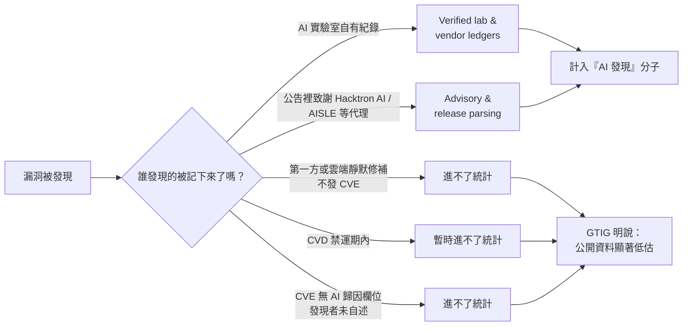
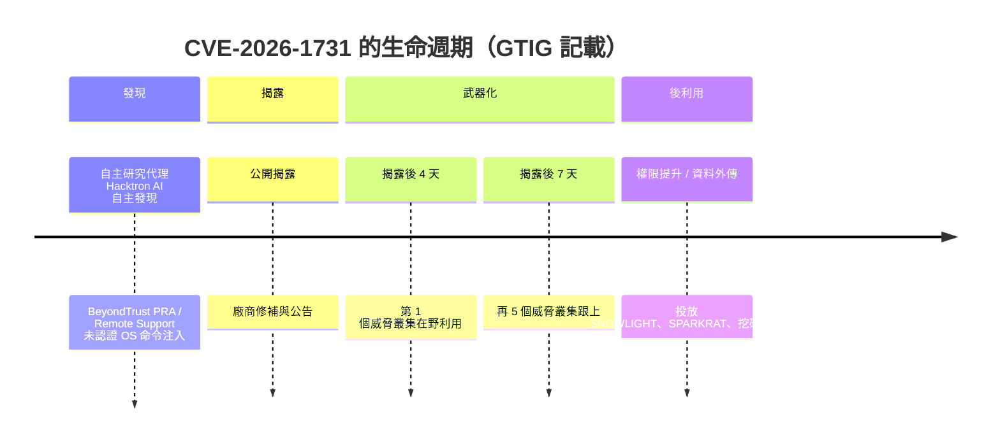

# Google Threat Intelligence Group《Vulnerability Discovery and Exploitation Trends in the AI Era》（2026 年 9 月）

> 課程模組：09 延伸研究 ｜ 來源類型：官方威脅報告 ｜ 原文：https://cloud.google.com/blog/topics/threat-intelligence/vulnerability-discovery-and-exploitation-trends-in-the-ai-era ｜ 整理日期：2026-10-05

> **本教材的資料層次標示規則**（沿用本模組慣例）：
> - **［GTIG］**＝這篇部落格長文原文可直接追溯的內容。本文無頁碼，以章節標題與圖號定位。凡標示「逐字」者，表示已向原文取回逐字句並比對。
> - **［Anthropic］**＝Anthropic《Detecting and countering misuse of AI: September 2026》PDF 原文，附頁碼。
> - **［外部］**＝第三方研究或媒體，附 URL 與日期，並註明「獨立查證」或「僅引述原報告」。
> - **［分析］**＝本教材作者的推論或教學詮釋，原文沒有明說，學員應視為可被挑戰的假設。

---

## 0. 先講清楚兩件事（這篇不是 AI Threat Tracker，以及它的證據類型與前幾期完全不同）

**第一，這篇不是季度 AI Threat Tracker。** GTIG 在 2026 年 9 月發了兩篇相關文章，本模組各做一份教材，不要混淆：

| 發布日 | 標題 | 性質 | 本模組教材 |
|---|---|---|---|
| 2026-09-09 | GTIG AI Threat Tracker: From Prompting to Autonomy | 季度**行為者**追蹤（誰在用 AI 做什麼） | [`gtig-2026-09-ai-threat-tracker.html`](gtig-2026-09-ai-threat-tracker.html) |
| **2026-09-30** | **Vulnerability Discovery and Exploitation Trends in the AI Era** | **漏洞生態的量化趨勢分析**（AI 讓漏洞世界的數字長什麼樣） | **本篇** |

**第二，證據類型換了。** AI Threat Tracker 的證據是「觀察到某個行為者做了某件事」，屬個案敘事；這一篇的證據是**漏洞揭露與在野利用的統計序列**，屬計量分析。兩者的判讀方法不同：個案敘事要問「這案例有多典型」，計量分析要問「分母是什麼、口徑有沒有變、成長是真實現象還是觀測能力提升」。本教材第 12 節會把這組問題全部套用到這篇身上，這也是本教材在課程裡最主要的教學功能。

> ［分析］這兩篇一起讀，剛好補上本課程一個長期缺口。模組 01 到 08 全部是個案（GTG-XXXXX），學員很容易養成「AI 濫用＝一串案例」的直覺。這一篇強迫學員面對一個不同的問題：**把所有個案抽掉，純粹看數字，AI 到底改變了什麼？** 答案比個案敘事保守得多，也更可檢驗。

---

## 1. 一頁速覽

1. **這是什麼**：Google Threat Intelligence Group（GTIG）2026-09-30 發布的長文，署名 **Robin Grunewald、Supriya Mazumdar、Kelli Vanderlee** 三位分析師。主題不是行為者，而是「AI 時代的漏洞揭露與利用趨勢」，監測窗口 **2025-01-01 到 2026-08-31**。［GTIG］

2. **最乾淨的單一數字**：每月漏洞揭露量在 2026 年內翻倍。逐字原文：「Vulnerability disclosures doubled from 5,045 in January 2026 to 10,477 in July, with the count of disclosed vulnerabilities reaching a peak of 10,740 in August (Figure 1).」［GTIG，逐字］

3. **在野利用也在漲，但分母漲得一樣快**：在野利用從 2025 年平均每月 10.5 件升到 2026 年每月 18 件，2026 年 1 至 8 月已錄得 **141** 件，超過 2025 全年的 **127** 件。但 Figure 6 的三個月滾動指數成長顯示，**揭露量成長 +128%、在野利用成長 +127%**，兩條線幾乎重合。［GTIG，逐字］

4. **AI 找到的漏洞，品質結構和人找的完全不同**（本篇最有教學價值的發現）：一般 CVE 揭露以低風險為主（69% Low、28% Medium），**AI 發現的漏洞把這個分布反轉過來**：58% 屬 Medium、低風險只剩 39%。更關鍵的是後果分布，逐字原文：「Exactly 50% of all AI-discovered vulnerabilities result in Remote Code Execution (RCE), compared to just 26% across the broader CVE ecosystem.」［GTIG，逐字］

5. **AI 系統自己就是一個 2,076 件規模的攻擊面**：監測窗口內 GTIG 追蹤到 **2,076** 件 AI 相關 CVE 揭露，其中 **1,500 件以上**集中在 2026 年 1 至 8 月，分布在八個架構層。**編排中介層（orchestration middleware）占全部 AI 相關漏洞的 50%，2026 年揭露量暴增 +347%。**［GTIG，逐字］

6. **n-day 轉換速度是真正變化的地方**：CVE-2026-1731（BeyondTrust PRA／Remote Support 未認證 OS 命令注入）由第三方自主研究代理 **Hacktron AI** 自主發現；公開揭露後**四天內** GTIG 就觀察到一個威脅叢集在利用，**七天內再有五個叢集**跟上。［GTIG，逐字］

7. **零日還沒被 AI 改寫，但有一個前兆案例**：GTIG 回顧 5 月那期報告，記載「the first known case of a threat actor in possession of a zero-day exploit script developed with generative AI」，該案在**行動規劃階段即被攔截**，從利用碼的結構特徵驗出高可信度的 LLM 生成痕跡。零日在野利用只從每月 8 件升到 11 件（+59%），是四項指標中漲幅最小的。［GTIG，逐字］

8. **GTIG 自己承認公開資料低估 AI 的貢獻**：原文明列四項限制（CVE 中繼資料沒有 AI 歸因欄位、第一方與雲端靜默修補不發 CVE、CVD 禁運期、因此公開資料顯著低估）。這段是本課程「單一來源情報紀律」的最佳正面示範，見第 8.3 節。［GTIG］

9. **這份研究在課程裡要教什麼**：教**怎麼讀一份計量威脅情報**。Anthropic 2026-09 報告給的是案例與 uplift 敘述，這篇給的是序列與占比。學員必須學會問：這個成長是現象變化還是口徑變化？「AI 發現的漏洞」這個分子是怎麼數出來的？兩條曲線同步上升，能不能推論因果？這些問題的答案，決定一個 CTI 團隊會不會把一份報告的數字直接寫進自己的風險評估。

---

## 2. 報告基本資料

| 項目 | 內容 | 出處 |
|---|---|---|
| 完整標題 | Vulnerability Discovery and Exploitation Trends in the AI Era | 頁面標題 |
| 機構 | Google Threat Intelligence Group（GTIG） | 署名 |
| 署名 | **Robin Grunewald、Supriya Mazumdar、Kelli Vanderlee**（具名，與 AI Threat Tracker 的團體署名不同） | 頁面 |
| 發布日期 | **2026-09-30** | 頁面 |
| 監測窗口 | **2025-01-01 至 2026-08-31** | 方法論段 |
| 形式 | Google Cloud 部落格長文（HTML），無頁碼、無 PDF 版 | 頁面 |
| 圖表 | **8 張 Figure**，無 Table | 全文 |
| IOC | **無**。全文沒有 IP、網域、雜湊；只有 CVE 編號與惡意程式族名 | 全文檢查 |
| 風險評等體系 | **GTIG Vulnerability Risk Ratings**，原文明示與 CVSS severity 不同 | 方法論段 |
| 資料來源類型 | 漏洞揭露編目 + GTIG 在野利用追蹤 + 「verified lab & vendor ledgers」+ 公告剖析（CISA 公告、MITRE 紀錄、廠商公報、對自主代理的明示致謝） | 方法論段 |
| 系列位置 | 與 2026-09-09 的 AI Threat Tracker 並行，多處回引 **May AI Threat Tracker** | 全文 |

### 2.1 「AI 發現的漏洞」這個分子是怎麼來的（方法論的關鍵一段）

這一節是全篇最重要、也最容易被跳過的部分。GTIG 把「某個漏洞是不是 AI 發現的」這件事，用兩條管道判定［GTIG］：

1. **Verified lab & vendor ledgers**：直接從前沿 AI 研究計畫的紀錄取得。
2. **Advisory & release parsing**：程式化監看 CISA 公告、MITRE 紀錄、廠商安全公報，以及**公告中對自主代理的明示致謝**。原文點名兩個被致謝的自主研究代理：**Hacktron AI** 與 **AISLE**。

> ［分析］這張流程圖是本教材給課堂的核心教具。它說明一件事：**「AI 發現的漏洞」這個分子，實質上是「發現者願意且有管道公開承認用了 AI」的子集合。** 而這個子集合正好偏向兩類主體：有公關誘因宣傳自家代理的 AI 安全新創（Hacktron AI、AISLE），以及流程規範的大廠。偏誤方向是**系統性的**，不是隨機的。第 4.3 節會說明，這個偏誤正好與 Anthropic 報告的偏誤方向相反，兩者併讀才能逼近真相。

---

## 3. 主要發現與案例逐一摘要

這篇以趨勢為主、個案為輔。先列趨勢，再列全文唯一兩個具名個案。

### 3.1 四項指標的成長總表（Figure 6，三個月滾動平均、以 2025-01 為 0% 基準）

| 指標 | 至 2026-08 的指數成長 | 判讀 |
|---|---|---|
| 整體 CVE 揭露量 | **+128%** | 分母 |
| High-Risk 漏洞揭露量 | **+241%**（排除 Linux／Oracle／TOTOLINK 三個異常來源後為 +128%） | **這一欄最需要小心，見下方說明** |
| 在野 CVE 利用 | **+127%** | 與分母幾乎同步 |
| 零日在野利用 | **+59%** | 四項中最低 |

**High-Risk 那一列的括號是整張表的重點。**［分析］原始數字 +241% 看起來像「高風險漏洞暴增」，但 GTIG 自己把三個供應商拆出來重算，結果掉回 +128%，與整體揭露量一致。換句話說：**高風險漏洞的「暴增」有一半以上來自三家廠商的集中揭露潮，不是生態的普遍變化。** GTIG 願意把這個拆解寫出來，等級很高；而任何只抄 +241% 不抄括號的二手報導，都會把這個發現講反。

三個異常來源的細節［GTIG］：

- **TOTOLINK（2026-04 至 05）**：消費級路由器固件，兩個月內 **75** 件 High-Risk。
- **Oracle 與 Linux（2026-06 至 08）**：僅 2026 年 8 月單月就 **128** 件 High-Risk，占該月 High-Risk 總量的 **37%**；集中在 Oracle WebLogic、Coherence 與 Linux kernel 網路驅動。
- High-Risk 揭露的基線從 2025 年中的每月約 65 件，升到 2026 年中的每月約 135 件；2026-01 的 131 件到 2026-08 的 350 件，成長 **167%**。2026 年 8 月 High-Risk 占全部揭露的 **3%**。

### 3.2 利用面的三個數字

［GTIG，逐字］

- 「From January 2026 to August 2026, GTIG recorded 141 distinct vulnerabilities disclosed and exploited, surpassing the total number of vulnerabilities exploited for the full year of 2025 (127).」
- 「In-the-wild exploitation increased from an average of 10.5 per month in 2025 to 18 per month in 2026.」
- 「The count of zero-days exploited increased marginally from an average of 8 per month in 2025 to an average of 11 per month in 2026.」零日數量「remained near baseline levels (between 8 and 12) through mid-2026」，但 **2026 年 8 月跳到 22 件**（Figure 4）。
- 零日占**全部已觀察在野利用漏洞**的 **62%**（2026-01 至 08）。
- High-Risk 漏洞的在野利用「more than doubled from 28 in 2025 to 75 from January 2026 to August 2026」。
- 整體而言，2026 年 1 至 8 月只有 **0.23%** 的已揭露漏洞被在野利用，約 **431 件中有 1 件**。

> 教學提示：第 4 點與第 6 點放在一起，是一組很好的辨析練習。「零日占在野利用的 62%」聽起來像「零日滿天飛」，但同一篇報告也說「零日每月只有 8 到 12 件」、「0.23% 的漏洞會被利用」。三個數字沒有矛盾，它們描述的是**三個不同的分母**（在野利用集合／時間／全部揭露）。讓學員自己畫出三個分母的關係圖，比任何講解都有效。

### 3.3 AI 發現的漏洞 vs 人發現的漏洞（Figure 7、Figure 8）

| 面向 | AI 發現 | 非 AI 發現 | 原文狀態 |
|---|---|---|---|
| Low Threat Risk | **39%** | **69%** | ［GTIG，逐字］ |
| Medium Threat Risk | **58%** | **28%** | ［GTIG，逐字］ |
| 後果為 Remote Code Execution | **50%** | **26%** | ［GTIG，逐字］ |
| 後果為 Information Disclosure | **8%** | **18%** | ［GTIG，逐字］ |
| 後果為 Data Manipulation | **5%** | **9%** | ［GTIG，逐字］ |

> **口徑提醒**：Low 39% + Medium 58% = 97%，餘下 3% 為更高評等；非 AI 側 69% + 28% = 97%，餘下 3% 同理。原文行文只逐字給出上述五組數字，**High Risk 一欄的確切占比本教材未能從行文取得逐字句**（圖中有該欄，但文字段落未複述），因此不在本表列出具體數值，僅記為「餘約 3%」。這一條就是第 12 節所說的「圖中數值與行文數值要分開記錄」原則的實例。

GTIG 對這組對比的解讀是，AI 代理「under-index in lower-impact categories」（在低衝擊類別上的占比偏低）。［GTIG，逐字］

> ［分析］這組數字有一個常被誤讀的方向。它**不**代表「AI 比人厲害」。它代表的是：**目前被公開記錄為 AI 發現的那些漏洞，是 AI 擅長的那一類。** 自動化代理擅長在大量程式碼裡追記憶體安全與命令注入這類有明確形狀的缺陷，而這類缺陷天生就容易導致 RCE；人類研究者則承擔了大量邏輯錯誤、權限設計瑕疵、資訊洩漏這些難以自動判定的工作。**這張圖量到的是「AI 的能力形狀」，不是「AI 的能力高度」。** 第 10.2 節把這點設計成討論題。

### 3.4 AI 系統本身的八層攻擊面（本篇第二大發現）

［GTIG］監測窗口內共 **2,076** 件 AI 相關 CVE，2026 年 1 至 8 月單獨超過 **1,500** 件，分布在八個架構層：

| 架構層 | 2026 年件數 | 主要攻擊向量 |
|---|---|---|
| **AI 編排與代理框架**（Orchestration & Agent Frameworks） | **782** | RCE、命令注入、經工作流序列化的 SSTI |
| AI 網頁應用與入口 | 230 | SSRF、Stored XSS、LFI |
| 推論與服務基礎設施 | 212 | 未認證 API、反序列化、記憶體損毀 |
| 模型安全公告 | 106 | prompt injection、系統提示外洩 |
| ML 框架與 Hub | 99 | 記憶體安全違規、任意檔案覆寫 |
| 前沿模型 | 97 | RCE、沙箱逃脫、隱密資料外傳 |
| MLOps 與實驗追蹤 | 39 | 檔案覆寫、未認證伺服器接管 |
| 向量資料庫與檢索 | 19 | 未認證集合操作、經外掛的 RCE |

「Orchestration middleware accounts for 50% of all AI-related flaws, experiencing a +347% surge in disclosures in 2026.」［GTIG，逐字］

**三個被點名的咽喉點**［GTIG］：

1. **代理編排層**：視覺化工作流建構器（原文點名 **Flowise**、**Langflow**），透過 prompt injection、精心構造的 workflow JSON，命中動態程式執行節點，造成未認證 RCE。
2. **集中式 AI 閘道**：雙層威脅。應用層是暴露的 API key 與含 PII 或原始碼的私有 prompt 串流；基礎設施層是資料庫憑證收割與雲端橫移。
3. **推論閘道**（2026 年 212 件）：其中 **24%** 源自未認證 API 或 SSRF，可繞過周邊防火牆、耗盡 GPU 算力、抽取模型 checkpoint。

**三件已在野被利用的 AI 基礎設施漏洞**［GTIG］：

| CVE | 產品 | 性質 | 狀態 |
|---|---|---|---|
| **CVE-2026-42271** | BerriAI **LiteLLM** | MCP 伺服器預覽端點 `POST /mcp-rest/test/connection` 的命令注入；可造成主機接管與 API 憑證竊取 | 在野利用中 |
| **CVE-2026-5027** | **Langflow** | `POST /api/v2/files` 上傳處理器的路徑穿越寫檔；可投放 cron job、SSH key | 在野利用中 |
| **CVE-2025-3248** | **Langflow** | `/api/v1/validate/code` 經 `exec()` 的未認證 Python 程式注入，立即 RCE | 在野利用中；已於 2025-05 列入 CISA KEV |

### 3.5 具名個案一：CVE-2026-1731（AI 發現的漏洞被最快速武器化的案例）

全文唯一有完整時間軸的個案。［GTIG，逐字］

- 「A notable case is CVE-2026-1731, an unauthenticated OS command injection flaw in BeyondTrust Privileged Remote Access (PRA) and Remote Support that was discovered autonomously by a third-party research agent (Hacktron AI).」
- 「Following public disclosure, GTIG observed threat actors weaponize this vulnerability in targeted initial-access campaigns to bypass enterprise perimeters.」
- 「More specifically, within four days of public disclosure, GTIG observed a threat cluster exploiting this vulnerability, followed by five additional threat clusters within seven days of public disclosure.」
- 後利用行為包含權限提升、資料外傳，以及投放次級酬載，點名 **SNOWLIGHT**、**SPARKRAT** 與挖礦程式。

> ［分析］這個案例是本篇的論證樞紐，但它證明的事情和直覺相反。被 AI 加速的不是**攻擊方的發現**，而是**防守方的發現**：漏洞是由一個防禦取向的自主研究代理找出來並走正常揭露流程的。攻擊方做的是老事情，**把一個公開的 n-day 在四天內轉成初始存取**。所以這一案的真正教訓是：**當 AI 把防禦側的漏洞發現速率拉高，而企業修補窗口仍是 30 到 60 天時，AI 的淨效果可能是擴大而不是縮小暴露面。** 這個張力在第 4.4 節會與 Anthropic 的「零日鑄造廠」並排處理，也是整個模組 09 目前最值得上課辯論的一題。

### 3.6 具名個案二：以生成式 AI 開發的零日利用腳本（回引 5 月報告）

［GTIG，逐字］「In other research, such as our May AI Threat Tracker, we reported the first known case of a threat actor in possession of a zero-day exploit script developed with generative AI.」「While intercepted during operational planning before in-the-wild execution, analysis of the exploit's structural artifacts revealed high-confidence LLM generation markers.」

三點要讀出來［分析］：

1. **這是回引，不是本期新案**。原案在 [`gtig-2026-05-ai-threat-tracker.html`](gtig-2026-05-ai-threat-tracker.html)。引用時務必標明一手出處是 5 月那期。
2. **「持有」不等於「使用」**。原文用 in possession of，並明說在行動規劃階段被攔截、未在野執行。
3. **歸因方法本身值得教**：GTIG 的依據是「利用碼結構特徵中的高可信度 LLM 生成痕跡」。這是一種**文物歸因**（artifact attribution），不是觀察到行為者在和模型對話。它的證據強度與 Anthropic 直接持有對話紀錄的強度不同，教學時要分開。

### 3.7 GTIG 的展望與防禦建議

［GTIG］GTIG 預期漏洞發現與利用在短中期將繼續上升。防禦建議五條：

1. **現代化漏洞分級與修補**：從無優先序的大規模修補，轉向以威脅情報驅動的分級，結合針對性的邊界防護與自動化、代理化的修補。
2. **AI 輔助的漏洞管理**：原文引述 Mandiant 的實施藍圖，目標是壓縮對手的時間線。
3. **主動的內部 AI 程式碼審查**：在上線前先跑 AI 強化的程式碼審查，原文點名 **CodeMender**（已整合進 Google AI Threat Defense）。
4. **立即的圍堵策略**：把自主代理工作負載沙箱化、實施風險導向的漏洞管理、守住「新的 AI 邊界」。
5. **把上線前審查做成標準實務**：原文指出，若上線前的 AI 程式碼審查成為標準，**公開漏洞揭露率反而可能下降**。

> ［分析］第 5 條是整篇最有意思的一句，也是一個預先埋好的統計陷阱警告。如果上線前審查變成標準，大量漏洞會在發 CVE 之前就被修掉，**於是「漏洞揭露量」這個指標會下降，而真實的程式碼安全其實是改善了**。任何把「CVE 揭露量」當成安全狀況代理指標的儀表板，在那一天都會給出完全相反的訊號。這一點值得寫進任何組織的 KPI 設計檢查表。

---

## 4. 與 Anthropic 2026-09 報告的對照

本節是本模組的核心。本篇與 Anthropic 報告的主題只部分重疊：Anthropic 報告沒有漏洞生態的計量章節，GTIG 這篇沒有行為者案例清單。所以對照的方式不是逐案配對，而是**逐個主張配對**，並特別標出兩份報告觀測位置不同所造成的系統性差異。

### 4.1 總對照表

| GTIG 本篇的主張 | Anthropic 2026-09 的對應內容 | 關係 | 教學重點 |
|---|---|---|---|
| AI 發現的漏洞 50% 導致 RCE，遠高於生態基線 26% | 報告沒有同類統計。最接近的是 Appendix A 的武器化 skills 清單與各案的 uplift 敘述 | **互補，無衝突** | 一邊是能力的「形狀」（計量），一邊是能力的「用途」（個案）。對應教材：[`../01-cyber/00-cyber-trends-and-skills.html`](../01-cyber/00-cyber-trends-and-skills.html) |
| 編排與代理框架占 AI 相關漏洞的 50%，+347% | GTG-50020：財務動機行為者在**評測沙箱**裡用 prompt injection 竊取金鑰，目標是 AI 產業本身 | **強烈一致** | GTIG 給出「AI 基礎設施是攻擊面」的分母，Anthropic 給出分子上的具體一案。對應教材：[`../01-cyber/GTG-50020-ai-supply-chain.html`](../01-cyber/GTG-50020-ai-supply-chain.html) |
| 尚未看到 AI 在野自主發現並利用零日；唯一相關案例是「持有 AI 開發的利用腳本」且被提前攔截 | **GTG-10007**：中國學生級行為者運行 agent swarm 與「自主零日鑄造廠」 | **表面相左，實為觀測位置差異** | 見 4.4，本模組目前最重要的一組對照 |
| n-day 武器化四天內發生，企業修補窗口 30 到 60 天 | 全報告的 Prevailing trends（p38 起）強調「複雜度脫鉤」與速度 uplift | **一致，且本篇提供了可量化的版本** | 對應教材：[`../shared/01-cross-cutting-analysis.html`](../shared/01-cross-cutting-analysis.html) |
| 公開資料顯著低估 AI 發現的漏洞，並逐項列出低估原因 | Anthropic 報告的對應限制是「只看得到 Claude 上的對話」 | **兩份報告的偏誤方向相反** | 見 4.3 |
| 沒有任何 IOC | Anthropic 每案都有 Indicators of compromise 表 | **相異** | 見 4.5 |
| 蒸餾 | **本篇完全沒有提到蒸餾** | **沒有對應** | 蒸餾的跨平台對照請看 [`gtig-2026-02-ai-threat-tracker.html`](gtig-2026-02-ai-threat-tracker.html) 與 [`../07-distillation/00-distillation-intro-and-mitigations.html`](../07-distillation/00-distillation-intro-and-mitigations.html) |
| 影響力行動、監控、生物、常規武器、詐騙 | Anthropic 報告各有專章 | **沒有對應**，本篇是純網路漏洞主題 | 明說沒有，避免學員以為 GTIG 否認那些領域 |

### 4.2 Anthropic 報告裡「複雜度脫鉤」的計量版本

Anthropic 2026-09 報告貫穿全文的第一主線是**複雜度脫鉤**：行為者的技術水準與其行動的複雜度不再相關（最清楚的例子是 GTG-50029，一名法語 hacktivist 打出國家級規模，以及 GTG-10007 的學生級行為者）。［Anthropic］

GTIG 本篇沒有用這個詞，但它的數字給了同一現象的另一半證據［分析］：

- 若複雜度脫鉤成立，則**可用的高衝擊漏洞供給**會成為行動規模的主要限制，而不是行為者的技能。
- GTIG 量到的正是這個供給在擴張：高風險漏洞揭露基線一年內從每月約 65 件升到約 135 件，而 AI 發現的那一批有 50% 導致 RCE。
- 同時，武器化窗口壓到四天。

把三者接起來：**脫鉤之所以可能，是因為「現成的高衝擊 n-day」這個公共池變大了、刷新變快了。** 行為者不需要自己有能力找零日，只需要有能力在四天內把公開資訊轉成可用利用碼，而這件事正是 LLM 擅長的。［分析］這條推論鏈兩份報告都沒有明說，請當成可被挑戰的假設在課堂上辯論。

### 4.3 兩份報告的偏誤方向正好相反（本節方法論核心）

| | Anthropic 2026-09 | GTIG 本篇 |
|---|---|---|
| 觀測位置 | **模型側**：Claude 上的對話與 API 流量 | **生態側**：公開 CVE 編目 + 在野利用追蹤 |
| 看得見什麼 | 行為者**意圖**與**過程**（逐字 prompt、重新提示、被拒絕後怎麼繞） | 漏洞的**結果**與**時間**（揭露量、風險等級、利用延遲） |
| 看不見什麼 | 其他平台、開源權重模型、本機模型、沒有對話痕跡的活動 | 意圖、對話、未發 CVE 的修補、禁運期內的發現、未自述使用 AI 的研究者 |
| 低估的方向 | 低估**不在 Claude 上發生**的濫用 | 低估**AI 的實際貢獻**（GTIG 自己明說） |
| 高估的風險 | 可能把「在 Claude 上看到的」誤當成「整個生態的樣貌」 | 可能把「有公關誘因宣布用了 AI 的那批」誤當成「AI 發現的全部」 |

> 教學提示：這張表建議當成模組 09 的通用教具，不只用在這一篇。每次新增一份延伸研究教材，都可以要求學員填一次這五列。填過三次以上，學員就會自動對任何一份威脅情報報告先問「你站在哪裡看」。共用規範見[證據與方法](../shared/04-evidence-and-methods.html)。

### 4.4 「有沒有在野的全自主零日能力」：兩家第三次給出不同答案

這是模組 09 目前最重要的一組對照，而且已經是第三次出現。

| 來源 | 時間 | 主張 |
|---|---|---|
| GTIG AI Threat Tracker | 2026-09-09 | 「GTIG has not yet observed threat actors deploying fully autonomous pipelines against targets in the wild」 |
| **GTIG 本篇** | **2026-09-30** | 零日在野利用僅 +59%，是四項指標中最低；唯一的 AI 零日案例是「持有」且被提前攔截 |
| Anthropic 2026-09 | 2026-09-10 | GTG-10007 運行 13 個「no human in the loop」常駐蒐集代理與自主零日鑄造廠［Anthropic］ |

三點判讀［分析］：

1. **GTIG 本篇的數字支持 GTIG 自己 9 月 9 日的判斷，但那不構成獨立佐證。** 同一機構、同一資料基礎的兩篇文章互相一致，只是內部一致，不增加證據強度。這一點必須對學員講清楚，否則很容易被「兩篇 GTIG 都這麼說」誤導。
2. **兩家可以同時為真。** GTIG 看生態的在野利用統計，Anthropic 看自家平台上的代理行為。一個行為者可以在 Claude 上運行自主代理（Anthropic 看得到），而其成果尚未轉化成 GTIG 統計得到的新零日在野利用（GTIG 看不到，因為還沒發生或還沒被歸因）。**「自主運行」與「成功產出在野零日」是兩件事。**
3. **本篇提供了一個可檢驗的預測。** 如果 Anthropic 的零日鑄造廠真的開始量產，那麼 GTIG 的「零日每月件數」與「零日指數成長」這兩條線應該在後續幾期出現明顯偏離。**這是模組 09 第一個可以用公開數據事後驗證的預測**，建議課程把它列為追蹤項目，每季回來看一次。

對應教材：[`../01-cyber/GTG-10007-exploit-foundry.html`](../01-cyber/GTG-10007-exploit-foundry.html)、[`gtig-2026-09-ai-threat-tracker.html`](gtig-2026-09-ai-threat-tracker.html)。

### 4.5 為什麼本篇完全沒有 IOC（而 Anthropic 每案都有）

［分析］這不是疏漏，是文體決定的。本篇的分析單位是 **CVE 與統計序列**，不是行動；CVE 編號本身就是比 IP 或網域穩定得多的指標。這給課堂一個實用結論：**不同文體的威脅情報，可操作產出完全不同**。本篇的可操作產出是「把 CVE-2026-42271、CVE-2026-5027、CVE-2025-3248 加進 AI 基礎設施的資產盤點與修補優先序」，而不是「把一批網域丟進封鎖清單」。IOC 的對照慣例見[證據與方法](../shared/04-evidence-and-methods.html)。

### 4.6 與本模組既有教材的銜接

- [`mandiant-2026-08-agentic-vulnerability-discovery.html`](mandiant-2026-08-agentic-vulnerability-discovery.html)：防禦側 agentic 程式碼審查。本篇的 CodeMender 建議與那份是同一條線，本篇補上了「為什麼要做」的量化理由。
- [`hacktron-2026-09-openai-libheif-rce.html`](hacktron-2026-09-openai-libheif-rce.html)：**Hacktron AI 在本篇被 GTIG 當成資料來源之一具名引用**（CVE-2026-1731 的發現者、以及 AI 歸因管道的致謝對象）。本模組因此出現一個難得的閉環：既有該代理自己寫的技術報告，也有 Google 把它當成生態統計輸入的視角。這組對照很適合用來討論「AI 安全新創的自我揭露，在生態統計裡扮演什麼角色、帶進什麼偏誤」。
- [`gtig-2026-05-ai-threat-tracker.html`](gtig-2026-05-ai-threat-tracker.html)：AI 開發的零日利用腳本一案的一手出處。
- [`ncsc-2025-05-ai-cyber-threat-2027.html`](ncsc-2025-05-ai-cyber-threat-2027.html)：NCSC 2025-05 以機率語言預測 AI 對漏洞研究的影響。本篇的數字可以當成對那份預測的部分事後檢核，建議兩份並讀。

---

## 5. TTP 與 MITRE ATT&CK 對應

本篇不是行動敘事，可對應的 ATT&CK 技術有限，但「AI 基礎設施被在野利用」那一段有明確的技術落點。

| 戰術 | 技術 ID | 本報告的具體作法 | 偵測構想（**均為未實測假說**） |
|---|---|---|---|
| Reconnaissance | T1595.002 Active Scanning: Vulnerability Scanning | 揭露後四天內對 CVE-2026-1731 的大規模掃描與初始存取嘗試 | 對外露管理介面（PRA／Remote Support 類）的 URI 路徑做新 CVE 揭露後 72 小時的基線偏移告警。**合法反例**：自家資安團隊與外部紅隊在同一窗口內的驗證掃描；供應商的修補驗證工具 |
| Initial Access | T1190 Exploit Public-Facing Application | BeyondTrust PRA 未認證命令注入；LiteLLM MCP 端點命令注入；Langflow 路徑穿越與 `exec()` 注入 | 在 AI 基礎設施前置代理層監看 `POST /mcp-rest/test/connection`、`POST /api/v2/files`、`/api/v1/validate/code` 的呼叫者分布；非 CI／非管理網段的呼叫為高訊號。**遙測需求**：AI 閘道的完整 HTTP 存取日誌，多數組織目前沒有 |
| Execution | T1059 Command and Scripting Interpreter | 編排層動態程式執行節點被 workflow JSON 觸發 | Flowise／Langflow 類服務的子行程建立事件；工作流定義檔的雜湊變更監控 |
| Persistence | T1053.003 Scheduled Task/Job: Cron | Langflow 路徑穿越寫入 cron job、SSH key | 對 AI 服務執行身分可寫路徑的檔案建立事件做白名單化 |
| Privilege Escalation / Exfiltration | T1068、T1041 | CVE-2026-1731 後利用的權限提升與資料外傳 | 既有 EDR 覆蓋，非本篇特有 |
| Resource Development | T1588.006 Obtain Capabilities: Vulnerabilities | 行為者持有以生成式 AI 開發的零日利用腳本 | 無端點遙測可偵測；屬情報蒐集範疇 |
| Credential Access | T1552.001 Unsecured Credentials: Credentials In Files | AI 閘道暴露 API key；私有 prompt 串流含憑證與原始碼 | prompt 串流的憑證字串偵測（需在閘道側做，且有隱私取捨） |
| Impact | T1496 Resource Hijacking | 推論閘道被用於耗盡 GPU 算力；CVE-2026-1731 後投放挖礦程式 | GPU 配額與推論請求量的時序異常 |
| **框架缺口** | **無對應** | **「自主研究代理發現漏洞」**（無論攻防）在 ATT&CK 裡沒有位置。ATT&CK 描述對手行為，而本篇最核心的現象之一是**防禦側自動化改變了漏洞供給的速率**，這不是對手行為 | 標示為缺口。ATLAS 涵蓋對 AI 系統的攻擊，但同樣不涵蓋「AI 作為漏洞發現者」這個生態角色 |
| **框架缺口** | **無對應** | **n-day 武器化延遲**本身是一個指標，不是一個技術 | 建議以組織自有的「揭露到偵測到第一次嘗試」中位數作為自訂度量，不要硬塞進 ATT&CK |

> 本表所有偵測構想均為**未經實測的假說**，附遙測需求與合法反例，不宣稱低誤報或可直接部署。評估規範見[證據與方法](../shared/04-evidence-and-methods.html)。

---

## 6. 圖表判讀

本篇共 8 張 Figure，全部是 GTIG 自有資料的統計圖，無流程圖、無截圖。以下逐張判讀。**本教材不下載圖檔、不嵌圖**，以下為文字描述；圖說為原文逐字。

| 圖 | 原文圖說（逐字） | 類型與圖上元素 | 核心訊息 | 課堂用法 |
|---|---|---|---|---|
| **Figure 1** | Count of vulnerabilities disclosed, January 2025 - August 2026 (Source: GTIG) | 月度折線或柱狀，橫軸 20 個月，縱軸件數。可辨識的錨點：2026-01 的 5,045、2026-07 的 10,477、2026-08 的峰值 10,740 | 分母在 2026 年內翻倍 | 開場圖。先只給這張，問學員「這張圖能不能證明 AI 讓漏洞變多」，答案是不能，因為沒有歸因資訊 |
| **Figure 2** | Count of vulnerabilities disclosed by GTIG vulnerability risk rating, January 2025 - August 2026 (Source: GTIG) | 堆疊式，分 Low／Medium／High（原文另提及 Critical 評等存在） | High-Risk 從 2026-01 的 131 件升到 2026-08 的 350 件 | 搭配 Figure 3 使用，單獨看會得出錯誤結論 |
| **Figure 3** | Count of vulnerabilities High Risk disclosed by Vendor, January 2025 to August 2026 (Source: GTIG) | 依供應商分解的 High-Risk 揭露量 | **TOTOLINK（2026-04 至 05，75 件）與 Oracle／Linux（2026-06 至 08，8 月單月 128 件、占該月 37%）兩個尖峰，解釋了 Figure 2 的大部分成長** | **本篇最重要的一張圖**。它是對 Figure 2 的反證。教學流程：先看 Figure 2 讓學員下結論，再給 Figure 3 讓他們自己推翻 |
| **Figure 4** | Count of all vulnerabilities exploited, by n-days and zero-days, January 2025 to August 2026 (Source: GTIG) | 分 n-day 與零日兩序列 | 零日維持每月 8 到 12 件的基線，**2026-08 跳到 22 件**；零日占全部在野利用的 62% | 單點跳升的判讀練習：一個月的 22 件是趨勢反轉還是雜訊？在只有一個資料點時，正確答案是「不知道，列入追蹤」 |
| **Figure 5** | Count of vulnerabilities exploited in the wild by GTIG vulnerability risk rating, January 2025 - August 2026 (Source: GTIG) | 在野利用依風險等級分層 | High-Risk 在野利用從 2025 的 28 件增至 2026 年 1 至 8 月的 75 件 | 與 Figure 2 併看：揭露端與利用端的風險結構是否同步惡化 |
| **Figure 6** | 3 Month Rolling Average of % Growth, Indexed to 0% at January 2025 (Source: GTIG) | 四條指數化成長曲線 | 揭露 +128%、High-Risk +241%（排除三異常源後 +128%）、在野利用 +127%、零日 +59% | **方法論教學的主力圖**。重點是「指數化」與「三個月滾動」兩個處理對曲線形狀的影響，以及為什麼一定要看括號裡的調整值 |
| **Figure 7** | Share of vulnerabilities per exploitation consequence - AI vs. Non AI discovery (Source: GTIG) | 分組占比柱狀，AI 與非 AI 兩組，依後果分類 | RCE 50% vs 26%；Information Disclosure 8% vs 18%；Data Manipulation 5% vs 9% | 「能力形狀 vs 能力高度」的辨析題，見 3.3 節的分析 |
| **Figure 8** | Share of vulnerabilities per exploitation consequence - AI vs. Non AI discovery (Source: GTIG) | 依風險等級的占比：AI 側 Medium 58%、Low 39%；非 AI 側 Low 69%、Medium 28% | AI 發現的漏洞風險分布相對基線反轉 | 與 Figure 7 併看 |

> **一個必須記錄的原文瑕疵**：本教材取回的 Figure 8 圖說與 Figure 7 **完全相同**（「Share of vulnerabilities per exploitation consequence - AI vs. Non AI discovery」），但兩張圖的內容不同（Figure 7 是後果分布，Figure 8 是風險等級分布）。這**應為原文的圖說錯誤**。［分析］遇到這種情形的正確處理是：照抄原文圖說、另外註明實際內容、不自行「修正」成看起來合理的版本。這本身就是一個很好的教學點，見第 10.2 節討論題。

---

## 7. IOC 與技術指標

**本篇沒有公開任何傳統 IOC**：全文無 IP、無網域、無檔案雜湊、無帳號。這與 Anthropic 2026-09 報告每案附 Indicators of compromise 表的做法形成對比（見 4.5 節）。

可操作的技術指標只有以下兩類，均為公開編目資訊，**無需也不應對任何指標連線查詢**：

### 7.1 CVE 編號

| 指標 | 類型 | 產品 | 偵測價值與壽命 |
|---|---|---|---|
| CVE-2026-1731 | CVE | BeyondTrust PRA / Remote Support | **高、壽命長**。揭露後 7 天內已有 6 個叢集利用；只要仍有未修補實例曝露在外，掃描與利用嘗試會持續多年。資產盤點價值高於即時告警價值 |
| CVE-2026-42271 | CVE | BerriAI LiteLLM（MCP 伺服器預覽端點） | **高、壽命長**。AI 閘道類元件的修補節奏普遍落後於傳統 IT 資產 |
| CVE-2026-5027 | CVE | Langflow（`POST /api/v2/files`） | **高、壽命長**。同上 |
| CVE-2025-3248 | CVE | Langflow（`/api/v1/validate/code`） | **高**。已於 2025-05 列入 CISA KEV，意味著聯邦機關已強制修補期限屆滿，仍在野利用代表長尾實例眾多 |

### 7.2 惡意程式族名

| 指標 | 類型 | 脈絡 | 偵測價值與壽命 |
|---|---|---|---|
| SNOWLIGHT | 惡意程式族名 | CVE-2026-1731 的次級酬載 | **中**。族名可用於情報關聯與既有簽章比對，但本篇未給雜湊，無法直接做偵測規則 |
| SPARKRAT | 惡意程式族名 | 同上 | **中**。公開工具，常見於多個行為者，單憑族名的歸因價值低 |
| 挖礦程式（未具名） | 類別 | 同上 | 低 |

### 7.3 可監看的端點路徑（來自原文對漏洞的描述）

以下三個 URI 路徑取自原文對漏洞位置的敘述，**屬產品端點而非攻擊者基礎設施**，可直接用於自家 AI 基礎設施的存取日誌審視：`POST /mcp-rest/test/connection`（LiteLLM）、`POST /api/v2/files`（Langflow）、`/api/v1/validate/code`（Langflow）。對應的偵測假說見第 5 節，所有假說均未實測。

---

## 8. 該機構的偵測、處置與防線缺口

### 8.1 做了什麼

本篇是分析產品，不是處置報告，GTIG 在本篇沒有宣告任何帳號停權或法律行動（對比 AI Threat Tracker 每期都有處置段落）。GTIG 在本篇的「作為」是三件事：建立並維護 AI 歸因管道、把 Mandiant 的 AI 輔助漏洞管理藍圖與 CodeMender 推為建議實務、以及公開自身方法論的限制。

### 8.2 怎麼偵測

兩條 AI 歸因管道（lab/vendor ledgers 與 advisory parsing）已在 2.1 節拆解。在野利用的偵測基礎未在本篇詳述，推定沿用 GTIG 既有的在野利用追蹤體系（Mandiant 事件回應 + Google 自家遙測 + 公開情報），但**本篇沒有明說，不應代為補充**。

### 8.3 哪裡失效或未揭露（以及一個正面示範）

**GTIG 自己列出的四項限制**［GTIG］：

1. CVE 中繼資料沒有標準化的 AI 歸因欄位。
2. 第一方與雲端的靜默修補不指派 CVE。
3. 協同漏洞揭露（CVD）窗口內的發現被禁運。
4. 因此，**公開資料顯著低估 AI 發現的漏洞數量**。

> ［分析］**這是本課程目前收錄的所有報告中，對自身資料限制交代得最完整的一份。** 它不只說「資料可能不完整」，而是逐條說明不完整的**機制**，並指出偏誤的**方向**（低估，不是隨機誤差）。把這四條與 Anthropic 2026-09 報告的限制段落並排，可以教學員辨認「有誠意的限制聲明」與「免責聲明式的限制聲明」的差別：前者讓讀者能自行調整結論，後者只是免責。本課程的[證據與方法](../shared/04-evidence-and-methods.html)把這一條列為共用判讀標準。

**本教材額外指出的未揭露項目**［分析］：

1. **「AI 發現」的定義邊界沒有說清楚**。完全自主的代理（如 Hacktron AI）與「研究者用 LLM 輔助」是否同列？這會大幅影響分子。原文未界定。
2. **在野利用的歸因方法沒有在本篇交代**，無法評估 141 件這個數字的口徑是否與 2025 年的 127 件一致。若口徑在期間內變動，成長率就不可比。
3. **「High-Risk」與 CVSS 的換算關係未公開**，GTIG Vulnerability Risk Ratings 是專有評等，外部無法重現 Figure 2 與 Figure 5。
4. **Figure 8 圖說錯誤**（見第 6 節），屬編輯層面瑕疵，不影響數據，但影響可引用性。

---

## 9. 第三方驗證與外部來源

| # | 來源 | URL | 日期 | 性質 | 內容與差異 |
|---|---|---|---|---|---|
| 1 | **Google Threat Intelligence Group（原報告）** | cloud.google.com/blog/topics/threat-intelligence/vulnerability-discovery-and-exploitation-trends-in-the-ai-era | 2026-09-30 | **一手** | 本教材所有數字的唯一來源 |
| 2 | **Help Net Security** | helpnetsecurity.com/2026/10/01/google-ai-discovered-vulnerabilities-remote-code-execution/ | 2026-10-01 | **僅引述原報告** | 標題強調「AI 找到的漏洞正是攻擊者想要的那些」。未發現獨立取材 |
| 3 | **Industrial Cyber** | industrialcyber.co（GTIG 漏洞發現報導） | 2026-10 | **僅引述原報告** | 把焦點放在關鍵基礎設施的攻擊面。未發現獨立取材 |
| 4 | **Mandiant《Staying Ahead of Adversarial AI Through Agentic Source Code Review》** | cloud.google.com/blog/topics/threat-intelligence/staying-ahead-of-adversarial-ai-through-agentic-source-code-review | 2026-08-18 | **同集團、非獨立** | 本篇建議第 2 條引述的藍圖出處。**Mandiant 屬 Google Cloud，與 GTIG 同集團，不構成獨立佐證**。本模組教材：[`mandiant-2026-08-agentic-vulnerability-discovery.html`](mandiant-2026-08-agentic-vulnerability-discovery.html) |
| 5 | **Hacktron AI《Hacking OpenAI》** | hacktron.ai/blog/hacking-openai | 2026-09-13 | **部分獨立** | Hacktron AI 是本篇的資料來源之一（CVE-2026-1731 發現者）。該公司自述其代理能力，屬**自我揭露**，與 GTIG 的引用方向相同，不構成對 GTIG 統計的獨立驗證。本模組教材：[`hacktron-2026-09-openai-libheif-rce.html`](hacktron-2026-09-openai-libheif-rce.html) |
| 6 | **CISA KEV 目錄** | cisa.gov（Known Exploited Vulnerabilities Catalog） | 2025-05（CVE-2025-3248 收錄） | **獨立編目** | 可獨立佐證 CVE-2025-3248 的在野利用事實。**但官方編目不自動構成獨立鑑識**，它記錄的是「有可信證據顯示被利用」，不是 GTIG 的具體觀察 |

**單一來源情報判定**：本篇的**統計主體是單一來源情報**。所有月度序列、占比與成長率都只有 GTIG 一家的資料，外部無法重現（專有評等體系 + 未公開的歸因清單）。唯一可外部獨立佐證的是個別 CVE 的在野利用事實（透過 CISA KEV 等編目）與 CVE 本身的存在。**教學時必須明確告知學員：引用本篇的任何百分比，都是在引用一家公司的內部度量。**

---

## 10. 課程教學設計

### 10.1 核心教學要點

1. **計量情報與個案情報要用不同的方法讀。** 個案問「多典型」，計量問「分母、口徑、歸因」。本篇與模組 01 的 GTG 案例並排教，是建立這個雙軌習慣最有效的方式。
2. **Figure 2 到 Figure 3 的推翻練習是本篇最高價值的 15 分鐘。** 先給 Figure 2 的 High-Risk +241%，讓學員下結論；再給 Figure 3 的供應商分解與排除後的 +128%。這個經驗比任何「要小心統計」的口頭提醒都有效。
3. **「AI 發現的漏洞 50% 是 RCE」測量的是能力形狀，不是能力高度。** 這是本篇最容易被誤引的數字，必須在課堂上明確拆解。
4. **AI 基礎設施自己就是攻擊面，而且編排層占一半。** 782 件編排與代理框架漏洞這個數字，對任何正在導入 AI 代理的組織都是直接的資產盤點指示。
5. **防禦側 AI 加速漏洞發現，在修補窗口不變的前提下，可能擴大而非縮小暴露面。** CVE-2026-1731 的四天對上 30 到 60 天，是這個張力最乾淨的例子。
6. **GTIG 的限制聲明是正面教材。** 用它來定義「什麼叫合格的限制聲明」。
7. **兩份同期報告對「在野全自主能力」給出不同答案，而且可以同時為真。** 觀測位置決定看得見什麼。

### 10.2 課堂討論題

1. **「AI 發現的漏洞有 50% 導致 RCE，一般漏洞只有 26%」這句話，可不可以用來主張「AI 比人類研究者更擅長找漏洞」？** 如果不行，要再補哪些資料才能回答原來那個問題？（提示：分子的選取偏誤、漏洞類型的可自動化程度、人類研究者未自述使用 AI 的比例。）
2. **GTIG 建議「上線前的 AI 程式碼審查成為標準實務，公開漏洞揭露率可能下降」。** 如果你的組織用「每季 CVE 揭露數」當成產品安全的 KPI，這件事會怎麼誤導你？請設計一個不會被這個效應污染的替代指標。
3. **本篇的 Figure 8 圖說與 Figure 7 相同，顯然是原文錯誤。** 作為引用者，你應該照抄錯誤圖說、自行更正、還是只引用內容不引用圖說？請說明你的選擇在什麼情況下會出問題。（這題沒有標準答案，爭點在「可追溯性」與「可讀性」的取捨。）
4. **GTIG 說「尚未在野觀察到全自主管線」，Anthropic 說 GTG-10007 運行 13 個無人在迴圈的常駐代理。** 如果你是台灣某部會的 CTI 分析官，必須在一頁情資裡同時交代這兩件事，你會怎麼寫？不准選邊，也不准含糊帶過。
5. **本篇的統計完全無法被外部重現**（專有風險評等 + 未公開的 AI 歸因清單）。在這個前提下，把本篇的百分比寫進自家年度風險評估報告，是可接受的實務還是不可接受的？如果可接受，需要附上什麼樣的限定語？
6. **CVE-2026-1731 是防禦取向的自主代理找出來的，卻在四天內被攻擊方利用。** 這是否構成「反對公開漏洞揭露」或「反對 AI 輔助漏洞研究」的論據？請同時論證正反兩面。

### 10.3 桌面演練建議（可在教室安全執行，不教攻擊操作）

**演練一：AI 資產盤點（60 分鐘，分組）**

情境：學員所屬組織正在導入 AI 代理工作流。依本篇的八層架構表，請各組列出自家組織在每一層**可能**存在的元件（例如編排層是否有 Flowise、Langflow、n8n、自建工作流引擎；推論層是否有 vLLM、LiteLLM、Ollama；是否有 MCP 伺服器）。接著依本篇的件數分布為每一層評定優先序，產出一頁的「AI 基礎設施修補優先序建議」。**不連線、不掃描任何系統，純文件盤點。**

**演練二：Figure 2 到 Figure 3 的推翻練習（30 分鐘，全班）**

講師先只呈現 High-Risk 揭露量從 131 件升到 350 件（+167%）與指數成長 +241%，要求各組在五分鐘內寫下一句新聞標題與一句風險評估結論。接著公布 Figure 3 的供應商分解與排除後的 +128%，要求各組修改自己的結論，並說明原來那句標題錯在哪裡。

**演練三：武器化時鐘（45 分鐘，分組）**

以 CVE-2026-1731 的時間軸為範本，各組用自家組織**真實的流程時間**（不是理想值）排出一條時間軸：CVE 公告發布 → 內部知悉 → 資產確認 → 變更審批 → 修補完成。對照本篇的「四天」，標出自家流程裡最長的那一段，並提出一個可以在不增加人力的前提下縮短它的做法。**本演練不涉及任何漏洞利用內容。**

**演練四：限制聲明評分（30 分鐘，個人）**

發給學員三份報告的限制段落（本篇、Anthropic 2026-09、任選一份其他報告），要求依四個標準評分：是否說明不完整的機制、是否指出偏誤方向、是否可讓讀者自行調整結論、是否只是免責。評分結果全班比對。

### 10.4 對台灣的意涵

1. **TOTOLINK 的尖峰打中台灣常見的消費級網通裝機基礎。** 本篇記載 TOTOLINK 在 2026 年 4 至 5 月兩個月內出現 75 件 High-Risk 固件漏洞。TOTOLINK 是在台灣零售與中小企業市場常見的消費級路由器品牌（**原文未交代該品牌的公司歸屬與國別，本教材亦未查證，不在此推斷**）；這一類裝置的共同特徵是裝機量高、固件更新率低、生命週期結束後仍長期在線。本篇沒有討論這些漏洞的在野利用情形，**但本課程[`../03-surveillance/GTG-30004-30005-30006-osint-recon.html`](../03-surveillance/GTG-30004-30005-30006-osint-recon.html)記載的伊朗關聯案例，正是以工控與網通設備 CVE 清單為蒐集目標**。兩者併讀，對台灣的訊息很明確：**國產網通固件的漏洞揭露潮，是境外行為者的現成目標清單。** 建議 TWCERT／CC 與相關廠商把「AI 輔助漏洞發現造成的揭露潮」納入協同揭露的量能規劃。
2. **AI 基礎設施的資產盤點在台灣普遍還沒開始。** 本篇的 782 件編排層漏洞，對照數位發展部[`moda-2026-01-public-sector-ai-playbook.html`](moda-2026-01-public-sector-ai-playbook.html)的公部門 AI 導入指引，缺口很清楚：導入指引著重於採購、治理與資料保護，對「AI 編排中介層本身是一個需要納管的資產類別」著墨有限。建議公部門 AI 專案的資安驗收項目，明確列入 MCP 伺服器、推論閘道與工作流引擎的版本盤點與修補責任歸屬。
3. **四天對上 30 到 60 天，這個差距在公部門更大。** 台灣公部門與關鍵基礎設施的變更管理流程普遍比商業組織更長。本篇的武器化窗口數字，是一個可以用來支持「對外露管理介面建立例外加速修補通道」的量化論據。
4. **引用紀律的提醒。** 本篇的數字會在接下來幾個月被大量引用進台灣的資安簡報與媒體報導。本教材建議的實務是：引用 +241% 時**必須同時引用括號裡的 +128%**，引用「50% RCE」時**必須說明這是 AI 發現漏洞的內部占比，不是與人類的能力比較**。這兩條是本篇最容易被誤用的地方。

---

## 11. 關鍵原文引文

以下七條為向原文取回的逐字句，附繁中翻譯與出處段落。

1. 「Vulnerability disclosures doubled from 5,045 in January 2026 to 10,477 in July, with the count of disclosed vulnerabilities reaching a peak of 10,740 in August (Figure 1).」
   漏洞揭露量翻倍，從 2026 年 1 月的 5,045 件到 7 月的 10,477 件，8 月的已揭露漏洞數達到 10,740 件的峰值（Figure 1）。
   ［出處：揭露趨勢段］

2. 「From January 2026 to August 2026, GTIG recorded 141 distinct vulnerabilities disclosed and exploited, surpassing the total number of vulnerabilities exploited for the full year of 2025 (127).」
   2026 年 1 月至 8 月，GTIG 記錄到 141 件既被揭露又被利用的個別漏洞，超過 2025 全年被利用的漏洞總數（127 件）。
   ［出處：在野利用段］

3. 「Zero-day exploitation also continues to represent a very small proportion of all vulnerabilities disclosed, though it still constitutes the majority (62%) of all observed exploited vulnerabilities from January 2026 to August 2026.」
   零日利用在全部已揭露漏洞中仍只占極小比例，不過在 2026 年 1 月至 8 月所有已觀察到的被利用漏洞中，它仍構成多數（62%）。
   ［出處：零日段］

4. 「In contrast, AI-discovered vulnerabilities invert this distribution: 58% qualify for Medium Threat Risk (more than double the baseline), while low-risk findings drop to 39%.」
   相對地，AI 發現的漏洞把這個分布反轉：58% 達到 Medium Threat Risk（超過基線的兩倍），而低風險發現降至 39%。
   ［出處：AI vs 非 AI 發現段，對應 Figure 8］

5. 「Exactly 50% of all AI-discovered vulnerabilities result in Remote Code Execution (RCE), compared to just 26% across the broader CVE ecosystem.」
   AI 發現的全部漏洞中，正好 50% 的後果是遠端程式碼執行（RCE），相較之下更廣泛的 CVE 生態只有 26%。
   ［出處：AI vs 非 AI 發現段，對應 Figure 7］

6. 「Orchestration middleware accounts for 50% of all AI-related flaws, experiencing a +347% surge in disclosures in 2026.」
   編排中介層占全部 AI 相關缺陷的 50%，2026 年揭露量暴增 +347%。
   ［出處：AI 攻擊面段］

7. 「More specifically, within four days of public disclosure, GTIG observed a threat cluster exploiting this vulnerability, followed by five additional threat clusters within seven days of public disclosure.」
   更具體地說，在公開揭露後四天內，GTIG 觀察到一個威脅叢集在利用這個漏洞，接著在公開揭露後七天內又有五個額外的威脅叢集跟上。
   ［出處：CVE-2026-1731 段］

8. 「While intercepted during operational planning before in-the-wild execution, analysis of the exploit's structural artifacts revealed high-confidence LLM generation markers.」
   儘管該利用碼在野執行之前、於行動規劃階段即被攔截，對其結構性文物的分析顯示出高可信度的 LLM 生成標記。
   ［出處：回引 May AI Threat Tracker 段］

---

## 12. 未能驗證之處與研究限制

### 12.1 核對範圍（分開記錄，不整篇標成已查證）

| 項目 | 日期 |
|---|---|
| 來源發布日 | 2026-09-30 |
| 原文觀察期間 | 2025-01-01 至 2026-08-31 |
| 本教材加入日 | 2026-10-05 |
| 本次逐字複核的段落 | 第 11 節八條引文、第 3.1 至 3.5 節的全部數字、Figure 1 至 8 的圖說。複核方式為向原文取回逐字句並與本教材文字比對 |
| **未逐字複核的段落** | 第 2.1 節方法論的四項限制敘述（取自摘要式取回，未取回逐字句）、第 3.4 節八層表的「主要攻擊向量」欄（同上）、第 3.7 節五條建議的細節措辭（同上） |

### 12.2 本教材的取得方式限制（必須告知審核者）

**本教材是透過網頁取回工具讀取原文的，不是人工逐字通讀全篇。** 具體影響：

1. **可能遺漏原文段落**。若原文有本教材未涵蓋的小節，本教材不會知道。
2. **圖中數值與行文數值已分開處理**。凡本教材標為「逐字」者，已取回逐字句；凡只來自圖表描述者（例如 Figure 2 的 Critical 評等是否存在、Figure 8 的 High Risk 欄確切占比），本教材明確標示未取得逐字句，並未填入具體數值。這是本模組對「圖表揭露」紅線的保守處理。
3. **建議的人工複核優先序**：（a）第 3.3 節的五組占比，（b）第 3.4 節八層表的件數，（c）第 3.1 節 Figure 6 的四個指數成長值與括號調整值。這三處是本教材最可能被外部引用、也最需要精確的部分。

### 12.3 原文本身的限制（GTIG 自述與本教材補充）

GTIG 自述四項已列於 8.3 節。本教材補充四項未揭露項目，亦見 8.3 節：「AI 發現」定義邊界未界定、在野利用歸因方法未交代、專有風險評等無法外部重現、Figure 8 圖說錯誤。

### 12.4 本教材明確無法回答的問題

1. **本篇的成長曲線有多少來自真實現象、多少來自觀測能力提升？** 無法判斷。GTIG 未公開其追蹤能量在期間內是否擴編。
2. **TOTOLINK 那 75 件 High-Risk 固件漏洞的在野利用情形如何？** 原文未寫。本教材第 10.4 節關於台灣網通供應鏈的推論，建立在「漏洞存在且更新率低」這個一般性前提上，**不是**原文的主張，屬［分析］。
3. **CVE-2026-1731 的六個威脅叢集是誰？** 原文未歸屬，只給了後利用行為與酬載族名。
4. **被 AI 發現的漏洞中，有多少是攻擊方的 AI 發現的？** 原文的「AI-discovered」資料來源（實驗室紀錄、公告致謝）結構上只涵蓋**防禦與研究取向**的 AI 發現。攻擊方 AI 發現的漏洞不會出現在這個分子裡。**這是本篇最大的結構性盲區，而原文沒有明說這一點。**［分析］
5. **本篇與 Anthropic 報告的時間窗是否可比？** GTIG 為 2025-01 至 2026-08，Anthropic 為 2025-12 至 2026-08。重疊區間是 2025-12 至 2026-08，做跨報告比較時應限制在這個區間。

### 12.5 第三方與原文的不一致

本次未發現第三方報導與原文的實質數字衝突。第 9 節表列的三家媒體與產業網站均為引述，未見獨立取材或相異數字。**若後續發現第三方引用 +241% 而未附括號調整值的情形，應視為引用瑕疵而非資料衝突**，處理原則以原文為準。
