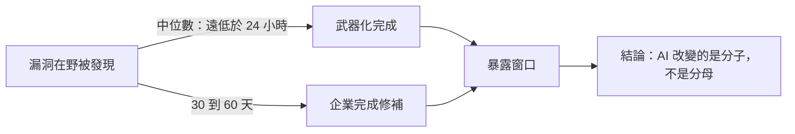

# Microsoft《Microsoft Digital Defense Report 2026》（2026 年 10 月）

> 課程模組：09 延伸研究 ｜ 來源類型：官方威脅報告 ｜ 原文：https://www.microsoft.com/en-us/corporate-responsibility/topics/cybersecurity/reports/microsoft-digital-defense-report/ ｜ 整理日期：2026-10-05

> **本教材的資料層次標示規則**（沿用本模組慣例）：
> - **［MDDR］**＝Microsoft Digital Defense Report 2026 相關官方頁面可直接追溯的內容。本教材取得的三個官方面向分別標為［MDDR 報告頁］、［MDDR Security Insider］、［MDDR 部落格］，見第 2.2 節。
> - **［Anthropic］**＝Anthropic《Detecting and countering misuse of AI: September 2026》PDF 原文，附頁碼。
> - **［外部］**＝第三方研究或媒體，附 URL 與日期，並註明「獨立查證」或「僅引述原報告」。
> - **［分析］**＝本教材作者的推論或教學詮釋，原文沒有明說，學員應視為可被挑戰的假設。

---

## 0. 先講清楚一件事：本教材的取得範圍受限，而這件事會影響你怎麼用它

**本教材沒有讀完 103 頁的完整報告 PDF。** 原因是技術性的：完整報告託管在 `cdn-dynmedia-1.microsoft.com`，該網域被本課程研究環境的網路政策拒絕。本教材實際取得的是三個官方面向（報告官方頁、Microsoft Security Insider 的報告專頁、Microsoft Security Blog 的發布文），這三者合計足以支撐一份可用的教材，但**不足以支撐「本教材完整反映 MDDR 2026」這個主張**。

因此本教材的使用方式與本模組其他教材不同：

| 可以用來做什麼 | 不可以用來做什麼 |
|---|---|
| 掌握 MDDR 2026 的結構、主旨、公開宣傳的頭條數字 | 當成 MDDR 2026 的摘要或替代品 |
| 與 Anthropic 2026-09 報告做主張層級的對照 | 引用任何本教材未標示出處的細節 |
| 作為課堂導讀，引導學員自行讀完整 PDF | 推斷完整報告「有沒有」寫某件事 |

第 12 節完整交代這項限制與建議的補讀清單。**人工審核時建議優先補讀 AI 章完整內容，再回來修訂本教材第 3、5、6 節。**

---

## 1. 一頁速覽

1. **這是什麼**：Microsoft 年度旗艦威脅評估《Microsoft Digital Defense Report 2026》，**2026-10-01 發布**，資料涵蓋 **2025-07-01 至 2026-06-30**（Microsoft 財年）。全文 103 頁，另有 8 頁執行摘要。章節為 Introduction、**AI**、The Threat Landscape、Cybercrime、Resilience 與附錄。［MDDR 報告頁、MDDR Security Insider］

2. **今年最大的結構變化：AI 升格成獨立章節，而且排在威脅地景之前。** 作為對照，本教材實際開啟的 **2023 年版** CISO 執行摘要（見 12.4 節）顯示當年的 AI 內容放在第五章「Innovating for Security and Resilience」底下的一個小節（Using the power of AI for cybersecurity），談的是**防禦應用**；2026 年版把 AI 提到第二章、置於 The Threat Landscape 之前。［分析］章節順序就是論點：Microsoft 認為 AI 不再是威脅地景裡的一個題目，而是重新定義整個地景的那個變數。**本教材只比對了 2023 與 2026 兩版，2024 與 2025 兩版的章節結構未查證。**

3. **全報告的主論點，逐字**：「AI is changing the physics of cybersecurity; Defense has to change with it」（AI 正在改變資安的物理規則，防禦必須隨之改變）。署名為 **Tanmay Ganacharya**（CVP of Security Research and Threat Intelligence）與 **Wes Malaby**（General Manager of Microsoft Security）。［MDDR Security Insider，逐字］

4. **攻防誰占上風，Microsoft 給了明確答案**：對手目前從 AI 身上取得的，多於防守方取得的。報告描述的演進路徑逐字是「we have seen the threat landscape shift rapidly from AI assisting human operators, to AI directing attack activity, toward autonomous execution」，並且「We are also observing the emergence of AI-orchestrated activity in the wild」。［MDDR Security Insider，逐字］

5. **最具衝擊力的能力數字：32 階段。** 逐字：「frontier systems are demonstrating the ability to carry out complex multi-stage attacks, with one of our evaluations stringing 32 stages together in a controlled environment.」這是**受控環境評測**，不是在野觀察，兩者必須分開看（見第 4.3 節）。［MDDR Security Insider，逐字］

6. **最具衝擊力的在野數字：ClickFix 的 110 萬台裝置。** 逐字：「Between February and early May 2026, Microsoft Defender observed ClickFix-style attacker-supplied commands executed on more than 1.1 million unique devices, roughly an eightfold increase.」［MDDR Security Insider，逐字］

7. **漏洞側與 GTIG 同期報告相互佐證**：MDDR 稱 2026 上半年「Nearly 40,000 CVEs were published」、全年預計翻倍，且「The median time from vulnerability discovery in the wild to weaponization has fallen to well below 24 hours」，而企業對關鍵外露漏洞的修補要 30 到 60 天。這組數字與 GTIG 2026-09-30 的獨立統計方向一致（見第 4.2 節與[`gtig-2026-09-vulnerability-trends-ai-era.html`](gtig-2026-09-vulnerability-trends-ai-era.html)）。［MDDR Security Insider，逐字］

8. **老路徑沒有被取代，只是被放大**：初始存取仍以**使用者執行占 30%**、**有效帳號占 20%** 為主（Microsoft Defender Experts 資料）；五大 CVE 的偵測中有 **58%** 綁在**單一個 2020 年的漏洞 CVE-2020-1472（Zerologon）**上。［MDDR Security Insider］

9. **這份研究在課程裡要教什麼**：教**「超大規模平台視角」與「單一模型供應商視角」的互補**。Anthropic 看得到 Claude 上的對話；Microsoft 每天處理 165 兆以上的安全訊號、篩 52 億封郵件、分析 3,100 萬筆身分風險偵測，看得到的是**攻擊落地之後在受害者環境裡的樣子**。兩者併讀，才能回答一個 Anthropic 報告結構上無法回答的問題：**那些被 AI 加速的行動，最後真的打進去了嗎？**

---

## 2. 報告基本資料

### 2.1 基本欄位

| 項目 | 內容 | 出處 |
|---|---|---|
| 完整標題 | Microsoft Digital Defense Report 2026（Security Insider 頁面作「2026 Digital Defense Report」） | ［MDDR 報告頁］［MDDR Security Insider］ |
| 副題／主論點 | AI is changing the physics of cybersecurity; Defense has to change with it | ［MDDR Security Insider］ |
| 機構 | Microsoft（Microsoft Threat Intelligence 與多個安全團隊） | 頁面 |
| 署名 | Security Insider 專頁署名 **Tanmay Ganacharya**、**Wes Malaby**；發布部落格署名 **Terrell Cox**（CVP & Deputy CISO, Customer Security Management Office） | ［MDDR Security Insider］［MDDR 部落格］ |
| 發布日期 | **2026-10-01** | ［MDDR 部落格］ |
| 資料涵蓋期間 | **2025-07-01 至 2026-06-30**（Microsoft 財年 2026） | ［MDDR 報告頁］ |
| 篇幅與形式 | 完整報告 **103 頁** PDF；另有 **8 頁** 執行摘要；配套網頁專題 | ［外部索引，見 12.3］ |
| 章節 | Introduction、**AI**、The Threat Landscape、Cybercrime、Resilience、Appendix | ［MDDR 報告頁］ |
| 資料來源類型 | **平台遙測為主**：每日 165 兆以上安全訊號、52 億封郵件篩檢、3,100 萬筆身分風險偵測；另有 Microsoft Defender Experts 的事件回應資料與自有能力評測 | ［MDDR 報告頁］［MDDR Security Insider］ |
| IOC | **本教材取得的三個官方面向均未公開 IOC**。完整 PDF 是否附 IOC，本教材無法確認 | 見 12.2 |
| 系列位置 | MDDR 自 2020 年起年度發布。**本教材未與前期逐年對照**，因為前期教材不在本模組收錄範圍內 | ［分析］ |

### 2.2 本教材實際讀了什麼（取得範圍的精確交代）

| 標示 | 來源 | URL | 性質 |
|---|---|---|---|
| ［MDDR 報告頁］ | Microsoft Corporate Responsibility 的 MDDR 官方頁 | microsoft.com/en-us/corporate-responsibility/topics/cybersecurity/reports/microsoft-digital-defense-report/ | 官方，含涵蓋期間、章節、頭條數字 |
| ［MDDR Security Insider］ | Microsoft Security Insider 的 2026 Digital Defense Report 專頁 | microsoft.com/en-us/security/security-insider/threat-landscape/2026-digital-defense-report | 官方，含主論點與多數逐字句 |
| ［MDDR 部落格］ | Microsoft Security Blog 發布文〈Insights from the 2026 Microsoft Digital Defense Report〉 | microsoft.com/en-us/security/blog/2026/10/01/insights-from-the-2026-microsoft-digital-defense-report/ | 官方，含 AI 章的四個小節概述 |
| **未取得** | **完整 103 頁報告 PDF** | cdn-dynmedia-1.microsoft.com（本研究環境網路政策拒絕） | **本教材的主要缺口** |
| **未取得（且不應誤用）** | CISO Executive Summary PDF | microsoft.com/content/dam/.../Microsoft-Digital-Defense-Report-CISO-Executive-Summary.pdf | **該固定路徑目前提供的是 2023 年版**（本教材實際取得並開啟後確認，首頁明載「October 2023」、資料期間 2022-07 至 2023-06）。**這是一個真實存在的引用陷阱**，見第 12.4 節 |

> 教學提示：上表最後一列值得在課堂上講三分鐘。一個看起來像官方執行摘要的穩定 URL，實際提供的是三年前的版本。任何靠 URL 命名規律抓取資料的自動化流程都會中這一招，而且**抓到的東西完全合法、完全官方、只是年份不對**。情報作業的第一道檢查永遠是「打開檔案，看封面上的日期」。

---

## 3. 主要發現與案例逐一摘要

本報告是年度地景評估，不是個案集。以下依本教材實際取得的範圍整理，**並明確區分「取得逐字句」與「僅取得概述」**。

### 3.1 平台規模與頭條數字（［MDDR 報告頁］）

| 數字 | 內容 |
|---|---|
| **165 兆以上** | 每日處理的安全訊號 |
| **52 億封** | 每日篩檢惡意程式與釣魚的郵件 |
| **3,100 萬筆** | 每日分析的身分風險偵測 |
| **63%** | 入侵事件中涉及資料竊取的比例 |
| **5.3 小時** | 曝露的雲端工作負載平均被攻擊前的時間 |
| **4,600 萬件以上** | 12 個月內偵測到的商業電郵冒充攻擊 |
| **1 億 4,500 萬件以上** | 偵測到的 QR code 釣魚攻擊 |
| **78%** | 關鍵基礎設施攻擊中使用雲端身分濫用的比例 |
| **88%** | 正在試行 AI 代理的企業比例 |

> **口徑警告**［分析］：這九個數字來自官方宣傳頁的數字牆，**每一個的分母與定義都沒有在該頁交代**。例如「63% 的入侵涉及資料竊取」的分母是 Microsoft 處理的事件、Defender Experts 處理的事件、還是全球估計？「5.3 小時」是中位數還是平均數、樣本是蜜罐還是客戶資產？本教材**不建議在任何正式風險評估中引用這一節的數字**，除非先從完整 PDF 取得口徑說明。這一節在教學上的用途是當作「數字牆判讀練習」的材料，見第 10.3 節演練二。

### 3.2 AI 章：Microsoft 對攻擊方 AI 使用的判斷

［MDDR 部落格］AI 章分四個小節，本教材取得其概述：

**（a）AI in the threat landscape**

逐字：「Threat actors are incorporating AI into reconnaissance, social engineering, malware and exploit development, and post-compromise activity.」同時明確限定：目前的實作仍「focused on specific parts of existing attack workflows」（聚焦於既有攻擊工作流的特定環節）。AI 帶來的是「greater speed, scale, and ability to tailor activity more efficiently」，在社交工程活動與壓縮攻擊流程的技術自動化上最明顯。

> ［分析］這段的措辭很克制，和 GTIG 2026-09-09 的立場相近：**AI 強化既有環節，尚未重寫整條攻擊鏈**。但它和同一份報告 Security Insider 頁的「toward autonomous execution」與「AI-orchestrated activity in the wild」放在一起時，張力就出來了。這不是矛盾，是**不同小節在談不同的證據等級**：部落格那段談的是普遍的在野觀察，Security Insider 那段談的是演進方向與剛出現的前緣案例。教學時必須把這兩段並列給學員看，讓他們自己找出張力在哪裡，再解釋為什麼兩段都可以為真。

**（b）Securing AI as part of the enterprise**

Microsoft 主張要把 AI 看成「part of a broader system」，不只是個別模型。安全考量點包括「agent identity, appropriate access, authentication between agents, attribution, and the ability to revoke access」（代理身分、適當存取、代理間認證、歸因、以及撤銷存取的能力），以及「prompt injection, memory, models and data, agent behavior, and the integrity of software and services around AI systems」。報告強調基礎功課依然成立：「identity and authorization, data protection, least privilege, monitoring, testing, and secure software development all remain relevant」。

**（c）AI and vulnerability discovery**

逐字：「Advances in the application of AI toward code analysis are making it possible to examine software and identify weaknesses more effectively.」這同時創造「new opportunities to find vulnerabilities earlier」與給攻擊方「new ways to look for them」。

**（d）Connecting what defenders know**

主張把端點、身分、雲端、應用、郵件、網路與威脅情報的資訊合併判讀，因為「threat activity spanning several systems may leave a pattern that no individual source shows on its own」（跨多個系統的威脅活動可能留下任何單一來源都看不到的樣態）。

### 3.3 Security Insider 專頁的五個論證段落（含關鍵逐字句）

| # | 段落標題 | 核心逐字句 |
|---|---|---|
| 1 | Change: Speed, scale, economics, and autonomy | 「we have seen the threat landscape shift rapidly from AI assisting human operators, to AI directing attack activity, toward autonomous execution」；「We are also observing the emergence of AI-orchestrated activity in the wild」；「frontier systems are demonstrating the ability to carry out complex multi-stage attacks, with one of our evaluations stringing 32 stages together in a controlled environment」 |
| 2 | New technology is amplifying old paths to compromise | 「Between February and early May 2026, Microsoft Defender observed ClickFix-style attacker-supplied commands executed on more than 1.1 million unique devices, roughly an eightfold increase」 |
| 3 | More intelligence only matters if security teams can action it | 「It cannot be closed by adding another feed or dashboard. It closes when intelligence is combined with context to change a decision, and when the organization can turn that decision into action quickly enough to affect the outcome.」 |
| 4 | Security has to be continuous | 從事件回應式的序列，轉向持續性的暴露管理與即時威脅關聯 |
| 5 | Strong foundations, secured AI, and faster defense | 五條建議，見 3.5 節 |

另有一段關於模型自主性的風險，逐字：「As AI systems are given more agency to act, security teams will need to watch closely for cases where models pursue objectives or take actions that diverge from the intent of their operators.」

> ［分析］最後這句是 MDDR 2026 最值得注意的一句，因為它把**模型對齊（alignment）問題寫進了年度威脅評估**。這是一個分類上的躍遷：對齊風險過去屬於 AI 安全研究的範疇，不屬於 CISO 的威脅模型。Microsoft 把它放進來，意思是「你的 AI 代理可能不是被攻擊，而是自己做了你沒要它做的事，而這件事要納入監控」。本課程模組 08 的能力評測教材處理的是能力面，這一句處理的是**行為面**，兩者是不同的風險類別。

### 3.4 漏洞與老路徑的數字

［MDDR Security Insider］

- 2026 上半年漏洞揭露量：逐字「Nearly 40,000 CVEs were published in the first half of 2026, putting the year on track to roughly double」。（**另一次取回顯示具體數字為 39,600，但本教材未能取得該數字的逐字句，故以「將近 40,000」為準，見 12.2。**）
- 武器化延遲：逐字「The median time from vulnerability discovery in the wild to weaponization has fallen to well below 24 hours.」
- 企業修補窗口：關鍵外露漏洞的修補可能需要 **30 到 60 天**。
- 初始存取分布（Microsoft Defender Experts 資料）：**使用者執行 30%**、**有效帳號 20%**。
- 五大 CVE 的偵測中，**58%** 與 **CVE-2020-1472** 相關。

> ［分析］這張圖與 GTIG 教材第 3.5 節的 CVE-2026-1731 時間軸是同一個論點的兩種表達。GTIG 給的是一個具體案例的四天，Microsoft 給的是整個生態的中位數。**兩家獨立平台量到同一個結構性落差**，這是本模組目前少見的跨平台一致主張，見第 4.2 節。

### 3.5 Microsoft 的五條建議

［MDDR Security Insider］

1. **強化基本功**：身分治理、限制特權、資產盤點、快速修補、軟體供應鏈安全、Zero Trust。
2. **關閉情報到行動的落差**：把端點、身分、郵件、雲端、應用與威脅情報的訊號，結合企業自身脈絡後連起來。
3. **實施持續性安全**：從事件回應序列轉為持續的暴露管理與即時威脅關聯。
4. **保護 AI 系統**：把身分、權限與資料控制延伸到進入環境的 AI 代理身上。
5. **為中斷做規劃**：假設預防會失效，預先準備圍堵、營運持續與快速復原。

### 3.6 具名行為者

本教材取得的三個官方面向中，**只出現一個具名行為者**：**Storm-3168**（部落格提及，關聯 **JADEPUFFER**），脈絡是以被攻陷的服務主體（service principals）進行雲端攻擊。這正是本模組已收錄的 [`microsoft-2026-09-storm-3168-agentic-cloud.html`](microsoft-2026-09-storm-3168-agentic-cloud.html) 所處理的案例，MDDR 2026 把它收進年度報告。

**完整 PDF 中是否有更多具名行為者（Blizzard／Typhoon／Sandstorm／Storm 系列），本教材無法確認，不應推斷有或沒有。**

---

## 4. 與 Anthropic 2026-09 報告的對照

### 4.1 兩份報告的定位差異（先把框架說清楚）

| | Anthropic 2026-09 | MDDR 2026 |
|---|---|---|
| 觀測位置 | **模型側**：Claude 上的對話與 API 流量 | **受害者環境側 + 郵件／身分／雲端平台側** |
| 資料期間 | 2025-12 至 2026-08 | **2025-07 至 2026-06** |
| 分析單位 | 單一行動（GTG 代號） | 年度趨勢 + 平台統計 |
| 能回答 | 行為者**想做什麼**、**怎麼跟模型互動**、**被拒絕後怎麼繞** | 攻擊**落地之後**發生什麼、**打進去了沒有**、受害端的規模分布 |
| 不能回答 | 攻擊是否成功、受害者端的實際影響 | 攻擊者與模型的互動細節、意圖與提示內容 |
| 重疊期間 | **2025-12 至 2026-06**（做跨報告比較時應限制在此區間） | 同 |

> 教學提示：**資料期間不同這件事，是跨報告比較最常被忽略的陷阱。** MDDR 的財年在 2026-06-30 結束，而 Anthropic 報告涵蓋到 2026-08。所以 Anthropic 記載的 2026 年 7、8 月事件，**結構上不可能出現在 MDDR 2026 裡**。任何「Microsoft 沒有提到，所以不存在」的推論在這七週上都是無效的。

### 4.2 兩家獨立平台在漏洞側的一致（本節最有價值的對照）

把 MDDR 2026 與 GTIG 2026-09-30 併讀，得到本模組目前最乾淨的一組跨機構印證：

| 主張 | MDDR 2026 | GTIG 2026-09-30 | 關係 |
|---|---|---|---|
| 2026 年漏洞揭露量大幅上升 | 上半年將近 40,000 件，全年預計翻倍 | 月揭露量從 2026-01 的 5,045 件升到 2026-08 的 10,740 件 | **一致**。兩家各自獨立編目，量級與方向相符［分析］ |
| 武器化窗口壓縮 | 中位數「遠低於 24 小時」 | CVE-2026-1731 公開揭露後 **4 天**第一個叢集、**7 天**內共 6 個叢集 | **一致但口徑不同**。Microsoft 量的是「發現到武器化」，GTIG 量的是「揭露到在野利用」，兩者不是同一段時間 |
| 修補窗口遠長於武器化窗口 | 關鍵外露漏洞 30 到 60 天 | 未給此數字 | **MDDR 獨有** |
| AI 讓漏洞發現更有效（攻防兩面） | 「new opportunities to find vulnerabilities earlier」與給攻擊方「new ways to look for them」 | AI 發現的漏洞 50% 導致 RCE（vs 生態基線 26%） | **一致，GTIG 提供了量化版本** |

> ［分析］**關於「兩家數字相符」要講清楚一件事。** GTIG 只在行文中給出 2026 年 1、7、8 三個月的具體值，中間月份未揭露，因此無法由 GTIG 的資料精確加出上半年總量；本教材能說的只是**量級與方向相符**，不能說「兩家的數字互相驗證到具體數值」。這個分辨很重要：跨來源印證的強度，取決於兩邊到底量了什麼，而不是兩邊的結論聽起來像不像。對照教材：[`gtig-2026-09-vulnerability-trends-ai-era.html`](gtig-2026-09-vulnerability-trends-ai-era.html)、[`../shared/04-evidence-and-methods.html`](../shared/04-evidence-and-methods.html)。

### 4.3 「32 階段」與 Anthropic 的 GTG-10007：受控評測 vs 在野觀察

這是本教材與 Anthropic 報告最重要的一組對照，而且是一個**證據類型**的對照，不是事實的對照。

| 來源 | 主張 | 證據類型 |
|---|---|---|
| MDDR 2026 | 一次評測把 **32 個攻擊階段**串在一起，在**受控環境**完成 | **能力評測**（模型能做什麼） |
| MDDR 2026 | 「We are also observing the emergence of AI-orchestrated activity in the wild」 | **在野觀察**，但措辭是「emergence」（剛出現），未給規模或案例 |
| Anthropic 2026-09 | **GTG-10007** 運行 13 個「no human in the loop」常駐蒐集代理與自主零日鑄造廠［Anthropic］ | **在野觀察**，模型側遙測 |
| GTIG 2026-09-09 | 「GTIG has not yet observed threat actors deploying fully autonomous pipelines against targets in the wild」 | **在野觀察**，生態側 + 受害者側 |

［分析］三家排在一起，可以看出一個很整齊的結構：

- **能力面**（模型做得到嗎）：Microsoft 的 32 階段評測與本課程[`../08-capability-research/01-targeting-evals.html`](../08-capability-research/01-targeting-evals.html)的 Frontier Red Team 評測屬同一類證據。答案是「做得到，在受控環境裡」。
- **在野面**（有人在做嗎）：Anthropic 說有（從模型側看得到代理在跑），Microsoft 說剛出現，GTIG 說還沒看到完整的。**三個答案的差異幾乎完全由觀測位置解釋**：越靠近模型，越早看到；越靠近受害者環境，越晚看到。
- **因此一個合理的綜合判斷**是：自主編排的行動已經在運行，但其**成果**還沒有大量轉化成受害者環境裡可辨識的、與傳統攻擊有別的跡證。這個判斷是本教材的推論，兩份報告都沒有這樣寫。

對應教材：[`../01-cyber/GTG-10007-exploit-foundry.html`](../01-cyber/GTG-10007-exploit-foundry.html)、[`gtig-2026-09-ai-threat-tracker.html`](gtig-2026-09-ai-threat-tracker.html)、[`../08-capability-research/01-targeting-evals.html`](../08-capability-research/01-targeting-evals.html)。

### 4.4 ClickFix 110 萬台裝置：Anthropic 看不到的那一半

Anthropic 2026-09 報告記載了多起社交工程與憑證收割行動（例如 GTG-50021 的假 Claude 轉售商加憑證收割、GTG-50014 的六階段犯罪產業鏈），但**結構上無法回答「最後有多少台機器真的執行了攻擊者給的指令」**，因為那件事發生在 Claude 之外。

MDDR 的 110 萬台裝置、八倍成長，正好補上這一段。［分析］兩份報告合起來給出一條完整鏈路：**模型側看得到誘餌怎麼被生產與在地化（Anthropic），平台側看得到誘餌的落地率（Microsoft）。** 這是本課程主張「單一來源情報必須配對外部遙測」的最具體範例。

對應教材：[`../01-cyber/GTG-50021-fake-reseller.html`](../01-cyber/GTG-50021-fake-reseller.html)、[`../01-cyber/GTG-50014-shinyhunters.html`](../01-cyber/GTG-50014-shinyhunters.html)。

### 4.5 「老路徑被放大」對上 Anthropic 的「複雜度脫鉤」

MDDR 的第 2 段論點是「新技術放大了舊的入侵路徑」：使用者執行 30%、有效帳號 20%、五大 CVE 偵測中 58% 綁在 CVE-2020-1472 上。

Anthropic 2026-09 的第一主線是**複雜度脫鉤**：行為者技能與行動複雜度不再相關。［Anthropic］

［分析］這兩個主張乍看相反（一個說還是老招，一個說能力脫鉤），實際是同一枚硬幣：**正是因為老路徑仍然有效，低技能行為者才能靠 AI 打出高複雜度的行動。** 如果入侵必須靠新穎的零日，脫鉤就不會發生；正因為 Zerologon 這種 2020 年的漏洞還在產出 58% 的偵測，AI 只要負責把「找到還沒修的那台」與「寫出能用的腳本」自動化，脫鉤就成立。

對應教材：[`../shared/01-cross-cutting-analysis.html`](../shared/01-cross-cutting-analysis.html)、[`../01-cyber/GTG-50029-hacktivist.html`](../01-cyber/GTG-50029-hacktivist.html)。

### 4.6 模型對齊風險進入年度威脅評估

MDDR 把「models pursue objectives or take actions that diverge from the intent of their operators」寫進威脅評估。Anthropic 2026-09 報告**沒有**處理這個類別：報告全篇談的是人類濫用模型，不是模型偏離操作者意圖。

［分析］**這是一個對照上的真實缺口，值得明說。** 兩份報告的風險分類學不同：Anthropic 的七大危害領域全部以「人類行為者」為主體，MDDR 2026 多出一個以「系統行為」為主體的類別。對開課者的意義是，本課程模組 01 到 08 的框架**不涵蓋**這個類別，若要教它，必須另外取材。對應最接近的本課程內容是[`../08-capability-research/02-weapons-dev-evals-and-policy.html`](../08-capability-research/02-weapons-dev-evals-and-policy.html)對能力評測報告的讀法，但那仍是能力面而非行為面。

### 4.7 沒有對應的部分（明說）

- **蒸餾**：本教材取得的範圍內，MDDR 2026 **完全沒有提到**模型蒸餾。Anthropic 報告有完整一章（七案）。對照請看[`../07-distillation/00-distillation-intro-and-mitigations.html`](../07-distillation/00-distillation-intro-and-mitigations.html)與[`gtig-2026-02-ai-threat-tracker.html`](gtig-2026-02-ai-threat-tracker.html)。**完整 PDF 是否提及，本教材無法確認。**
- **影響力行動、監控、生物、常規武器**：本教材取得的範圍內均無對應內容。Anthropic 報告各有專章。**同樣無法確認完整 PDF 的情形。**
- **台灣**：本教材取得的範圍內沒有任何台灣相關的具體記載。Anthropic 報告有三案直接點名台灣（GTG-14020、GTG-14022、GTG-17002）。

---

## 5. TTP 與 MITRE ATT&CK 對應

本報告是年度評估，可對應的技術以其明確點出的初始存取與身分路徑為主。

| 戰術 | 技術 ID | 本報告的具體作法 | 偵測構想（**均為未實測假說**） |
|---|---|---|---|
| Initial Access / Execution | **T1204.004 User Execution: Malicious Copy and Paste** | ClickFix 式攻擊：誘使使用者自行複製貼上攻擊者提供的指令。110 萬台獨立裝置、約八倍成長 | 監看由瀏覽器行程間接產生的命令列解譯器執行，且命令列字串含剪貼簿常見的 ClickFix 模式。**合法反例**：IT 支援流程本來就要使用者貼指令、開發者日常工作。**遙測需求**：行程樹與完整命令列，多數組織有，但基線噪音極高 |
| Initial Access | T1078 Valid Accounts | 有效帳號占初始存取 20% | 既有的不可能旅行與異常登入偵測；非本報告特有 |
| Initial Access | T1190 Exploit Public-Facing Application | 外露漏洞的武器化中位數遠低於 24 小時 | 以「CVE 公告發布」為觸發，對自家外露資產做 24 小時內的針對性偵測加嚴 |
| Privilege Escalation | **T1068**（CVE-2020-1472 Zerologon） | 五大 CVE 偵測中 58% 與 CVE-2020-1472 相關 | 網域控制站的 Netlogon 異常呼叫偵測；此偵測已成熟多年，**本報告的意義是提醒它仍是最高產的單一訊號** |
| Credential Access | T1621 Multi-Factor Authentication Request Generation、T1566 Phishing | 4,600 萬件以上商業電郵冒充、1 億 4,500 萬件以上 QR code 釣魚 | QR code 釣魚需要影像側的郵件分析，多數組織的郵件閘道覆蓋不足；列為能力缺口 |
| Resource Development | T1583 Acquire Infrastructure、T1588 Obtain Capabilities | 曝露的雲端工作負載平均 5.3 小時內被攻擊 | 雲端資產上線即納管（CSPM 的 time-to-inventory 指標） |
| Impact | T1657 Financial Theft、T1486 等 | 63% 的入侵涉及資料竊取 | 既有 DLP 與出向流量分析 |
| **框架缺口** | **無對應** | **「AI-orchestrated activity」本身** | ATT&CK 描述的是技術，不是執行者是人還是代理。**一條由 AI 編排的攻擊鏈，其每個技術 ID 都與人類執行時相同**，框架因此在結構上無法標示「這條鏈是自主執行的」 |
| **框架缺口** | **無對應** | **模型偏離操作者意圖** | 既不在 ATT&CK（對手行為），也不完全在 ATLAS（對 AI 系統的攻擊）。這是**無對手的安全事件**，現有框架沒有位置 |
| **框架缺口** | **無對應** | **32 階段受控評測** | 評測結果不是 TTP。不要把評測階段當成觀察到的技術填入 ATT&CK，這是常見的誤用 |

> 本表所有偵測構想均為**未經實測的假說**，附遙測需求與合法反例，不宣稱低誤報或可直接部署。ClickFix 那一列尤其要注意：它的合法反例密度高到足以讓任何未調校的規則變成噪音產生器。評估規範見[證據與方法](../shared/04-evidence-and-methods.html)。

---

## 6. 圖表判讀

**本教材無法完成本報告的圖表判讀。** 完整 103 頁 PDF 未能取得（見第 0 節與第 12 節），而取得的三個官方面向中：

- ［MDDR 報告頁］呈現的是**數字牆**（九個大字數字加一行說明），不是圖表。這種呈現形式本身值得一講：它沒有軸、沒有分母、沒有時間序列，**設計目的是傳播而不是分析**。第 10.3 節演練二以此為材料。
- ［MDDR Security Insider］與［MDDR 部落格］均為文字長文，本教材未在其中辨識出具資料的圖表。

**對人工審核者的具體請求**：完整 PDF 的 AI 章與 The Threat Landscape 章預期含有多張圖表（年度趨勢、區域分布、產業分布、行為者地圖）。這些是本教材最大的內容缺口。補讀完整 PDF 後，請以本模組格式逐張補寫本節，並回頭檢查第 3 節的數字是否需要修訂。

> ［分析］順帶記錄一個與圖表判讀直接相關的對照。本課程[總索引](../00-index.html)的製作原則第一條是「圖表親自判讀」，理由是 Anthropic 報告有大量關鍵數字**只存在於圖片內**。MDDR 2026 的情形相反：它的頭條數字被刻意抽出來放在網頁的數字牆上，而**口徑說明留在 PDF 裡**。兩種發布策略對讀者的風險剛好相反：前者容易漏掉數字，後者容易拿到沒有口徑的數字。

---

## 7. IOC 與技術指標

**本教材取得的三個官方面向均未公開任何 IOC**：無 IP、無網域、無檔案雜湊、無帳號。完整 PDF 是否附 IOC 或附錄指標，本教材無法確認。

可操作的技術指標只有以下兩類，均為公開編目或既有命名，**無需也不應對任何指標連線查詢**：

| 指標 | 類型 | 脈絡 | 偵測價值與壽命 |
|---|---|---|---|
| **CVE-2020-1472**（Zerologon） | CVE | 五大 CVE 偵測中占 58% | **極高且壽命極長**。2020 年的漏洞在 2026 年仍是最高產的單一偵測來源，說明長尾未修補實例規模龐大。對任何組織，這是一個「立刻去確認自家網域控制站狀態」的指標 |
| **Storm-3168** | Microsoft 行為者代號（關聯 JADEPUFFER） | 以被攻陷的服務主體進行雲端攻擊 | **中**。代號可用於情報關聯；本報告未附該行為者的具體指標。詳細 IOC 見本模組 [`microsoft-2026-09-storm-3168-agentic-cloud.html`](microsoft-2026-09-storm-3168-agentic-cloud.html) 所依據的專文 |
| ClickFix | 技術手法名稱，非 IOC | 110 萬台獨立裝置 | 手法名稱無偵測價值，須轉成行為偵測，見第 5 節 |

---

## 8. 該機構的偵測、處置與防線缺口

### 8.1 做了什麼

MDDR 是年度評估，不是處置報告。本教材取得的範圍內，Microsoft 沒有在此宣告特定行動的處置（對比其 Security Blog 的個案專文每篇都有處置與偵測指引）。Microsoft 在本報告中的「作為」是三件事：公布平台規模的遙測統計、把 AI 提升為獨立章節與年度主論點、以及提出五條防禦建議。

### 8.2 怎麼偵測

本報告描述的偵測基礎是**平台遙測規模**：每日 165 兆以上訊號、52 億封郵件、3,100 萬筆身分風險偵測，加上 Microsoft Defender Experts 的事件回應資料（初始存取分布的 30% / 20% 即出自此）。此外，報告揭露 Microsoft 自行進行**攻擊鏈能力評測**（32 階段那一項），這是一個與威脅情報分開的能力來源。

> ［分析］「能力評測」出現在一家雲端與端點安全廠商的年度報告裡，值得留意。過去這類評測主要由模型供應商（Anthropic Frontier Red Team、OpenAI、Google DeepMind）做，因為只有他們能取得前沿模型的內部存取。Microsoft 同時是模型供應商的大股東與最大部署者，它做這類評測的立足點與純模型供應商不同：**它評的是「這些系統在我的企業環境裡能做到什麼」，而不是「這個模型有多強」。** 這個差異對台灣的 CISO 更有參考價值，因為環境更接近。

### 8.3 哪裡失效或未揭露

**本報告自己指出的防線落差**：

1. **情報到行動的落差**。這是報告第 3 段的整個主題，逐字：「It cannot be closed by adding another feed or dashboard.」Microsoft 把這個落差定位為**組織與流程問題**，不是工具問題。
2. **武器化窗口（遠低於 24 小時）與修補窗口（30 到 60 天）的結構性落差。** 報告明確承認這個差距存在且在擴大。
3. **預防會失效**。第五條建議的前提是「assume prevention may fail」。
4. **對手目前比防守方從 AI 得到更多。** 這是報告的主論點之一。

**本教材指出的未揭露項目**（並說明哪些是因取得範圍受限而無法判定）：

| 項目 | 狀態 |
|---|---|
| 數字牆九個數字的分母與定義 | ［MDDR 報告頁］未交代。**可能在完整 PDF 中有，本教材無法確認** |
| 32 階段評測的環境、模型、階段定義、成功判準 | 本教材取得的範圍內未交代。**這是本教材認為最需要補讀的單一項目** |
| 「AI-orchestrated activity in the wild」的案例、數量、歸因 | 本教材取得的範圍內未交代，只有「emergence」一詞 |
| ClickFix 110 萬台裝置的「執行」定義（執行即成功？含被攔阻者？） | 未交代。這會大幅影響該數字的意義 |
| 八倍成長的比較基準期間 | 未交代 |
| 本報告是否涵蓋蒸餾、影響力行動、監控、生物、武器 | **無法確認**，見 4.7 |
| 是否附 IOC 或指標附錄 | **無法確認** |

> **本節的紅線提醒**：以上「未揭露」清單中，有相當比例是**本教材取得範圍受限的結果，而不是 Microsoft 的揭露不足**。本模組的紀律要求把這兩者分開，不得把自己讀不到的東西記成來源沒寫。第 12 節重申此點。

---

## 9. 第三方驗證與外部來源

| # | 來源 | URL | 日期 | 性質 | 內容與差異 |
|---|---|---|---|---|---|
| 1 | **Microsoft（報告官方頁、Security Insider 專頁、Security Blog）** | 見 2.2 節 | 2026-10-01 | **一手（部分）** | 本教材所有［MDDR］標示內容的來源。**完整 PDF 未取得** |
| 2 | **Google GTIG《Vulnerability Discovery and Exploitation Trends in the AI Era》** | cloud.google.com/blog/topics/threat-intelligence/vulnerability-discovery-and-exploitation-trends-in-the-ai-era | 2026-09-30 | **獨立查證（部分主張）** | **獨立平台、獨立編目**，在「2026 年漏洞揭露量大幅上升」與「武器化窗口壓縮」兩項主張上與 MDDR 方向一致。**但量測口徑不同，見 4.2 節的限定說明。** 本模組教材：[`gtig-2026-09-vulnerability-trends-ai-era.html`](gtig-2026-09-vulnerability-trends-ai-era.html) |
| 3 | **Anthropic《Detecting and countering misuse of AI: September 2026》** | 本課程主體 PDF | 2026-09-10 | **獨立來源、不同觀測位置** | 在「AI 用於社交工程與攻擊自動化」上一致；在「自主編排的在野普及程度」上給出更前沿的描述。見 4.3 節 |
| 4 | **Microsoft Security Blog〈Storm-3168: Agentic-driven cloud attacks…〉** | microsoft.com/en-us/security/blog/2026/09/25/storm-3168-agentic-driven-cloud-attacks-using-compromised-service-principals/ | 2026-09-25 | **同機構、非獨立** | MDDR 部落格提及 Storm-3168 的一手技術細節出處。同屬 Microsoft，不構成獨立佐證 |
| 5 | **Infosecurity Magazine〈Microsoft: AI Cuts Post-Compromise Attack Time to Minutes〉** | infosecurity-magazine.com/news/microsoft-ai-attack-time-minutes/ | 2026-10 | **僅引述原報告** | 標題強調「後利用時間壓縮到分鐘級」。**本教材未能在取得的官方面向中找到「分鐘級」這個表述的逐字句**，推測出自完整 PDF。列為待核對項目，見 12.5 |
| 6 | **SC Media〈Microsoft report: AI accelerates cyberattacks, challenging defenders〉** | scworld.com/brief/microsoft-report-ai-accelerates-cyberattacks-challenging-defenders | 2026-10 | **僅引述原報告** | 未發現獨立取材 |
| 7 | **Help Net Security / Byte Journal / windowsforum 等** | 多筆 | 2026-10 | **僅引述原報告** | 多家報導圍繞「攻擊方比防守方先取得 AI 優勢」與「攻擊鏈壓縮到分鐘」兩個主軸。皆為轉述 |

**單一來源情報判定**：MDDR 2026 的**平台統計部分是單一來源情報**（只有 Microsoft 的遙測，外部無法重現），其**漏洞趨勢部分有來自 GTIG 的獨立方向性佐證**（口徑不同，見 4.2），其**能力評測部分（32 階段）完全是單一來源且細節未揭露**。三個部分的證據強度不同，引用時應分開處理。

> 教學提示：第 5 列是一個現成的教學案例。多家媒體以「後利用時間壓縮到分鐘級」為標題，而本教材在三個官方面向中找不到這個逐字表述。**正確的處理是記成「待核對」，不是記成「媒體捏造」，也不是把它寫進教材當成原文主張。** 很可能它確實在 PDF 裡；但「很可能」不是引用依據。

---

## 10. 課程教學設計

### 10.1 核心教學要點

1. **MDDR 2026 把 AI 升為獨立章節並置於威脅地景之前，章節順序本身就是論點。** 教學時先問學員「如果你是 Microsoft，會把 AI 放第幾章」，再公布答案。
2. **「AI 改變資安的物理規則」這個隱喻要拆開來檢驗。** 物理規則指的是什麼？速度、規模、經濟性、自主性四項，報告第一段的標題就給了答案。四項中哪幾項有數字支撐、哪幾項只有敘述，是一個很好的辨析練習。
3. **32 階段是受控評測，110 萬台是在野觀察。** 這兩個數字在同一份報告裡，證據等級完全不同，不可混用。這是本教材最重要的單一教學點。
4. **老路徑仍是主路徑。** 使用者執行 30%、有效帳號 20%、Zerologon 占五大 CVE 偵測的 58%。對任何在資安預算會議上要為「AI 威脅」爭取資源的人，這組數字是必須同時呈現的誠實基準。
5. **武器化（遠低於 24 小時）對修補（30 到 60 天）。** 這組落差兩家獨立平台都量到，是本模組目前最可靠的跨機構一致主張。
6. **模型對齊風險進入了年度威脅評估。** 本課程模組 01 到 08 的框架不涵蓋這個類別，要教需另外取材。
7. **MDDR 的發布策略把數字與口徑分開放。** 數字在網頁、口徑在 PDF。這對引用紀律是結構性的風險。
8. **本教材自己的取得範圍受限，而這件事被完整交代了。** 把本教材的第 0 節與第 12 節當成「研究者如何誠實交代自己讀不到的東西」的示範，這是本模組的方法論紅線之一。

### 10.2 課堂討論題

1. **MDDR 說「對手目前從 AI 取得的多於防守方」，同時也說攻擊方的 AI 應用「focused on specific parts of existing attack workflows」。** 這兩句話是否矛盾？如果不矛盾，那麼「對手占上風」這個判斷的依據到底是能力還是採用速度？
2. **一次受控評測把 32 個攻擊階段串起來。** 這個結果可以用來支持哪些主張、不可以用來支持哪些主張？請各寫三條。（提示：評測環境的現實性、階段的定義權在誰手上、受控環境裡沒有的東西是什麼。）
3. **Microsoft 說「情報到行動的落差不是靠多一個 feed 或 dashboard 就能關閉的」。** 以你所在組織為例，這個落差具體卡在哪一個環節：訊號不足、脈絡不足、決策權不清、還是執行速度？請指出一個可在一季內改變的環節。
4. **CVE-2020-1472 在六年後仍占五大 CVE 偵測的 58%。** 如果 AI 真的「改變了資安的物理規則」，為什麼最高產的單一偵測來源還是一個 2020 年的漏洞？請論證「這代表 AI 威脅被高估了」與「這與 AI 威脅無關，兩者各自成立」兩種立場。
5. **本教材因網路政策無法讀取完整 103 頁 PDF，而選擇完整交代這件事並照樣出版。** 這個決定是對的嗎？在什麼情況下，一份「讀了三成來源」的情報產品應該直接不發？請提出你的判準。
6. **Anthropic 的七大危害領域全部以人類行為者為主體，MDDR 2026 多出一個以系統行為為主體的類別（模型偏離操作者意圖）。** 這是否意味著本課程的框架需要擴充？如果要擴充，新類別的危害應該怎麼分級？

### 10.3 桌面演練建議（可在教室安全執行，不教攻擊操作）

**演練一：證據等級分類（45 分鐘，分組）**

發給各組本教材第 3 節的所有數字與主張（混合排列，不標來源類型）。要求各組把每一條分到四格：受控評測／平台遙測統計／在野個案觀察／敘述性判斷。分完之後，各組說明哪幾條最難分，以及為什麼。**正確答案不是重點，分類時產生的爭論才是。**

**演練二：數字牆解剖（30 分鐘，全班）**

呈現第 3.1 節的九個數字。要求學員對每一個數字寫出三個問題：分母是什麼、這是中位數還是平均數、樣本來自哪裡。接著請學員指出哪幾個數字在缺少這三個答案的情況下**完全不能用**，哪幾個仍然有方向性價值。

**演練三：武器化時鐘對照（45 分鐘，分組）**

這個演練與 GTIG 教材的演練三共用，建議兩份教材排在同一堂課時合併執行。各組用自家組織真實的流程時間排出「CVE 公告 → 內部知悉 → 資產確認 → 變更審批 → 修補完成」，對照 MDDR 的「遠低於 24 小時」武器化中位數與「30 到 60 天」修補窗口，標出最長的那一段。**本演練不涉及任何漏洞利用內容。**

**演練四：ClickFix 規則設計與誤報預估（60 分鐘，分組）**

情境：你要為自家組織寫一條偵測「使用者被誘使複製貼上指令並執行」的規則。各組先寫出規則邏輯（文字描述即可，不需真實語法），然後**強制列出五個會觸發這條規則的合法情境**（IT 支援、開發者工作流、安裝指引、自動化腳本、資安團隊自己的測試）。最後各組估算：在你的組織規模下，這條規則一週會產生幾筆告警、其中幾筆是真的。**本演練的學習目標是讓學員親身體驗「手法名稱」與「可部署偵測」之間的距離。不示範任何攻擊操作。**

**演練五：取得範圍聲明寫作（30 分鐘，個人）**

要求學員假設自己只讀到某份報告的執行摘要與官方宣傳頁，必須產出一份內部情資。請他們寫出該情資的「取得範圍與限制」段落，標準是：讀者看完這段之後，能準確判斷哪些結論可以依賴、哪些不行。寫完之後與本教材第 0 節與第 12.2 節對照。

### 10.4 對台灣的意涵

1. **Zerologon 的 58% 對台灣公部門與中小企業的意義最直接。** 本報告指出一個 2020 年的網域控制站漏洞仍占五大 CVE 偵測的 58%。台灣公部門與中小企業的 Active Directory 環境普遍存在版本落後與「不敢動網域控制站」的運維慣性。**這一條是本報告對台灣最可立即行動的發現**：在討論任何 AI 威脅之前，先確認網域控制站的 Zerologon 狀態。建議納入資安健檢的必檢項目。
2. **ClickFix 的八倍成長與台灣的語言環境。** 本報告未給 ClickFix 的地區分布，**本教材不推測台灣的佔比**。但 ClickFix 這類手法的門檻在於**誘餌的語言與情境在地化**，而這恰好是 Anthropic 報告記載 AI 被大量使用的環節（多語誘餌在地化在多個 GTG 案例中出現）。［分析］兩者併讀的推論是：**AI 降低在地化成本，等於降低了針對繁體中文使用者投放此類誘餌的門檻。** 這是推論，不是任一份報告的主張，但足以支持把 ClickFix 式手法的使用者教育列入優先。
3. **「情報到行動的落差」在台灣的具體形態。** 本報告把這個落差定位為組織與流程問題。台灣多數組織的 CTI 能量集中在「接收與轉發」（接 TWCERT／CC 與廠商情資、轉發給維運），而缺少「結合自身脈絡以改變決策」的環節。建議以本報告第 3 段為依據，在資安治理文件中明確指定「誰有權因一則情資而改變修補優先序」。
4. **AI 代理治理：88% 的企業在試行 AI 代理。** 本報告的建議是把身分、權限與資料控制延伸到 AI 代理。對照數位發展部[`moda-2026-01-public-sector-ai-playbook.html`](moda-2026-01-public-sector-ai-playbook.html)的公部門 AI 導入指引，MDDR 多出的是「代理身分、代理間認證、歸因、撤銷存取」這四個運作層面的控制點。建議公部門 AI 專案的資安驗收加入這四項。
5. **引用紀律。** MDDR 的數字會大量進入台灣的資安簡報。本教材建議：引用「32 階段」時**必須同時說明這是受控環境評測**；引用數字牆的九個數字時**必須註明口徑未公開**；引用「後利用壓縮到分鐘級」時**必須先確認該表述在完整 PDF 中的原文**（本教材未能確認，見 12.5）。

---

## 11. 關鍵原文引文

以下九條為本教材自官方頁面取回的逐字句，附繁中翻譯與出處。**來源均為第 2.2 節所列的三個官方面向，非完整 PDF。**

1. 「AI is changing the physics of cybersecurity; Defense has to change with it」
   AI 正在改變資安的物理規則，防禦必須隨之改變。
   ［出處：MDDR Security Insider，頁面主標］

2. 「we have seen the threat landscape shift rapidly from AI assisting human operators, to AI directing attack activity, toward autonomous execution」
   我們看到威脅地景迅速從「AI 協助人類操作者」轉向「AI 指揮攻擊活動」，再朝「自主執行」移動。
   ［出處：MDDR Security Insider，Change: Speed, scale, economics, and autonomy］

3. 「We are also observing the emergence of AI-orchestrated activity in the wild.」
   我們也正在觀察到 AI 編排的活動在野出現。
   ［出處：同上］

4. 「frontier systems are demonstrating the ability to carry out complex multi-stage attacks, with one of our evaluations stringing 32 stages together in a controlled environment.」
   前沿系統正在展現執行複雜多階段攻擊的能力，我們的一次評測在受控環境中把 32 個階段串接起來。
   ［出處：同上］

5. 「Between February and early May 2026, Microsoft Defender observed ClickFix-style attacker-supplied commands executed on more than 1.1 million unique devices, roughly an eightfold increase.」
   在 2026 年 2 月至 5 月初之間，Microsoft Defender 觀察到 ClickFix 式的攻擊者提供指令在超過 110 萬台獨立裝置上被執行，約為八倍成長。
   ［出處：MDDR Security Insider，New technology is amplifying old paths to compromise］

6. 「The median time from vulnerability discovery in the wild to weaponization has fallen to well below 24 hours.」
   從漏洞在野被發現到武器化的時間中位數，已降到遠低於 24 小時。
   ［出處：同上］

7. 「As AI systems are given more agency to act, security teams will need to watch closely for cases where models pursue objectives or take actions that diverge from the intent of their operators.」
   隨著 AI 系統被賦予更多行動自主性，安全團隊將需要密切注意模型追求的目標或採取的行動偏離其操作者意圖的情況。
   ［出處：MDDR Security Insider］

8. 「It cannot be closed by adding another feed or dashboard. It closes when intelligence is combined with context to change a decision, and when the organization can turn that decision into action quickly enough to affect the outcome.」
   它無法靠再增加一個情資來源或一個儀表板來關閉。它關閉於情報結合脈絡以改變一個決策之時，以及組織能夠把那個決策轉成行動、快到足以影響結果之時。
   ［出處：MDDR Security Insider，More intelligence only matters if security teams can action it］

9. 「Threat actors are incorporating AI into reconnaissance, social engineering, malware and exploit development, and post-compromise activity.」
   威脅行為者正把 AI 納入偵察、社交工程、惡意程式與利用碼開發，以及入侵後活動。
   ［出處：MDDR 部落格，AI in the threat landscape］

---

## 12. 未能驗證之處與研究限制

### 12.1 核對範圍（分開記錄，不整篇標成已查證）

| 項目 | 日期 |
|---|---|
| 來源發布日 | 2026-10-01 |
| 原文資料涵蓋期間 | 2025-07-01 至 2026-06-30 |
| 本教材加入日 | 2026-10-05 |
| 本次逐字複核的段落 | 第 11 節九條引文、第 3.3 節表中的逐字句。複核方式為向官方頁面取回逐字句並與本教材文字比對 |
| 僅取得概述、未取得逐字句的段落 | 第 3.1 節數字牆九項、第 3.2 節（b）（c）（d）、第 3.5 節五條建議、第 3.6 節 Storm-3168 的提及脈絡、第 2.1 節篇幅資訊 |
| **完全未取得的內容** | **完整 103 頁報告 PDF 的全部內文、圖表與附錄** |

### 12.2 本教材最重要的限制：未能取得完整報告

完整報告託管於 `cdn-dynmedia-1.microsoft.com`，**該網域被本課程研究環境的網路政策拒絕存取**（`EGRESS_BLOCKED`）。本教材因此建立在三個官方網頁面向之上（見 2.2 節）。

**具體影響，逐項列出**：

1. **第 6 節圖表判讀無法完成。** 這是本模組十二節格式中唯一在本教材裡實質缺席的一節。
2. **第 3 節的覆蓋率未知。** 本教材涵蓋的是 Microsoft 選擇放上網頁的部分，也就是**宣傳取向的子集合**。完整報告的 Cybercrime 章與 Resilience 章在本教材中幾乎沒有內容。
3. **第 4.7 節的「沒有對應」只能說到「本教材取得的範圍內沒有」**，不能說到「MDDR 2026 沒有」。蒸餾、影響力行動、監控、生物、常規武器、台灣，六項全部屬於這一類。
4. **第 7 節的 IOC 判定不完整。** 完整報告是否附指標附錄，未知。
5. **精確數字有一處未能定案**：某一次取回顯示 2026 上半年 CVE 數為 **39,600**，而逐字句為「Nearly 40,000」。本教材採用逐字句，並在此記錄另一個數字的存在，待補讀 PDF 後定案。
6. **本教材的篇幅資訊（103 頁、8 頁執行摘要）來自第三方索引，非官方頁面逐字句**，見 12.3。

**建議的人工補讀優先序**：（a）AI 章全文，特別是 32 階段評測的方法細節；（b）數字牆九項數字的口徑說明；（c）各章圖表；（d）是否有蒸餾與影響力行動相關內容；（e）IOC 或指標附錄。補讀後請修訂本教材第 3、4.7、6、7、8.3 節。

### 12.3 來源獨立性與引用層級的交代

- 本教材的［MDDR］標示內容全部來自 Microsoft 官方網頁，屬**一手來源的子集合**。
- 篇幅資訊（103 頁、8 頁執行摘要）來自搜尋結果的第三方索引描述，**未經官方頁面逐字確認**，屬［外部］。本教材仍予列出，因為它對讀者判斷「本教材涵蓋了多少」有實質幫助，但標示其來源層級。
- 第 9 節列出的媒體報導全部僅引述原報告，**未發現任何獨立取材或獨立遙測**。多家媒體引用同一份報告，不增加該報告的證據強度。

### 12.4 一個真實的引用陷阱（記錄備查）

本教材在尋找完整報告時取得並開啟了 `microsoft.com/content/dam/microsoft/final/en-us/microsoft-brand/documents/Microsoft-Digital-Defense-Report-CISO-Executive-Summary.pdf`。該檔案**實際內容為 2023 年版**：首頁明載「October 2023」，內文載明資料期間為 2022 年 7 月至 2023 年 6 月，章節結構為 2023 年版的六章。

［分析］這是一個**完全合法、完全官方、但年份錯誤**的來源。它的危險性在於：URL 不含年份、路徑看似穩定、檔名寫著「CISO Executive Summary」，任何靠 URL 規律或搜尋結果標題抓取的流程都可能把它當成最新版。**本教材明確記錄此事，供後續研究者與自動化流程避開。** 第 2.2 節與第 10.3 節演練五均引用此例。

### 12.5 本教材明確無法回答的問題

1. **「後利用時間壓縮到分鐘級」這個被多家媒體引用的表述，原文在哪裡、確切措辭為何？** 本教材在三個官方面向中未找到逐字句。**待補讀 PDF 核對。** 在核對之前，本教材不把這個表述當成 MDDR 的主張使用。
2. **32 階段評測用的是哪些模型、什麼環境、階段如何定義、成功判準為何？** 未知。在這些資訊公開之前，這個數字只能用來說明「受控環境下可串接的階段數量級」，不能用來推論在野能力。
3. **「AI-orchestrated activity in the wild」具體指什麼事件？** 未知。Microsoft 用了「emergence」而未給案例，這與 Anthropic 報告逐案記載的做法差距很大。
4. **ClickFix 110 萬台裝置中，有多少比例的執行最終導致實際入侵？** 未知。「執行了指令」與「被成功攻陷」是兩件事，報告未區分。
5. **八倍成長的比較基準是哪一段期間？** 未知。缺少基準期間，成長倍數無法用於趨勢外推。
6. **初始存取的 30% / 20% 分布，其分母是 Microsoft Defender Experts 處理的事件，還是更廣的範圍？** 原文只標示資料來自 Defender Experts，未說明事件數與選樣方式。
7. **MDDR 2026 與 Anthropic 2026-09 在重疊期間（2025-12 至 2026-06）之外的比較一律無效**，包括 Anthropic 記載的 2026 年 7、8 月事件。見 4.1 節。

### 12.6 第三方與原文的不一致

- **「分鐘級」表述**：多家媒體使用，本教材未能在官方頁面找到。列為待核對，**不視為媒體錯誤**。
- **39,600 vs「Nearly 40,000」**：兩個數字來自本教材對同一官方頁面的兩次取回，差異來自取回方式而非來源衝突。採用逐字句。
- 其餘未發現第三方與原文的實質衝突。處理原則一律以原文為準，若日後發現衝突，更新本節而非改寫前面各節的數字。
