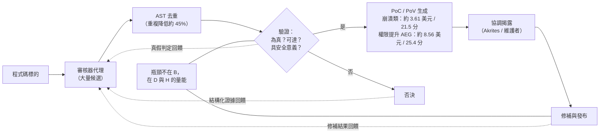

# 微軟《3 lessons from frontier AI vulnerability research》（2026-10）

> 課程模組：09 延伸研究 ｜ 來源類型：產業研究（防禦側自述，含量化成本數據） ｜ 原文：[3 lessons from frontier AI vulnerability research](https://www.microsoft.com/en-us/security/blog/2026/10/07/3-lessons-from-frontier-ai-vulnerability-research/) ｜ 整理日期：2026-10-19
>
> 證據邊界：本篇只核對微軟官方部落格該篇原文，以及可取得的第三方報導。本教材**未取得** MDASH 的技術文件、140 個 Windows CVE 的清單與編號、155 份開源報告的明細、627 筆 Linux kernel 發現的原始資料、Akrites 的協調紀錄，也未取得任何成本數據的計算底稿。第 4 節的對照、第 5 節的框架缺口、第 10 節的教學設計，以及所有標示「本教材分析」的段落是教學分析，不是原文陳述。本篇為防禦側研究，**不含任何可操作的漏洞利用內容**，本教材亦不轉錄任何漏洞細節、觸發條件或利用方法。

## 1. 一頁速覽

- **學習目標：**用一份防禦側的量化成本揭露，為本課程[GTG-10007 漏洞鑄造廠](../01-cyber/GTG-10007-exploit-foundry.html)所述的「自主零日鑄造」建立**經濟學錨點**，並學會分辨「能力證據」與「實際濫用證據」這兩種完全不同的資料。
- 2026-10-07 發布，作者 **Taesoo Kim（Vice President, Agentic Security）**，單位為微軟的 **FORGE Lab**（Frontier Offensive Research & Generative Exploitation）。體裁是**防禦側研究自述**，不是威脅情報。
- **規模數字：**FORGE 的工作在 **2026-05 至 09** 共關聯 **140 個 Windows CVE**，其中 **52 個**在 2026-09 的安全更新中處理。逐月為 **16 / 10 / 27 / 35 / 52**，呈明顯上升。
- **開源成果：****155** 份經內部驗證的報告、涵蓋 **23** 個專案（含 Linux kernel）；其中 **93** 項獲維護者確認或接受，涵蓋 **14** 個專案或家族。
- **本篇對本課程價值最高的數據，是成本：**在崩潰類發現的 PoC 研究中，**182** 筆已確認崩潰發現的平均成本為 **3.61 美元 / 21.5 分鐘**；六個本機權限提升案例的自動利用生成（AEG）平均為 **8.56 美元 / 25.4 分鐘**。
- **核心結論是瓶頸轉移：**發現已不是主要限制，**判斷哪些報告為真、可達、且具安全意義**才是。原文：「More candidates do not create more throughput when the review queue grows faster than fixes ship.」
- 工具鏈為 **MDASH**（multi-model agentic scanning harness，多模型代理掃描框架，2026-05 首次公開、06 更新）。Linux kernel 的驗證使用 **GPT-5.5**，且原文稱未做大量針對任務的調校。抽象語法樹（AST）去重使重複降低約 **45%**。
- **這份研究在課程裡要教什麼：**它是**雙重用途的最清楚樣本**。同一組技術、同一組成本結構，在微軟手上是 140 個 CVE 被修補，在本課程 GTG-10007 手上是零日鑄造廠。**本篇讓學員第一次能用具體金額推估攻擊側的經濟可行性**，但也必須同時學會為什麼這個推估的誤差很大（見 3.4）。
- 限制：單一廠商自述其**自家**研究計畫，無外部重現；成本數據的計算範圍明確排除了篩選、過濾與人工調查的成本；140 個 CVE 無編號清單；無 IOC（體裁上不應有）；**本篇不是濫用案例，不可當作攻擊者已達成此成本的證據**。

## 2. 報告基本資料

| 欄位 | 核對結果 |
|---|---|
| 機構 | Microsoft Security，**FORGE Lab**（Frontier Offensive Research & Generative Exploitation） |
| 具名作者 | **Taesoo Kim**，Vice President, Agentic Security |
| 發布日期 | **2026-10-07** |
| 文件形式 | 官方安全部落格研究長文；分類為 Research，標籤含 Vulnerability、Windows |
| 資料型態 | **廠商自述其自家研究計畫的產出與成本**；含量化統計，但無第三方稽核 |
| 涵蓋期間 | Windows CVE 統計為 **2026-05 至 2026-09**；MDASH 自 2026-05 公開，06 有更新；其他統計未標明確區間 |
| 涉及模型 | 「frontier and distilled models」（前沿與蒸餾模型）、專門化審核器與程式碼分析工具，依任務分配；Linux kernel 驗證明確使用 **GPT-5.5** |
| 標的 | Windows；23 個開源專案（含 Linux kernel） |
| 章節結構 | 導言、三個 shift（lesson）各一節、給安全主管的建議、結語 |
| 與其他發布的關係 | 建立在 MDASH 的 2026-05 公開與 2026-06 更新之上；與微軟 2026-10-01 的[數位防禦報告 2026](microsoft-2026-10-digital-defense-report.html) 同月但不同主題 |
| 協調機制 | **Akrites**（Linux Foundation 的一項倡議）用於機密修補與揭露；另辦 FORGE OSS Bug Hunt Party 黑客松（Project Sunshine） |

**體裁判讀（本教材分析），這是本篇最需要先講清楚的一件事：**

本篇**不是威脅情報，也不是濫用案例**。它是一家公司描述自己用 AI 找自己與開源軟體的漏洞。在本課程的證據分類中，它屬於**能力證據**，與模組 08 的[能力評測研究](../08-capability-research/01-targeting-evals.html)同類，而與模組 01 到 07 的案例型遙測不同類。

本課程[總索引](../00-index.html)已建立這個區分：**能力研究測「模型可能做什麼」，威脅報告記「有人實際做了什麼」。**本篇是前者，而且是前者之中少見的**帶真實產出與真實成本**的樣本（多數能力評測只給基準分數）。

這個定位決定了它能證明與不能證明什麼：

| 本篇可以支持的主張 | 本篇**不能**支持的主張 |
|---|---|
| 以 AI 代理大規模發現真實漏洞，在 2026 年已是工程上可行的常規作業 | 攻擊者已達成同等規模或同等成本 |
| 在微軟的條件下，驗證一個崩潰類發現的邊際成本可低至個位數美元 | 任何其他組織（含攻擊者）能以此成本運作 |
| 瓶頸已從發現轉移到驗證與修補 | 攻擊者也面臨同樣的瓶頸（**攻擊者的驗證標準不同，見 3.4**） |
| 這類管線的產出可逐月提升 | 這個上升趨勢會延續，或可線性外推 |

課堂上請先建立這張表，再談數字。**把本篇當成「攻擊者現在能以 3.61 美元造一個零日」的證據，是本篇最容易、也最嚴重的誤讀。**

## 3. 主要發現逐段摘要

### 3.1 三個轉移（原文的三課）

原文以三個 shift 組織全文。**原文的摘要列表與各節標題用語略有不同**，下表並列（這個差異本身值得注意，引用時應以節標題為準）：

| # | 摘要列表的用語 | 節標題的用語 | 核心主張 |
|---|---|---|---|
| 1 | From frontier capability to scale | （同義） | 找到一個難的漏洞證明的是**能力**；要在多個標的上重現，需要可重用的前置準備、去重與審查量能。**應優化的單位是「可重現的發現」** |
| 2 | From token consumption to reasoning economics | （同義） | 把 token 最小化是錯的目標。**應把推理花在能消除特定不確定性的地方**，且任何節省都要對照覆蓋率與漏掉的漏洞來衡量 |
| 3 | From isolated discovery to coordinated validation and remediation | **Validation and remediation as a continuous learning loop** | 驗證與修補是發現的一部分，不是下游的善後。**每一階段都應把結構化證據回饋給系統** |

原文對第二課的表述：「Spend reasoning to remove uncertainty, not simply to produce more analysis.」（把推理用於消除不確定性，而不只是產出更多分析。）

**本教材分析：**第二課對本課程有一個不明顯但重要的意義。它說明**成本優化的目標函數不是 token 數，而是「每單位不確定性消除的成本」**。這個框架可以直接搬到防禦側的偵測工程：一個告警規則的價值不在於它產生多少告警，而在於它消除了多少「這是不是真的」的不確定性。本課程各案教材的偵測構想一律標為假說，原因正是未經實測的規則無法量化這一點。

### 3.2 規模數字

**Windows CVE（2026-05 至 09，共 140 個）：**

| 月份 | CVE 數 |
|---|---|
| 2026-05 | 16 |
| 2026-06 | 10 |
| 2026-07 | 27 |
| 2026-08 | 35 |
| 2026-09 | **52** |
| 合計 | **140** |

**重要的計數語意限制（原文與第三方摘要均指出）：**這些月度數字是依**公告與維護批次（announcement and servicing cohort）**分組，**不反映發現日期，也不反映掃描產出量**。

**本教材分析，這是本節最該強調的一點：**因此 **16 到 52 的上升不能直接讀成「能力在五個月內成長 3.25 倍」**。它混合了三個無法分離的因素：實際掃描產出的變化、微軟內部修補與公告排程的變化、以及計畫本身的擴編。原文沒有宣稱這是能力成長曲線，但這張表的形狀極易誘發該推論。本課程[證據與方法](../shared/04-evidence-and-methods.html)要求「未配對時間不當加速倍數」，此處是同一條紀律在計數語意上的延伸：**未對齊的計數基準，不能當成趨勢。**

**開源成果：**

| 指標 | 數字 | 判讀（本教材分析） |
|---|---|---|
| 經內部驗證的報告 | **155** 份，涵蓋 **23** 個專案 | 「內部驗證」是微軟自己的標準，非維護者確認 |
| 獲維護者確認或接受 | **93** 項，涵蓋 **14** 個專案或家族 | 約為 155 的 **60%**。第三方摘要明確指出：獲確認**不等於**成為 CVE、已修補或已公開揭露 |
| Linux kernel 具驗證證據的發現 | **627** 筆 | 與 155 份報告是不同計數層級，不可相加 |
| 已確認崩潰的發現 | **182** 筆 | PoC 成本研究的樣本 |
| Akrites 協調的 Linux 發現中內部 CVSS > 7.0 | **9** 項 | 627 筆中僅 9 項逾 7.0，**嚴重度分布極度偏向低端** |
| AST 去重使重複降低 | 約 **45%** | 確定性方法在代理管線中的價值證據 |
| 黑客松（Project Sunshine） | **50** 名參與者、**39** 份報告、**6** 個專案 | 人力活動，與自動管線不同性質 |

**本教材分析：**627 筆具驗證證據的發現中，內部 CVSS 超過 7.0 的只有 **9** 項。這個比例（約 1.4%）是全篇最誠實也最被忽略的數字。它說明**大規模 AI 漏洞發現的產出，絕大多數是低嚴重度的**。這與本課程 [GTIG：AI 時代的漏洞趨勢](gtig-2026-09-vulnerability-trends-ai-era.html) 以及 [Mandiant：防禦側 agentic 漏洞探勘](mandiant-2026-08-agentic-vulnerability-discovery.html)（十個月數萬筆發現換 12 個 CVE）的形狀完全一致：**產出量大，高價值產出稀少。**

三份獨立來源指向同一形狀，這是本模組少見的**跨機構一致觀察**，可支持趨勢層級的主張。

### 3.3 瓶頸轉移：發現不再是限制

原文的核心論點：

> 「Discovery creates security value only when validation and remediation can keep pace.」
>
> （只有在驗證與修補能跟上時，發現才產生安全價值。）

> 「More candidates do not create more throughput when the review queue grows faster than fixes ship.」
>
> （當審查佇列的成長快於修補的交付，更多候選並不帶來更多產出。）

原文並指出，驗證相對於發現是**便宜的**：在 Linux kernel 的規模上，自動化驗證以可行的成本與延遲產出了有用結果。作者推測，成本若再降 **10 倍或 50 倍**，將顯著擴大「經濟上值得驗證」的發現集合。

另一條線是**回饋即訓練資料**：掃描結果（真陽性與偽陽性判定、重複、修補結果）可用於強化學習與專門化網路安全模型的微調。

**本教材分析：**這個「回饋即訓練資料」的環節，是本篇最具前瞻性也最該被課堂追問的一段。它意味著一個規模化的漏洞發現管線會**自我改善**：跑得越多，標註資料越多，下一代模型越強。

這對攻防平衡的意義不對稱，且方向不明確。防禦側有修補結果這個高品質標籤（漏洞被確認且修好了），攻擊側沒有同等標籤，但攻擊側也不需要同等品質（見 3.4）。**原文未討論此不對稱，以下為本教材的推論，不是原文結論。**

### 3.4 成本數據與雙重用途推論的邊界

這是本教材認為最需要謹慎處理的一節。

**原文給的成本（請連同其計算範圍一併閱讀）：**

| 項目 | 樣本 | 平均成本 | 平均時間 |
|---|---|---|---|
| 崩潰類發現的 PoC | 182 筆已確認崩潰 | **3.61 美元** | **21.5 分鐘** |
| 本機權限提升的 AEG | **僅 6 個案例** | **8.56 美元** | **25.4 分鐘** |

**原文明確陳述的計算範圍：**平均值**包含成功案例的所有嘗試**，但**排除**初始篩選、被過濾掉的候選、以及**人工調查與修補工作**。

**本教材分析，這三項排除使這些數字不能當作端到端成本：**

1. 排除初始篩選與過濾掉的候選，意味著**漏斗上游的成本不在分母裡**。要產生 182 筆已確認崩潰，上游掃描了多少程式碼、產生多少候選、花了多少錢，原文未給。
2. 排除人工調查與修補，意味著**最貴的那一段（人）不在裡面**。而本篇自己的核心論點正是「瓶頸在驗證與修補」，也就是在人力那一段。
3. AEG 的樣本**只有 6 個案例**。六個樣本的平均值，信賴區間極寬，**不應被當作可靠的單位成本**。

**關於雙重用途的推論，以下全部是本教材分析，原文未作任何攻擊側推論：**

誘人的推論是：「若 3.61 美元能造一個 PoC，攻擊者就能以極低成本量產武器化漏洞。」這個推論的**方向可能正確，但量級不可靠**，理由有四：

- **標的不同。**微軟掃的是自家 Windows 原始碼與開源專案原始碼。多數攻擊者**沒有原始碼**，必須對二進位或黑箱運作，成本結構完全不同。
- **崩潰不等於可利用。**3.61 美元買到的是「已確認崩潰」的 PoC，不是可靠的武器化利用。從崩潰到穩定利用（繞過現代緩解措施）仍是本篇未涵蓋的昂貴步驟。原文另列的 AEG 數字只涉本機權限提升，且樣本僅 6 個。
- **攻擊者的驗證標準不同，這一點是雙向的。**攻擊者不需要維護者確認、不需要 CVSS 評分、不需要協調揭露，所以**攻擊者的下游瓶頸比微軟小得多**。但攻擊者需要的是**可靠性**（利用必須在目標環境上穩定成功），而微軟只需要證明漏洞存在。**兩邊的「驗證」是不同的工作，不可互相換算。**
- **規模前置投入未計。**MDASH 是一個多模型代理框架，加上專案專屬的 PoV 生成器、harness 建構器與觸發輸入搜尋器。這些前置工程不在邊際成本裡。

**課堂上的正確說法：**本篇證明了**在擁有原始碼、具備工程量能的組織內，驗證一個崩潰類發現的邊際成本已降到個位數美元**。它使 GTG-10007 那類「自主零日鑄造廠」的敘述**在經濟上變得可信**，因為它顯示這類管線的邊際成本確實很低。但它**不能**用來推估任何特定攻擊者的實際成本，也不能用來宣稱武器化漏洞的價格已崩跌。

### 3.5 工具鏈與方法

| 元件 | 原文所述 |
|---|---|
| **MDASH** | multi-model agentic scanning harness，統籌整個工作；2026-05 首次公開、2026-06 更新 |
| 模型配置 | 前沿與蒸餾模型、專門化審核器、程式碼分析工具，**依任務分配** |
| Linux kernel 驗證 | 使用 **GPT-5.5**，且**未做大量針對任務的調校** |
| 驗證工具 | 專案專屬的 PoV / PoC 生成器、harness 建構器、觸發輸入搜尋器 |
| 自動利用生成 | **AEG**，用於權限提升測試 |
| 確定性方法 | **AST 分析**用於去重，重複降低約 **45%** |
| 協調揭露 | **Akrites**（Linux Foundation 倡議） |
| 人力活動 | FORGE OSS Bug Hunt Party 黑客松（Project Sunshine） |

**本教材分析，兩個值得注意的細節：**

第一，**AST 去重降低約 45% 的重複**。這是一個**確定性（非 AI）方法**在代理管線中創造大量價值的具體證據。在一個關於 AI 能力的報告裡，最乾淨的效率數字來自傳統程式分析。這對本課程的防禦側討論有直接意義：**代理管線的瓶頸常常用確定性工程解決，而不是換更強的模型。**原文結語恰好呼應這一點：「The next advance won't come from a better model alone.」（下一個進展不會單靠更好的模型。）

第二，微軟用 **GPT-5.5** 做 Linux kernel 驗證，且稱未做大量調校。這有兩層意義：（一）這類工作在 2026 年已**不需要**專門訓練的模型，通用前沿模型即可，這降低了門檻，對攻防雙方都成立；（二）微軟在自家安全研究中使用 OpenAI 模型，而本課程主體報告記錄的是 Claude 上的濫用。**同一類工作可在任何前沿模型上進行，這正是本課程反覆指出的「單一平台遙測看不到全貌」的另一面證據。**

### 3.6 給安全主管的建議（原文）

- **量測整條管線**，不只是發現數：候選到達量、重複、否決、已驗證缺陷、佇列年齡、各階段耗時。
- **成本要對照人力**：評估模型與執行成本時，一併計入審查時間；並追問每一次額外的推理回合是否真的降低了不確定性或提升了覆蓋率。
- **追蹤修補結果**：重現成功率、補丁返工、回歸證據，以及從已驗證缺陷到核准修補與發布的經過時間。
- **計算已驗證的修補數，而非發現數**：原文用語為「count validated fixes, not just findings」。
- **把結構化證據回饋進系統**：失敗的重現與被否決的發現應作為資料回饋，而不是留在工單佇列裡。

## 4. 與 Anthropic 2026-09 報告的對照

| 本課教材 | 對照點 | 兩造差異與不可作的推論 |
|---|---|---|
| [GTG-10007：漏洞鑄造廠](../01-cyber/GTG-10007-exploit-foundry.html) | **最直接的對照，也是本篇的核心價值。**同一種管線的攻防兩側 | GTG-10007 是攻擊側的 agent swarm 與自主零日鑄造；本篇是防禦側同構管線的**成本與產出實測**。**本篇使該案的經濟可行性變得可信，但不可用本篇的金額推估該案的成本**（標的、原始碼可得性、驗證標準全不同，見 3.4） |
| [網路行動導論](../01-cyber/00-cyber-trends-and-skills.html) | uplift 的 depth 軸 | 本篇提供 depth 軸的罕見量化素材（成本與時間）。**但月度 CVE 數不可當成能力成長倍數**（計數基準未對齊，見 3.2） |
| [情報鎖定三評測](../08-capability-research/01-targeting-evals.html) | 能力證據的讀法 | 同屬能力證據，但本篇是**真實產出**而非基準分數，證據類型更強。**兩者共同的限制是：能力不等於已被濫用** |
| [武器研發評測與政策](../08-capability-research/02-weapons-dev-evals-and-policy.html) | 如何讀能力評測報告 | 該頁建立的讀法（看樣本數、看計算範圍、不外推）在本篇全部適用，特別是 AEG 的 6 個樣本 |
| [Mandiant：防禦側 agentic 漏洞探勘](mandiant-2026-08-agentic-vulnerability-discovery.html) | **形狀一致的獨立佐證** | Mandiant 十個月數萬筆發現換 12 個 CVE；本篇 627 筆發現中僅 9 項 CVSS > 7.0。**兩家獨立資料指向同一結論：產出量大、高價值稀少。**可支持趨勢層級主張 |
| [GTIG：AI 時代的漏洞趨勢](gtig-2026-09-vulnerability-trends-ai-era.html) | 第三家獨立觀察 | GTIG 記錄 2026-01 至 08 有 141 個漏洞被揭露並遭利用。**與本篇的 140 個 CVE 數字接近純屬巧合，兩者計數的是完全不同的東西**（一為遭利用的漏洞，一為 FORGE 關聯的修補），**絕不可相提並論或相加** |
| [arXiv：已知漏洞代理實驗](arxiv-2024-04-one-day-agent-benchmark.html) | 學術先行研究 | 2024 年的學術實驗顯示代理可利用已知漏洞；本篇是兩年半後的工業規模實作。**可作為同一條能力曲線的兩個時間點**，但實驗設計與標的不同，不可連線外推 |
| [Hacktron AI：libheif Heist](hacktron-2026-09-openai-libheif-rce.html) | 獨立研究者的單案實證 | 該案是外部研究者用前沿模型找到真實 RCE；本篇是大廠的規模化管線。**兩者互補：一個證明單案可達成，一個證明可規模化** |
| [Anthropic Cyber Mission](anthropic-2026-10-cyber-mission.html) | 同月的防禦側計畫 | 兩家前沿模型供應商在 2026-10 同時推防禦側漏洞掃描。**可對比揭露顆粒度：本篇給了成本與產出數字，該篇較偏計畫宣告** |
| [微軟數位防禦報告 2026](microsoft-2026-10-digital-defense-report.html) | 同機構同月發布 | 數位防禦報告述攻擊側趨勢，本篇述防禦側能力。**同一機構的兩種體裁，並讀可見其攻防敘事如何互相支撐** |
| [證據與方法](../shared/04-evidence-and-methods.html) | 計數語意與成本範圍 | 本篇是練習「看計算範圍再看數字」的最佳新素材（見 3.4） |
| [跨案例分析：複雜度脫鉤](../shared/01-cross-cutting-analysis.html) | 低資源取得高能力 | 本篇顯示通用前沿模型（GPT-5.5，未大量調校）即可勝任核心驗證工作。**這支持複雜度脫鉤命題中「不需專門訓練」這一環**，但本篇是大廠環境，不能直接推論低資源行為者 |
| 生物與武器模組 | **不適用** | 本篇純屬軟體漏洞研究，與該兩模組無關 |

**核心教學點（本教材分析）：**本篇與 GTG-10007 並讀，構成本課程**雙重用途**主題最乾淨的一組教材。

兩者的技術棧幾乎相同：多代理編排、任務分工、自動驗證、迭代修正。差別只在**標的的所有權**與**產出的用途**。微軟掃自己的程式碼，把發現送去修補；GTG-10007 掃別人的程式碼，把發現送去利用。

**但這組對照還有第三層，比「同一技術兩種用途」更重要：兩邊的瓶頸不在同一處。**微軟的瓶頸在下游（驗證、審查佇列、修補排程、協調揭露），這些全是**組織與流程成本**。攻擊者沒有這些負擔，但有另一個微軟沒有的負擔：**利用必須在目標環境上可靠運作**。

這意味著 AI 對攻防的助力**不是對稱的，但也不是單向的**。原文未討論此議題，本段為本教材分析。課堂上應讓學員自己推導這個不對稱，而不是給他們結論。

## 5. TTP 與 MITRE ATT&CK 對應

本篇是**防禦側研究**，不含攻擊鏈。下表對應的是**該管線的能力所對應的攻擊技術類別**，用於說明若同類管線被濫用會落在何處，**並非本篇記錄的攻擊行為**。

| 戰術或行為 | 技術 ID | 對應關係 | 偵測構想（假說，未經實測） |
|---|---|---|---|
| Resource Development | [T1588.006：Obtain Capabilities: Vulnerabilities](https://attack.mitre.org/techniques/T1588/006/) | 本管線的產出（已驗證漏洞）即此技術的標的物；**微軟用於修補，濫用者可用於取得** | 不適用於平台側偵測；屬情報與供應鏈議題 |
| Resource Development | [T1587.004：Develop Capabilities: Exploits](https://attack.mitre.org/techniques/T1587/004/) | AEG（自動利用生成）即此技術的自動化形式 | 模型服務側：對大量涉及記憶體原語、緩解繞過的請求叢集建立基線。**合法反例：資安研究、CTF、課程教學，誤報成本高** |
| Resource Development | [T1588.007：Obtain Capabilities: Artificial Intelligence](https://attack.mitre.org/techniques/T1588/007/) | 使用通用前沿模型（原文：GPT-5.5，未大量調校）執行核心驗證 | 單獨偵測價值低；本課程全部案例的共同前置條件 |
| Discovery（標的研究） | [T1595.002：Active Scanning: Vulnerability Scanning](https://attack.mitre.org/techniques/T1595/002/) | **僅部分對應。**本篇是原始碼靜態分析，非網路掃描 | 不適用 |
| **大規模候選去重與分流** | **無對應 ID（框架缺口）** | AST 去重、審核器加辯論器的管線結構 | 框架無此層級概念 |
| **多模型代理編排** | **無對應 ID（框架缺口）** | MDASH 的多模型任務分配 | **這是本課程反覆出現的同一缺口** |
| **驗證與修補的回饋迴路** | **無對應 ID（框架缺口）** | 判定結果回饋為訓練資料 | 框架無法表達能力的自我改善 |

**框架缺口說明（本教材分析）：**本篇暴露的缺口與本課程[Storm-3168 教材](microsoft-2026-09-storm-3168-agentic-cloud.html)、[常規武器導論](../04-weapons/00-weapons-intro-and-safeguards.html)所指出的是同一個：**ATT&CK 以單一攻擊動作為單位，描述不了編排、分流與迴路。**

本篇多了一個新的缺口維度：**ATT&CK 是攻擊者行為的分類法，本篇描述的是防禦者行為**。雖然技術棧相同，框架在結構上無法同時描述兩側。這使得「同一能力的攻防雙重用途」這件事，**在現行框架裡沒有任何表達方式**。課堂上可用這一點說明：為什麼雙重用途議題難以用技術分類法管理，而必須回到治理層面。

**本節的全部偵測構想都是假說**，本教材未在任何環境實測，不宣稱低誤報率，也不建議直接部署。尤其第二列（AEG 相關）的合法反例極多（資安研究、CTF、教學），誤報成本高，**不應據以建立阻擋規則**。

## 6. 圖表判讀

**原文有少量表格式數據呈現，但本教材未取得可判讀的圖表影像。**

依本教材所取得的原文內容，本篇的數據以**行文敘述與列點**為主，另有月度 CVE 的數字序列。原文可能含有版面圖示或流程示意，但本教材**未取得可供逐張判讀的圖檔，因此不作圖表描述**，以免編造。

依本課程安全紅線與模組 09 規格：**本教材不下載圖檔、不嵌圖。**

第 3.3 節的 Mermaid 管線圖是**本教材繪製**，用於說明原文所述的瓶頸位置，**不是原文圖表**，節點上的成本數字取自原文第 3.4 節所列資料。

**本教材分析：**本篇的關鍵數字（月度 16 / 10 / 27 / 35 / 52，以及 3.61 美元 / 21.5 分鐘）**以散文與列點形式給出，未製成圖表**。這與本課程主體報告大量依賴圖表的呈現方式相反。

這個差異有一個實際後果值得在課堂上指出：**散文形式的數字，讀者較不容易注意到計數基準的註腳。**原文確實說明了月度數字依公告批次分組、不反映發現日期，但這個限制寫在行文中，而非標在圖上。若同樣的數據被製成折線圖，上升趨勢的視覺衝擊會更強，而限制說明更容易被忽略。**呈現形式會改變限制說明的可見度**，這是閱讀任何量化報告時都適用的觀察。

## 7. IOC 與技術指標

**原文沒有公開任何 IOC，且體裁上不應有。**

本篇是防禦側漏洞研究，不涉威脅行為者，因此沒有網域、IP、雜湊或帳號等指標。

| 指標類型 | 本篇是否提供 | 偵測價值與壽命 |
|---|---|---|
| 網域、IP、雜湊、帳號 | **無**（體裁上不適用） | 不適用 |
| CVE 編號清單 | **無。**原文給總數 140，**未列出編號** | 若公開，對修補管理有高價值；但 CVE 編號非 IOC |
| 漏洞技術細節 | **無**，且本教材不轉錄任何漏洞細節、觸發條件或利用方法 | 不適用 |
| 工具名稱 | 有：MDASH、AEG、Akrites、Project Sunshine | 非指標。屬方法學詞彙，無偵測用途 |
| 成本與時間基準 | 有（見 3.4） | **非指標，但具規劃價值**：可用於防禦側的量能估算 |

**本教材分析：**本篇對 SOC 的即時偵測管線**無可用指標**，但對兩類讀者有實質價值：

1. **漏洞與修補管理團隊**：第 3.6 節的管線量測建議（候選到達量、佇列年齡、各階段耗時、已驗證修補數）可直接作為自家指標設計的參考。原文的「count validated fixes, not just findings」是一句可以直接搬進管理報表的原則。
2. **CTI 與風險評估團隊**：第 3.4 節的成本結構可用於推估威脅演化的方向（**非具體數值**），以及評估「漏洞發現門檻下降」這個趨勢對自家修補節奏的壓力。

140 個 CVE 未列編號，是本篇對修補管理最可惜的一個缺口（見第 8 節）。

依本課程安全紅線：本節無任何指標可供抄錄，亦無任何對象可連線，**本教材全程未對任何標的進行查詢或連線**。

## 8. 該機構的偵測、處置與防線缺口

### 8.1 做了什麼（原文自述）

- 以 **MDASH** 統籌多模型代理掃描，依任務分配前沿與蒸餾模型、專門化審核器與程式碼分析工具。
- 用專案專屬的 **PoV / PoC 生成器、harness 建構器、觸發輸入搜尋器**自動化驗證。
- 用 **AEG** 自動生成權限提升的利用以驗證可利用性。
- 用 **AST 分析**去重，重複降低約 **45%**。
- 經 **Akrites**（Linux Foundation 倡議）進行機密修補與協調揭露；對 23 個開源專案提交 155 份內部驗證報告。
- 辦 **FORGE OSS Bug Hunt Party** 黑客松補充人力視角。
- 把真偽判定、重複與修補結果**回饋**為後續訓練資料。
- 對外提出以「已驗證修補數」而非「發現數」為管理指標。

### 8.2 哪裡失效或未揭露（本教材盤點）

| 缺口 | 說明 | 嚴重度判讀（本教材分析） |
|---|---|---|
| **140 個 CVE 無編號清單** | 只給總數與月度分布，未列 CVE 編號 | **中高。**使外部無法查證、無法評估嚴重度分布、無法與自家修補狀態比對。對修補管理團隊是最實用的缺口 |
| **成本數據排除最貴的一段** | 平均值排除初始篩選、過濾候選、人工調查與修補 | **高。**而本篇核心論點正是「瓶頸在驗證與修補」，即人力那一段。**端到端成本因此未知** |
| **AEG 樣本僅 6 例** | 8.56 美元 / 25.4 分鐘建立在 6 個案例上 | **高。**信賴區間極寬，不應作為可靠單位成本引用 |
| **月度計數基準未對齊** | 依公告與維護批次分組，不反映發現日期或掃描產出 | **高。**使 16 到 52 的上升無法解讀為能力成長 |
| 上游漏斗規模未揭露 | 掃了多少程式碼、產生多少候選、否決率多少，全未給 | 中高。無此分母，無法評估管線效率 |
| 偽陽性率未揭露 | 第三方摘要明確指出：彙總數據未拆解偽陽性、重複、嚴重度與修補完成率 | 中高 |
| 「內部驗證」標準未定義 | 155 份為內部驗證，93 項獲維護者確認，兩者差距的原因未說明 | 中 |
| 嚴重度分布僅片段揭露 | 627 筆中 9 項 CVSS > 7.0 只涉 Akrites 協調的 Linux 發現，整體分布未給 | 中 |
| 無外部重現或稽核 | 全篇為單一廠商自述其自家計畫 | 中。體裁使然，但應明確標示 |
| 不可一般化 | 微軟自己的來源指出，其成本與產出不可推及其他組織 | 中。原文有此保留，讀者常忽略 |

**本教材分析，最該在課堂上停留的兩個缺口：**

第一是**成本範圍與核心論點的張力**。本篇論證「瓶頸已從發現轉移到驗證與修補」，同時其成本數據**明確排除了人工調查與修補工作**。也就是說，**被認定為瓶頸的那一段，恰好不在被報告的成本裡**。這不是矛盾（兩段談的是不同事），但它使讀者無法回答最想問的問題：整條管線每產出一個已修補的真漏洞，到底要花多少錢？**課堂上可以把這個結構抽象成通用檢核：當一份報告指出某處是瓶頸，去看它有沒有量測那一處。**

第二是**無 CVE 清單**。這是一個低成本就能補上的透明度缺口，且對防禦社群有實際價值（修補比對）。原文未解釋為何不列，本教材不替它推斷原因。

## 9. 第三方驗證與外部來源

**本篇為單一廠商自述其自家研究計畫，無外部重現或稽核。**

| 來源 | URL | 日期 | 性質判讀 |
|---|---|---|---|
| 微軟原文 | https://www.microsoft.com/en-us/security/blog/2026/10/07/3-lessons-from-frontier-ai-vulnerability-research/ | 2026-10-07 | **一手來源。**本教材全部主張以此為準 |
| The Hacker News（MDASH 首次公開報導） | https://thehackernews.com/2026/05/microsofts-mdash-ai-system-finds-16.html | 2026-05 | **僅引述微軟發布。**報導 MDASH 找到 16 個 Windows 漏洞，與本篇 2026-05 的 16 個一致。**此一致性支持月度數字的內部一貫性，但仍是同源資料** |
| CSO Online | https://www.csoonline.com/article/4170785/microsofts-new-ai-system-finds-16-windows-flaws-including-four-critical-rces.html | 2026-05 | **僅引述微軟發布。**補充其中四個為關鍵 RCE |
| Redmond Magazine | https://redmondmag.com/articles/2026/05/14/microsoft-pushes-agentic-ai-security.aspx | 2026-05-14 | **僅引述微軟發布** |
| DEV Community（技術社群摘要） | https://dev.to/anoymask/microsoft-forge-three-lessons-for-scaling-frontier-ai-vulnerability-research-2hec | 2026-10 | **僅摘要原文。**非獨立查證 |
| All About Security（德文） | https://www.all-about-security.de/ki-schwachstellenforschung-3-erkenntnisse-von-microsoft/ | 2026-10 | **僅引述原報告**（德文轉述） |
| xcademia | https://www.xcademia.com/news/microsoft-reveals-3-lessons-from-ai-powered-vulnerability-research | 2026-10 | **僅引述原報告** |
| MDASH 技術文件 | **本教材未取得** | 不適用 | 2026-05 公開與 06 更新的原始技術說明 |
| 140 個 CVE 的編號與內容 | **本教材未取得**（原文未列） | 不適用 | 見第 8 節 |
| Akrites（Linux Foundation）的協調紀錄 | **本教材未取得** | 不適用 | 若公開，將是**唯一可能的獨立佐證來源**（維護者側的確認） |

**獨立性判讀（本教材分析）：**上表的所有媒體與社群來源**全部僅引述微軟自己的發布，無一進行獨立重現或稽核**。本篇的全部數字目前**只有微軟一個來源**。

有一項**內部一貫性**的弱佐證值得記錄：2026-05 的第三方報導（The Hacker News、CSO Online）獨立記錄了 MDASH 當月找到 **16 個** Windows 漏洞，與本篇月度表的 2026-05 數字 **16** 相符。這支持本篇月度數字並非事後編造，但兩者**同源於微軟的發布**，不構成獨立查證。

**唯一可能的真正獨立佐證來源，是開源維護者側**：155 份報告中有 93 項獲確認，這些確認存在於各專案的追蹤系統與 Akrites 的協調紀錄中，原則上**可由第三方查證**。本教材未進行此查證（需逐專案比對，且原文未列專案名稱）。**這是本篇驗證度最高的可行後續工作**，記入第 12 節。

**判定：本篇為單一來源情報。**其方法學主張（瓶頸轉移、推理經濟學、回饋迴路）與另外兩家獨立機構（Mandiant、GTIG）的觀察形狀一致（見 3.2 與第 4 節），該**趨勢層級**的結論可視為有跨機構支持；但本篇的**具體數字**（140、627、3.61 美元、45%）全部僅有單一來源。

## 10. 課程教學設計

### 10.1 核心教學要點

1. **能力證據與濫用證據是兩種東西。**本篇是能力證據（而且是帶真實產出與成本的高品質能力證據），不是濫用案例。它讓 GTG-10007 的敘述在經濟上可信，**但不證明任何攻擊者已達成這個成本**。這個區分是本課程的方法論核心。
2. **看數字前先看計算範圍。**3.61 美元是「排除初始篩選、過濾候選、人工調查與修補」之後的邊際成本。而本篇自己說瓶頸就在人工那一段。**被指為瓶頸的那一段，沒有被量測。**
3. **看樣本數。**AEG 的 8.56 美元建立在**6 個案例**上，不可當作可靠單位成本。
4. **計數基準未對齊，不能當趨勢。**月度 16 / 10 / 27 / 35 / 52 依公告批次分組，不反映發現日期或產出量，不可讀成五個月成長 3.25 倍。
5. **產出量大，高價值稀少。**627 筆發現中僅 9 項 CVSS > 7.0（約 1.4%）。這個形狀與 Mandiant、GTIG 的獨立觀察一致，是本模組少見的**跨機構一致結論**。
6. **雙重用途的瓶頸不對稱。**防禦側的瓶頸在審查佇列與協調揭露（組織成本）；攻擊側沒有這些負擔，但需要利用的可靠性。**兩邊的「驗證」是不同的工作，不可互相換算。**
7. **確定性工程仍然關鍵。**最乾淨的效率數字（去重降低 45%）來自 AST 分析，不是更強的模型。原文結語：「The next advance won't come from a better model alone.」
8. **通用模型已足夠。**Linux kernel 驗證用 GPT-5.5 且未大量調校，說明這類工作在 2026 年不需專門訓練的模型，**門檻對攻防雙方同時降低**。

### 10.2 課堂討論題

1. 本篇論證「瓶頸已從發現轉移到驗證與修補」，而其成本數據明確排除人工調查與修補。**這使該論點更可信還是更不可信？**如果你是審稿人，會要求補上哪一個數字？
2. 假設你要用本篇的 3.61 美元去推估一個攻擊者造出可用零日的成本。**請列出你必須做的所有假設**，並指出哪一個假設最可能錯得最嚴重。（提示：原始碼可得性、崩潰到可靠利用的距離、前置工程投入。）
3. 627 筆發現中只有 9 項 CVSS 超過 7.0。**這個比例是讓你更擔心還是更安心？**一個產出大量低嚴重度發現的管線，對防禦者是資產還是負債？對攻擊者呢？
4. 微軟用 **GPT-5.5** 做自家安全研究，而本課程主體報告記錄的是 Claude 上的濫用。**這對「單一平台遙測」的限制說明了什麼？**如果每一家供應商只看得到自己平台上的事，產業要如何建立完整圖像？這需要什麼機制，又會有什麼風險？
5. 原文建議以「已驗證的修補數」而非「發現數」為管理指標。**這個指標會誘發什麼新的扭曲行為？**（提示：任何指標都會被優化。思考它對「難修但重要」的漏洞會造成什麼待遇。）
6. 本篇提到掃描結果可回饋為訓練資料，使管線自我改善。**防禦側在這個迴路上有結構優勢（修補結果是高品質標籤），攻擊側有嗎？**如果攻擊側的標籤品質較低但需求也較低，淨效果對誰有利？
7. ATT&CK 無法同時描述攻擊側與防禦側的同一技術棧。**雙重用途議題能用技術分類法管理嗎？**如果不能，應該用什麼？

### 10.3 桌面演練建議

全部演練**不涉及任何漏洞探勘、不執行任何掃描工具、不產製任何利用程式、不連線任何標的**。所有活動限於文件判讀與管理設計。

**演練 A：計算範圍還原（25 分鐘，小組）**
只給學員「3.61 美元 / 21.5 分鐘」與「8.56 美元 / 25.4 分鐘」兩組數字，不給計算範圍。要求各組寫下他們認為這個數字包含什麼。然後公布原文的排除項（初始篩選、過濾候選、人工調查與修補），比較落差。**這個演練的目的是讓學員親身體驗「不看計算範圍就引用數字」的風險。**

**演練 B：管線指標設計（35 分鐘，小組）**
依第 3.6 節的建議，為學員自己的組織設計一組漏洞管理指標（候選到達量、重複率、否決率、已驗證缺陷、佇列年齡、各階段耗時、已驗證修補數）。然後交換給另一組，要求對方**找出每個指標可能被如何操弄**。討論指標與行為的關係。

**演練 C：雙重用途對照（30 分鐘，兩人一組辯論）**
一人代表防禦側（本篇），一人代表攻擊側（GTG-10007）。各自列出自己的瓶頸、所需驗證標準、以及最貴的那一段成本。然後共同填一張對照表，標出哪些成本項是共有的、哪些是單邊的。**不討論任何具體技術手法**，只討論成本結構與流程瓶頸。

**演練 D：跨機構一致性檢核（25 分鐘，全班）**
給學員三份摘要（本篇的 627 比 9、Mandiant 的數萬筆換 12 個 CVE、GTIG 的漏洞趨勢），要求判斷：這三者支持哪一個共同結論？哪些細節**不能**互相佐證？為什麼本篇的 140 與 GTIG 的 141 不可相提並論？（後者是本教材第 4 節明確標示的陷阱。）

**演練 E：透明度要求清單（20 分鐘，個人）**
假設你是政府或大型企業的採購方，要向一家宣稱「以 AI 大規模發現漏洞」的廠商提問。依本篇第 8.2 節的缺口盤點，寫出十個你會問的問題。**這份清單可直接用於實際採購場景**，是本演練的交付物。

### 10.4 對台灣的意涵

以下為**本教材分析**，原文完全未提及台灣。

1. **修補節奏的壓力，而非攻擊的壓力。**本篇最直接的意涵不是「攻擊會變多」，而是**漏洞被發現的速率在上升，而修補量能沒有同步上升**。微軟 2026-09 單月處理 52 個由自家 AI 管線關聯的 CVE。對台灣的政府機關、金融機構與關鍵基礎設施營運者，這意味著**上游供應商的修補數量會持續增加**，下游的測試、驗證與部署視窗會被壓縮。這是一個**量能與流程問題**，不是採購一套新工具能解決的。

2. **本篇的方法可被台灣的防禦側直接採用，而且應該採用。**MDASH 是微軟的內部系統，但第 3.6 節的**管線量測原則**與第 3.5 節的**確定性去重（AST）優先**是公開的方法學，不需前沿模型的規模即可實施。台灣的大型軟體開發組織（公部門系統整合商、金融核心系統、半導體相關軟體）可以先做兩件低成本的事：建立「已驗證修補數」而非「發現數」的指標，以及在既有的靜態分析結果上加做結構化去重。

3. **通用前沿模型已足夠，這對台灣是雙面的。**Linux kernel 驗證使用未大量調校的 GPT-5.5，說明此類工作不需專門模型。**正面意義**是台灣的資安團隊不需自建模型即可導入此類管線，門檻在工程與流程，不在模型取得。**負面意義**是同樣的門檻下降也適用於針對台灣的行為者，而本課程[GTG-17002 電子戰與防空壓制](../04-weapons/GTG-17002-ew-sead-taiwan.html)、[GTG-14022 輿情監控](../03-surveillance/GTG-14022-public-opinion-monitoring-taiwan.html)等案例顯示，台灣確實是被鎖定的標的。**但請注意：本篇是軟體漏洞研究，與該兩案的領域不同，此處的連結是「門檻下降」這一個共同機制，不是案例關聯。**

4. **開源依賴的揭露缺口值得台灣關注。**本篇對 23 個開源專案提交 155 份報告，93 項獲確認，但**未列專案名稱**。台灣大量公部門與金融系統依賴開源元件，卻無法從本篇得知哪些專案正在被大規模掃描、哪些已被修補。**這對台灣的實務建議是：不要等廠商報告，而是強化自身的 SBOM（軟體物料清單）與上游修補追蹤能力**，因為揭露的顆粒度由發布者決定，不由使用者決定。

5. **採購與監理的提問清單。**第 10.3 節演練 E 的交付物（十個問題）是本篇對台灣最可直接落地的產出。當廠商宣稱其產品「以 AI 發現漏洞」時，應問：計算範圍是什麼、樣本數多少、嚴重度分布如何、偽陽性率多少、計數基準是否對齊、是否有外部重現。**本篇示範了一份相對誠實的揭露（它確實說明了計數限制與成本排除項），可作為評估其他廠商揭露品質的對照基準。**

## 11. 關鍵原文引文

以下引文逐字取自原文，附繁中翻譯與出處段落。

1. **核心論點：瓶頸轉移**（導言）

> 「Discovery creates security value only when validation and remediation can keep pace.」
>
> （只有在驗證與修補能跟上時，發現才產生安全價值。）

2. **佇列的算術**（Shift 1）

> 「More candidates do not create more throughput when the review queue grows faster than fixes ship.」
>
> （當審查佇列的成長快於修補的交付，更多候選並不帶來更多產出。）

**本教材註：**全篇最適合作為管理原則引用的一句。它把「發現更多」與「更安全」之間的連結明確切斷。

3. **推理經濟學**（Shift 2）

> 「Spend reasoning to remove uncertainty, not simply to produce more analysis.」
>
> （把推理用於消除不確定性，而不只是產出更多分析。）

4. **給安全主管的指標建議**（Recommendations for security leaders）

> 「count validated fixes, not just findings」
>
> （計算已驗證的修補數，而不只是發現數。）

5. **結語：模型不是唯一變數**（結論）

> 「The next advance won't come from a better model alone.」
>
> （下一個進展不會單靠更好的模型。）

**本教材註：**這句與 AST 去重降低 45% 重複的數據互相呼應（見 3.5），是本篇對「換更強的模型就能解決」這個常見預設最直接的反駁。

## 12. 未能驗證之處與研究限制

### 12.1 本教材的核對範圍

- **已核對：**微軟原文（2026-10-07）的三個 shift 結構、第 3 節與第 11 節所引述的全部數字與引文、作者與單位、工具鏈名稱、原文自述的成本計算範圍。
- **已檢索但僅為轉述：**第 9 節所列六項媒體與社群來源，全部僅引述微軟發布。其中 2026-05 的報導獨立記錄了 16 個 Windows 漏洞，與本篇月度表一致，構成**內部一貫性**的弱佐證（非獨立查證）。
- **未取得：**MDASH 技術文件（2026-05 公開與 06 更新）；140 個 Windows CVE 的編號清單；155 份開源報告的專案名稱與明細；627 筆 Linux kernel 發現的原始資料；182 筆崩潰發現與 6 個 AEG 案例的計算底稿；Akrites 的協調紀錄；偽陽性率與整體嚴重度分布。
- **核對日期：**2026-10-19。原文發布日 2026-10-07，Windows CVE 統計期間 2026-05 至 09。三個日期分開記錄，不可互相代換。
- **安全紅線遵守：**本教材未對任何標的進行掃描、查詢或連線；未轉錄任何漏洞細節、觸發條件或利用方法。

### 12.2 原文本身的限制

1. **單一廠商自述其自家計畫，無外部重現或稽核。**
2. **成本數據排除最關鍵的一段。**平均值排除初始篩選、過濾掉的候選、以及人工調查與修補工作。端到端成本未知，而本篇核心論點正是瓶頸在人工那一段。
3. **AEG 成本的樣本僅 6 例。**不應作為可靠單位成本引用。
4. **月度 CVE 計數基準未對齊。**依公告與維護批次分組，不反映發現日期或掃描產出量，不可讀為能力成長曲線。
5. **140 個 CVE 未列編號**，無法外部查證或與自家修補狀態比對。
6. **上游漏斗規模未揭露**（掃描量、候選數、否決率），無分母可評估管線效率。
7. **偽陽性率、重複率、嚴重度分布、修補完成率未拆解。**
8. **「內部驗證」標準未定義**，155 份與 93 項確認之間的差距未說明。
9. **不可一般化。**微軟自己的來源指出其成本與產出不可推及其他組織。
10. **155 份報告的專案名稱未列**，使維護者側的獨立查證難以進行。
11. **摘要列表與節標題的第三課用語不一致**（見 3.1），引用時應以節標題為準。

### 12.3 本教材明確標示為分析而非原文陳述的部分

下列內容為本教材的教學分析，**原文未如此陳述**，引用時請勿歸給微軟：

- 第 2 節的體裁判讀，以及「本篇可以／不能支持的主張」對照表。
- 第 3.1 節關於推理經濟學可搬到偵測工程的延伸。
- 第 3.2 節把月度上升拆解為三個無法分離的因素，以及「627 筆中僅 9 項逾 7.0」的比例計算與其意義。
- 第 3.3 節的 Mermaid 管線圖、瓶頸位置標註，以及關於回饋迴路攻防不對稱的推論。
- 第 3.4 節**全部的雙重用途推論與其四項邊界**，以及「崩潰不等於可利用」、「兩邊的驗證是不同工作」的判讀。
- 第 3.5 節關於確定性工程與通用模型門檻的兩點分析。
- 第 4 節全部對照與差異判讀，特別是「140 與 GTIG 的 141 不可相提並論」的警告，以及「瓶頸不在同一處」的核心教學點。
- 第 5 節全部偵測構想（皆為未實測假說）與框架缺口分析，包含「ATT&CK 無法同時描述攻防兩側」這一新缺口維度。
- 第 6 節關於呈現形式影響限制可見度的分析。
- 第 7 節關於本篇對兩類讀者的實務價值判讀。
- 第 8.2 節全部缺口盤點與嚴重度判讀，特別是「被指為瓶頸的那一段沒有被量測」。
- 第 9 節的獨立性判讀與「維護者側是唯一可能的獨立佐證」的認定。
- 第 10 節全部教學設計，特別是 10.4 對台灣的五點意涵（原文完全未提及台灣）。

### 12.4 需要補強的後續查證

1. **向開源維護者側查證 93 項確認。**這是本篇**唯一可行的真正獨立佐證路徑**，優先度最高。但原文未列專案名稱，須先取得名單或從 Akrites 的公開紀錄反查。
2. **取得 140 個 Windows CVE 的編號清單。**可與微軟 2026-05 至 09 的 Patch Tuesday 公告反向比對，評估嚴重度分布與修補狀態。
3. **取得 MDASH 的 2026-05 公開與 06 更新技術文件。**用於核實「超過 100 個專門化代理」等本教材僅從第三方報導取得、**未經原文確認**的描述（本教材已在第 3.5 節避免將此數字當作原文陳述）。
4. **追蹤本篇是否有後續發布補上偽陽性率與端到端成本。**若有，應據以重寫 3.4 與 8.2。
5. **核對第 9 節各媒體報導的確切發布日期**（本教材僅確認至月份，Redmond Magazine 一則確認為 2026-05-14）。
6. **若日後出現第二家機構以可比方法揭露同類成本數據**，應據以檢驗本篇 3.61 美元這個量級是否具一般性。
